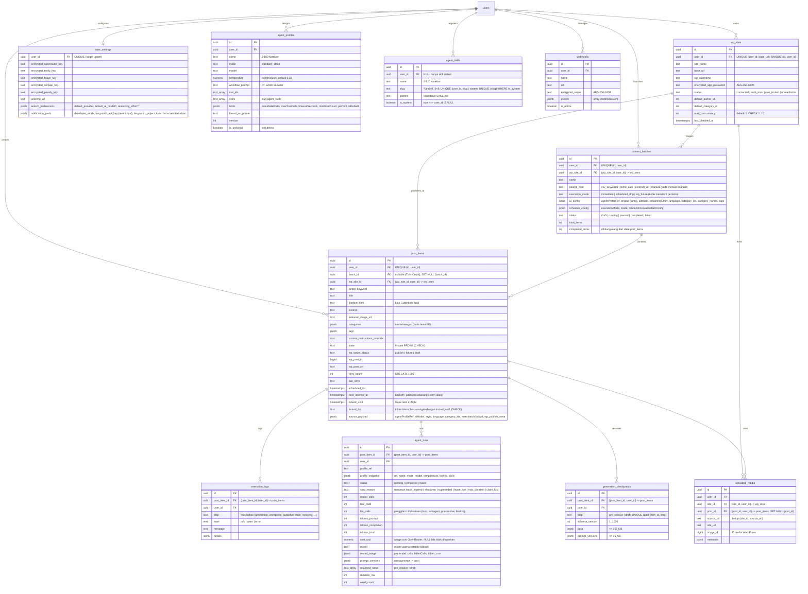
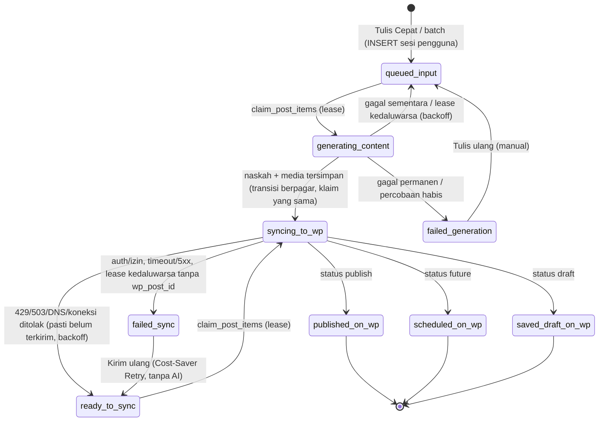
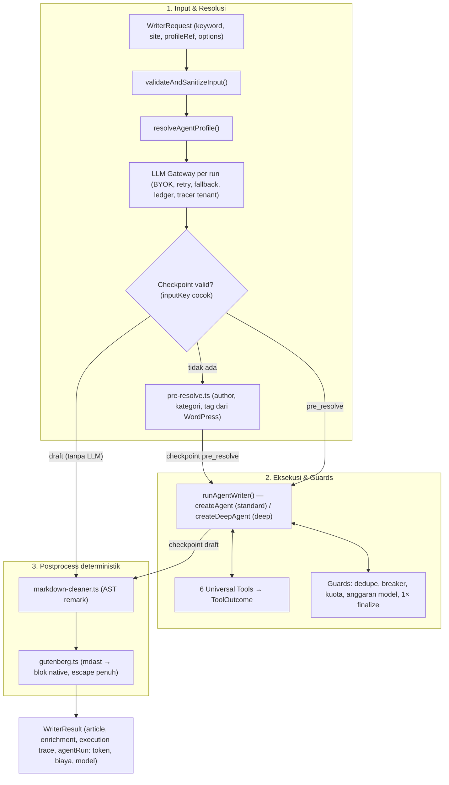

# ARCHITECTURE.md — Arsitektur Sistem & Cetak Biru Teknis Panitera

Cetak biru teknis **Panitera (WP Autopost & Multi-Site Content Dashboard)**: lapisan kode, skema Supabase, siklus
antrean, *Agent Profile Runtime*, pipeline media, integrasi WordPress REST API, keamanan, frontend, dan katalog API.
Semua isi mengikuti kode di branch ini; bila kode berubah, perbarui bagian terkait di sini.

Dokumen terkait: alur bisnis & modul → [`PRD.md`](PRD.md) · design system → [`DESIGN.md`](DESIGN.md) · status fase & ADR →
[`MEMORY.md`](MEMORY.md) · deploy → [`docs/deploy/docker-compose-vps.md`](docs/deploy/docker-compose-vps.md) dan
[`docs/deploy/upgrade-ke-v2.md`](docs/deploy/upgrade-ke-v2.md) · panduan pengguna → [`docs/guides/`](docs/guides/).

---

## 1. Prinsip Arsitektur

1. **Lapisan tegas.** `src/app` hanya halaman RSC tipis + Route Handler tipis → `src/server` (HTTP `defineRoute`, service
   per domain, runner antrean) → `src/core` (domain murni: `writer/` Agent Profile Runtime, `queue/` logika antrean,
   `shared/` gateway LLM, tools, formatter, media, prompt) → `src/lib` (adapter & utilitas bersama: Supabase, WordPress,
   `safeFetch`, kripto, env, skema zod murni yang juga dipakai form client).
2. **Database-First State Machine.** Setiap job (Tulis Cepat, batch langsung, batch bertahap) dicatat `queued_input` di
   Supabase sebelum dikerjakan. Tidak ada job di dalam request HTTP: route mencatat/menjadwalkan ulang lalu membangunkan
   runner antrean (§4).
3. **Agent Profile Runtime.** Hirarki *Agent Profile → Universal Tools → Runtime Guards*: profil menentukan mode
   (`standard`/`deep`), model, prompt alur kerja, batas, tool, dan skill; tidak ada engine/node kaku (§5).
4. **Zero-Plugin Onboarding & perlindungan hosting.** Komunikasi ke WordPress hanya lewat REST API bawaan
   (`/wp-json/wp/v2/...`) + Application Password (WP ≥ 5.6), tanpa plugin/PHP kustom. Beban per situs dibatasi saat klaim
   antrean: maksimal `wp_sites.max_concurrency` item diproses paralel per situs (default 2, rentang 1–10).
5. **Markdown-first → Gutenberg.** LLM menulis Markdown; pembersihan & konversi ke blok Gutenberg native dilakukan
   deterministik di server (§5.7).
6. **BYOK-only & multi-tenant.** Kunci API milik tenant (terenkripsi AES-256-GCM); kunci platform hanya bila
   `PLATFORM_KEY_ALLOWED=true`. RLS `FORCE` di semua tabel, FK komposit anti lintas-tenant, Service Role hanya untuk
   proses sistem (§3, §10).

---

## 2. Struktur Direktori

```text
wp-autopost-dashboard/
├── .claude/                     # Harness Claude Code: rules/ (dimuat otomatis), skills/ (pihak ketiga + panitera-*),
│                                #   hooks/ (guard-secrets, session-start), settings.json
├── .github/workflows/ci.yml     # CI: typecheck, lint, test, audit, npm audit, next build, docker build, e2e
├── .workspaces/                 # Sandbox lokal (di-ignore Git): scripts, temp, assets, worklogs
├── docs/
│   ├── deploy/                  # Runbook deploy Docker Compose/VPS & upgrade ke v2
│   └── guides/                  # Panduan pengguna 0N-*.md (satu-satunya yang disajikan reader in-app /docs)
├── e2e/                         # Playwright: global-setup (Supabase lokal + WordPress Playground + next dev),
│                                #   support/ (stack, fixture, helper UI/API), tests/*.spec.ts, wordpress/blueprint.json
├── evals/                       # Eval kualitas writer (`npm run eval:writer`): cases/*.json, runner, scoring, report
├── public/                      # Aset statis
├── scripts/                     # audit-codebase.ts (+ audit-allowlist.json), build-prompts.ts, eval-writer.ts, README.md
├── searxng/settings.yml         # Konfigurasi SearXNG internal (JSON API; image_proxy mati)
├── src/                         # Kode aplikasi (lihat di bawah)
├── supabase/                    # config.toml, migrations/*.sql, seed.sql, tests/ (PGlite) — lihat §3.6
├── Dockerfile                   # Image Next.js standalone (Node 22 alpine), HEALTHCHECK /api/health
├── docker-compose.yml           # Layanan `panitera` + `searxng-internal` (jaringan internal, stop_grace_period 40 dtk)
├── next.config.ts               # output standalone, NEXT_PUBLIC_APP_VERSION dari package.json, header keamanan
├── playwright.config.ts · vitest.config.mts · tsconfig.json (strict) · eslint.config.mjs · components.json
└── AGENTS.md · CLAUDE.md · PRD.md · ARCHITECTURE.md · DESIGN.md · MEMORY.md · README.md
```

```text
src/
├── instrumentation.ts           # register(): validasi env server (production gagal cepat) + start runner antrean (Node.js)
├── proxy.ts                     # Proxy Next 16: refresh sesi Supabase SSR, /login?next= untuk halaman (tidak untuk /api/**)
├── app/
│   ├── layout.tsx               # Root: font next/font, skrip tema tanpa kedip, AppProviders, title template
│   ├── not-found.tsx · globals.css   # 404 global · token Tailwind v4 (DESIGN.md §4–5)
│   ├── (auth)/                  # layout (pengguna bersesi → redirect), error, login/ (masuk & daftar), register/ (→ /login?tab=register)
│   ├── (dashboard)/             # layout (getUser + shell sekali + flag Developer Mode), loading, error, not-found, page (overview)
│   │   ├── agents/              # katalog, new/ (?cloneFrom=), [id]/ (edit; preset → kloning)
│   │   ├── batches/ · docs/     # riwayat batch · reader panduan (?doc=<slug>)
│   │   ├── lab/                 # layout (gerbang Developer Mode di server), page (?tab=tools|agent)
│   │   ├── posts/               # page (→ /), new/ (Tulis Cepat), [id]/ (detail, log live, metrik run)
│   │   ├── queue/               # page (Tulis Massal), items/ (tabel antrean)
│   │   ├── scheduled/ · write/  # redirect → /queue · redirect → /posts/new; write/structured/ (Tulis Terstruktur)
│   │   ├── settings/            # page (hub), keys/ (BYOK), ai/, webhooks/, profile/ (preferensi, Developer Mode, Keamanan Akun)
│   │   ├── sites/               # daftar + sambungkan (?auth_status=), [id]/ (cek & sambungkan ulang koneksi, pengaturan,
│   │   │                        #   kategori, author, hapus)
│   │   ├── skills/              # registry SKILL.md: page, new/, [id]/ (skill sistem baca-saja)
│   │   └── tools/               # hub WP Tools, link-building/, authors/, categories/ (?site=<uuid>)
│   └── api/**/route.ts          # 36 Route Handler, semuanya defineRoute (katalog §9)
├── components/                  # Atomic Design (DESIGN.md, .claude/rules/atomic-design-and-styling.md)
│   ├── atoms/                   # Primitive shadcn/Radix (button, input, field, alert, badge, dialog, sonner, table, …)
│   ├── molecules/               # page-header, form-field, controlled-field, confirm-dialog, empty-state, status-badge, …
│   ├── organisms/               # Blok fitur per folder (agents/, auth/, queue/, sites/, settings/, tools/, …),
│   │                            #   queue-data-table, sidebar-nav, top-navbar, route-error-state
│   ├── providers/               # AppProviders (TanStack Query, Tooltip, ConfirmProvider, Toaster), confirm-provider
│   └── templates/               # dashboard-shell, page-container, page-skeleton
├── server/                      # Lapisan server API (tanpa UI; "server-only")
│   ├── http/                    # route.ts (defineRoute), errors.ts (ApiError, pemetaan SQLSTATE), response.ts, rate-limit.ts
│   ├── services/                # Logika per domain (supabase, userId, …): agents, ai, auth, dashboard, docs, lab, posts,
│   │                            #   queue, settings, sites, skills, webhooks, wp-tools
│   ├── validation/              # Skema zod khusus server (agents, sites, tools, webhooks) yang mem-.extend() lib/validation
│   └── queue/                   # Runner tertanam: runner.ts, embedded.ts (registri globalThis, nudge, mode on-demand),
│                                #   backend.ts, shutdown.ts, enqueue.ts, batches.ts, schemas.ts, action-errors.ts
├── core/                        # Domain murni
│   ├── queue/                   # worker.ts (jalur eksekusi satu klaim), leases.ts (RPC klaim/heartbeat, pelepasan & pemulihan),
│   │                            #   retry-policy.ts, stale-recovery.ts, final-state.ts, manual-actions.ts, checkpoints.ts,
│   │                            #   agent-runs.ts, claim-abort.ts, batch-progress.ts, cron-auth.ts
│   ├── shared/
│   │   ├── llm/                 # gateway.ts (BYOK, retry, fallback model, completeJson), errors.ts, usage.ts (ledger token & biaya)
│   │   ├── tools/               # Implementasi tool + contract.ts (ToolOutcome): web-search, web-reader, image-search,
│   │   │                        #   keyword-suggestions, upload-media, wordpress-publisher (publish, dipakai worker & Lab)
│   │   ├── media/               # auto-media-pipeline.ts (unggah gambar naskah ke WP), media-repository.ts (cache uploaded_media)
│   │   ├── formatters/          # markdown-ast.ts (parse + pre-scan), markdown-cleaner.ts, gutenberg.ts, __golden__/
│   │   ├── prompts/             # *.md (3 pilar), loader.ts, registry.generated.ts (ter-generate), untrusted-data.ts, __golden__/
│   │   ├── langsmith.ts         # Tracer LangSmith per tenant (tanpa mutasi process.env)
│   │   └── settings.json        # Batas Agent Profile (standard/deep/systemBounds) & default gateway LLM (ai)
│   └── writer/                  # Agent Profile Runtime
│       ├── writer.ts · index.ts # Facade run() + barrel @/core/writer
│       ├── profiles/            # builtin.ts (3 preset), LEGACY_ENGINE_MAP (pemetaan field lama → preset)
│       ├── presets/registry.ts  # Shim kompatibilitas (re-export profiles/builtin)
│       ├── runtime/             # run-agent, build-agent, pre-resolve, checkpoints, guards, loop-guard, finalize,
│       │                        #   postprocess, prompt-builder, resolve-profile, resolve-model, resolve-skills, telemetry, validate-input, output-schema
│       ├── tools/               # registry.ts, definitions/ (6 Universal Tools), eligibility.ts, tool-response.ts
│       └── types/               # contracts.ts (WriterRequest/Result), profile.ts (AgentProfile, clampLimits)
├── lib/
│   ├── agents/                  # catalog.ts: mapper katalog Agent Profile & skill untuk UI
│   ├── ai/                      # platform-keys.ts (BYOK-only), reasoning.ts, settings.ts (DEFAULT_AI_MODEL)
│   ├── api/                     # client.ts (apiFetch, ApiClientError), contract.ts, query-client.ts, query-keys.ts,
│   │                            #   queries/<domain>.ts (queryOptions)
│   ├── auth/                    # routes.ts (klasifikasi rute, sanitasi ?next=), session.ts (getSession/requireSession), auth-errors.ts
│   ├── constants/               # languages.ts, auth.ts (hasLabAccess)
│   ├── env/                     # server.ts / client.ts / shared.ts: env tervalidasi zod (satu-satunya pembaca process.env)
│   ├── hooks/                   # useZodForm, useHydrated, useTheme, useDeveloperMode, useRealtimeTopic,
│   │                            #   useQueueLiveUpdates, usePostDetailLive, useDelayedPush
│   ├── navigation/breadcrumbs.ts # Label & induk breadcrumb per rute (dashboard) untuk TopNavbar (test: semua page terdaftar)
│   ├── net/safe-fetch.ts        # Anti-SSRF (§10)
│   ├── parser/                  # universal-batch-parser.ts (CSV/TSV/pipe/baris + pemetaan kolom), structured-batch-templates.ts
│   ├── queue/                   # Model UI antrean murni: states, table-model, live-patch, poll-backoff, retry-actions, run-metrics, …
│   ├── scheduler/               # date-calculator.ts (jadwal random/interval/instant + jitter)
│   ├── security/                # redact.ts, security-headers.ts
│   ├── settings/user-keys.ts    # Dekripsi sentral kunci BYOK (server)
│   ├── supabase/                # client.ts (browser), server.ts (sesi SSR), admin.ts (Service Role), proxy.ts (refresh sesi),
│   │                            #   stateless.ts (client tanpa cookie, verifikasi kredensial sekali pakai)
│   ├── ui/                      # notify.ts (toast Sonner), confirm.ts (useConfirm)
│   ├── validation/              # Skema zod MURNI bersama form & route per domain (common, auth, sites, agents, batches, …)
│   ├── webhooks/                # dispatcher.ts, signature.ts (HMAC), validation.ts (kebijakan URL)
│   ├── wordpress/               # client.ts (wpFetch & endpoint WP), site-health.ts (klasifikasi wp_sites.status),
│   │                            #   connect-callback.ts, internal-link.ts, plain-text.ts, category-match.ts, app-name.ts
│   ├── crypto.ts                # AES-256-GCM + state token HMAC alur otorisasi WordPress
│   ├── sanitize-html.ts         # DOMPurify allowlist konservatif untuk pratinjau HTML
│   └── search-params.ts · utils.ts   # firstParam() · cn()
├── types/                       # Tipe kanonis respons API: agents, dashboard, docs, lab, posts, queue, settings, site, skills, tools, webhook
└── test-utils/                  # server-only-stub.ts (alias Vitest)
```

---

## 3. Skema Database (Supabase PostgreSQL)

Sumber kebenaran: migrasi Supabase CLI di [`supabase/migrations/`](supabase/migrations/) (wajib PostgreSQL ≥ 15). **11 tabel**
di skema `public`; setiap baris terikat `user_id → auth.users(id) ON DELETE CASCADE` (kecuali skill sistem), RLS `ENABLE` +
`FORCE` di semua tabel, dan hak akses `GRANT` dinyatakan eksplisit (tidak bergantung auto-grant Data API). Baseline
`20261015090000_baseline_schema.sql` merekonstruksi skema yang dipakai kode dan idempoten terhadap DB lama; tabel lama
`prompt_templates`/`prompt_template_versions` tidak dibuat.



Kolom `created_at`/`updated_at` (dan `finished_at` di `agent_runs`) tidak ditampilkan di diagram.

### 3.1 RLS & Hak Akses

Policy berlaku `TO authenticated` dengan predikat `(select auth.uid()) = user_id`; `anon` tidak punya hak apa pun atas 11
tabel. `service_role` (Service Role / secret key) mem-bypass RLS dan hanya dipakai worker & proses sistem; kode tetap wajib
memfilter `user_id` eksplisit.

| Tabel | `authenticated` (client sesi) | Penulis lain |
| :--- | :--- | :--- |
| `wp_sites`, `content_batches`, `agent_profiles`, `user_settings`, `webhooks` | CRUD baris sendiri (UPDATE `USING` + `WITH CHECK`; mis. cek ulang koneksi menulis `wp_sites.status` lewat client sesi) | worker (`wp_sites.status` hasil observasi, §4.8) |
| `agent_skills` | SELECT skill sistem atau milik sendiri; INSERT/UPDATE/DELETE hanya skill non-sistem milik sendiri | Migrasi `20261019090000` (skill sistem `anti-ai-editor`) |
| `post_items` | SELECT & DELETE milik sendiri; INSERT hanya `state = 'queued_input'` tanpa naskah/`wp_post_*`/lease/`next_attempt_at`, dan **hanya kolom input** (GRANT per kolom: `user_id, batch_id, wp_site_id, target_keyword, title, state, scheduled_for, wp_target_status, categories, tags, custom_instructions_override, source_payload`); **tanpa UPDATE** | transisi state, naskah, `wp_post_id`, lease: worker |
| `execution_logs` | SELECT + INSERT milik sendiri (append-only) | worker; terhapus kaskade item |
| `agent_runs`, `uploaded_media`, `generation_checkpoints` | SELECT milik sendiri | worker (checkpoint hanya lewat RPC §3.4) |

### 3.2 FK Komposit Anti Lintas-Tenant

Induk punya `UNIQUE (id, user_id)`; anak merujuk `(fk, user_id)` sehingga tidak dapat merujuk baris tenant lain, termasuk
penulisan via `service_role`.

| FK anak | Induk | ON DELETE |
| :--- | :--- | :--- |
| `content_batches (wp_site_id, user_id)` | `wp_sites (id, user_id)` | CASCADE |
| `post_items (wp_site_id, user_id)` | `wp_sites (id, user_id)` | CASCADE |
| `post_items (batch_id, user_id)` | `content_batches (id, user_id)` | SET NULL (`batch_id`) |
| `execution_logs`, `agent_runs`, `generation_checkpoints` `(post_item_id, user_id)` | `post_items (id, user_id)` | CASCADE |
| `uploaded_media (site_id, user_id)` | `wp_sites (id, user_id)` | CASCADE |
| `uploaded_media (post_id, user_id)` | `post_items (id, user_id)` | SET NULL (`post_id`) |

### 3.3 Constraint, Indeks & Trigger

- **CHECK**: 9 state `post_items.state`, `wp_target_status`, `retry_count` 0..1000, `max_concurrency` 1..10, pasangan lease
  (`locked_until IS NULL ⇔ locked_by IS NULL`, `locked_by` 1–200 karakter), enum status/mode/source, `execution_logs.level`
  (`step` sengaja bebas), slug & kepemilikan skill sistem, bentuk `jsonb` (object/array), metrik `agent_runs` non-negatif,
  `resumed_steps ⊆ {pre_resolve, draft}`, ukuran `generation_checkpoints.data` ≤ 256 KiB.
- **UNIQUE**: `wp_sites (user_id, base_url)`, `agent_skills (user_id, slug)` + `(slug) WHERE is_system`,
  `user_settings (user_id)`, `generation_checkpoints (post_item_id, step)`, serta `(id, user_id)` pada induk FK komposit.
- **Indeks antrean**: parsial `post_items_claimable_idx (wp_site_id, created_at) WHERE state IN (queued_input, ready_to_sync)`,
  parsial `post_items_in_flight_lease_idx (wp_site_id, locked_until) WHERE state IN (generating_content, syncing_to_wp)`,
  `(batch_id, state)` untuk progres batch, `(user_id, created_at desc)` untuk daftar. Setiap FK berindeks; dedup media
  `uploaded_media (site_id, source_url)`.
- **Trigger** `set_updated_at` (BEFORE UPDATE) di tabel ber-`updated_at`; fungsi trigger tidak dapat dieksekusi role API.

### 3.4 Fungsi & RPC

Semua fungsi memakai `search_path = ''` dan `EXECUTE` dicabut dari `public`, `anon`, `authenticated`; RPC antrean
`SECURITY INVOKER` (dijalankan `service_role`), fungsi trigger Broadcast `SECURITY DEFINER`.

| Fungsi | Pemanggil | Perilaku |
| :--- | :--- | :--- |
| `claim_post_items(p_worker, p_limit, p_lease_seconds, p_user_id?)` | `service_role` (runner) | Klaim atomik item jatuh tempo: `queued_input → generating_content`, `ready_to_sync → syncing_to_wp`; `pg_advisory_xact_lock` + `FOR UPDATE SKIP LOCKED`; `locked_by = p_worker || ':' || 32 hex acak` (token unik per klaim), `locked_until = now + lease`; batas slot per situs & urutan round-robin antar-tenant (§4.3). |
| `extend_post_item_lease(p_id, p_worker, p_lease_seconds)` | `service_role` | Heartbeat: perpanjang lease hanya bila `locked_by = p_worker` (token klaim) dan item masih in-flight; mengembalikan `boolean`. |
| `save_generation_checkpoint(p_post_item_id, p_lease_token, p_step, p_schema_version, p_data, p_prompt_versions?)` | `service_role` | Upsert checkpoint hanya bila item masih dipegang token itu dalam `generating_content` (baris dikunci `FOR SHARE`); pemilik diambil dari item; `false` = klaim sudah berpindah. |
| `broadcast_post_item_update`, `broadcast_post_items_inserted`, `broadcast_post_items_deleted`, `broadcast_execution_log` | trigger (`SECURITY DEFINER`) | Kirim Broadcast Realtime privat (§3.5). |
| `set_updated_at` | trigger | `updated_at = now()`. |

### 3.5 Realtime Broadcast (sisi database)

Postgres Changes tidak dipakai: event DELETE-nya tidak melewati RLS/filter dan setiap event diotorisasi ulang per pelanggan.
Migrasi `20261017100000_realtime_broadcast.sql` mengeluarkan `post_items`/`execution_logs` dari publication
`supabase_realtime` (yang didaftarkan migrasi `20261017090000`), lalu — hanya bila skema Realtime Supabase ada — memasang
trigger yang memanggil `realtime.send(payload, event, topic, private => true)` dengan payload ringkas (tanpa naskah,
`source_payload`, maupun lease):

| Topik | Event | Pemicu |
| :--- | :--- | :--- |
| `user:<user_id>:queue` | `post_item` | AFTER UPDATE per baris, hanya bila kolom tampilan berubah (`state`, `title`, `batch_id`, `wp_target_status`, `wp_post_*`, `scheduled_for`, `next_attempt_at`, `retry_count`, `last_error`); heartbeat/lease tidak dibroadcast |
| `user:<user_id>:queue` | `post_items_inserted` / `post_items_deleted` | per statement per pemilik (jumlah; ID terhapus maks 500) |
| `user:<user_id>:post:<post_item_id>` | `execution_log` | log baru; `details` > 32 KiB tidak dikirim (`details_truncated`) |

Policy `panitera_receive_own_user_topics` pada `realtime.messages` (SELECT, `to authenticated`, `extension = 'broadcast'`)
hanya mengizinkan join topik berawalan `user:<auth.uid()>:`; otorisasi dievaluasi saat join. Syarat deploy: "Allow public
access" Realtime dimatikan dan tidak ada policy SELECT longgar lain pada `realtime.messages` (rincian di runbook deploy).
Klien: §11.5.

### 3.6 Migrasi & Test

| Migrasi | Isi |
| :--- | :--- |
| `20261015090000_baseline_schema.sql` | 10 tabel, CHECK, FK komposit, indeks, trigger, RLS + policy, GRANT; konversi drift production lama (`webhooks.events` text[] → jsonb, `user_settings.id`); query pre-flight di header |
| `20261015090001_fase0_data_fixes.sql` | `failed_sync` tanpa naskah → `failed_generation` (+ log audit); buang kuota `perTool` tool yang dihapus |
| `20261015100000_queue_leases.sql` | Kolom lease & `next_attempt_at`, indeks antrean, `claim_post_items`, `extend_post_item_lease` |
| `20261015110000_queue_hardening.sql` | GRANT INSERT per kolom `post_items`, CHECK `retry_count`/`max_concurrency`, token klaim unik |
| `20261016090000_generation_checkpoints.sql` | Tabel `generation_checkpoints`, RPC `save_generation_checkpoint`, metrik biaya/versi `agent_runs` |
| `20261017090000_realtime_publication.sql` | (Digantikan) mendaftarkan 2 tabel antrean ke `supabase_realtime` |
| `20261017100000_realtime_broadcast.sql` | Keluarkan dari publication, trigger Broadcast privat, policy `realtime.messages` |
| `20261018090000_backfill_requested_category_names.sql` | Data: salin kategori baris lama (`categories`) ke `source_payload.requested_category_names` untuk item batch yang masih akan di-pre-resolve |
| `20261018100000_converge_legacy_columns.sql` | Konvergensi production lama: default & NOT NULL 50 kolom bawaan (NULL diisi default), hapus trigger `handle_updated_at()` duplikat `set_updated_at` |

- `supabase/seed.sql`: data contoh non-produksi (dijalankan `db reset`; `db push` hanya dengan `--include-seed`). Skill sistem
  `anti-ai-editor` disisipkan/diselaraskan migrasi `20261019090000_align_anti_ai_editor_skill.sql`.
- `supabase/tests/` (PGlite, tanpa Docker; `npm run db:test`, juga ikut `npm test`): `rls`, `constraints`, `queue`,
  `queue-hardening`, `generation-checkpoints`, `realtime-broadcast`, `migrations` (idempotensi & konvergensi dari skema lama
  `fixtures/legacy-adhoc-schema.sql`); helper `helpers/test-db.ts` + prelude Supabase.
- Alur kerja & template: skill [`panitera-db-migration`](.claude/skills/panitera-db-migration/SKILL.md). Skema hanya berubah
  lewat berkas migrasi (bukan SQL editor/skrip Management API). Sebelum `db push` pertama ke production: query pre-flight +
  `supabase db diff` (lihat runbook upgrade).

---

## 4. Siklus Hidup Antrean (Queue State Machine)



| # | `state` | Arti | Saat gagal / aksi ulang |
| :- | :--- | :--- | :--- |
| 1 | `queued_input` | Tercatat, menunggu jatuh tempo & slot situs | "Jalankan sekarang" → `next_attempt_at = now` |
| 2 | `generating_content` | Agent Profile meriset & menulis; memegang lease yang diperpanjang heartbeat | Lease kedaluwarsa → `queued_input` + backoff (maks 3 percobaan) → `failed_generation` |
| 3 | `ready_to_sync` | Naskah tersimpan, menunggu (ulang) pengiriman: backoff sinkronisasi atau "Kirim ulang" | Diklaim → `syncing_to_wp` |
| 4 | `syncing_to_wp` | Request ke WordPress; memegang lease | Lease kedaluwarsa → `failed_sync` (tidak dikirim ulang otomatis); bila `wp_post_id` tercatat → state akhir sukses |
| 5 | `published_on_wp` | Terbit (`publish`) | — |
| 6 | `scheduled_on_wp` | Terjadwal di WordPress (`future`) | — |
| 7 | `saved_draft_on_wp` | Draf di wp-admin (`draft`) | — |
| 8 | `failed_generation` | Generasi gagal permanen / percobaan habis / tanpa naskah | "Tulis ulang" → `queued_input` (checkpoint valid dipakai ulang) |
| 9 | `failed_sync` | Pengiriman gagal atau mungkin sudah terkirim (timeout/5xx) | "Kirim ulang" → `ready_to_sync`, naskah tersimpan dikirim tanpa AI |

### 4.1 Enqueue

`/api/posts/quick` dan `/api/batches` memanggil `src/server/queue/enqueue.ts` dengan **client sesi** (RLS + GRANT kolom
input): satu item (Tulis Cepat, `batch_id = null`) atau satu `content_batches` + item (`source_type = 'manual'`, maks 50 baris
per batch — `MAX_BATCH_ITEMS` di `src/lib/validation/batches.ts`, dipakai form dan skema route, jadwal dari `src/lib/scheduler/date-calculator.ts`: `random`/`interval`/`instant`), plus log langkah `queue`. Konfigurasi
AI (Agent Profile, model, bahasa, kategori) disalin ke `source_payload` / `ai_config`. Route lalu memanggil
`nudgeQueueRunner()`; respons tidak menunggu pemrosesan.

### 4.2 Runner (`src/server/queue/`)

- **Mode `embedded`** (default production): `register()` di `src/instrumentation.ts` memulai satu runner per proses Node.js
  (singleton `globalThis`, aman HMR). Loop: pemulihan lease kedaluwarsa tiap 60 dtk (melewati klaim milik proses sendiri) →
  klaim hingga `QUEUE_CONCURRENCY − job berjalan` → jalankan `runClaimedPostItem` (`src/core/queue/worker.ts`) →
  tidur `QUEUE_POLL_INTERVAL_MS` atau bangun lewat `nudge()`. Heartbeat tiap `min(60 dtk, lease/3)`; batas umur job 30 menit
  (`2 × STALE_CLAIM_THRESHOLD_MS`). ID worker `runner-<12 hex>` (tanpa hostname/pid karena menjadi awalan `locked_by` yang
  dapat dibaca tenant; pemetaan host dicatat di log server).
- **Shutdown** (SIGTERM/SIGINT): tenggat total 30 dtk (di bawah `stop_grace_period` 40 dtk) — berhenti mengklaim, tunggu job,
  cabut klaim yang belum selesai, lepas lease: klaim yang belum memulai request pembuatan post kembali ke state sebelum klaim;
  yang sudah memulai menjadi `failed_sync` (atau sukses bila `wp_post_id` tercatat). Run yang dilepas ditutup di `agent_runs`.
- **Mode `off`** (default di luar production, atau cron eksternal/serverless): tanpa runner tertanam. `/api/queue/process`
  dengan `CRON_SECRET` (`Authorization: Bearer …` atau `x-cron-secret`) mengklaim maksimal 1 item per pemicu lewat runner
  on-demand dan menahan invocation dengan `after()` (`maxDuration = 800` dtk). `CRON_SECRET` wajib di production bila
  `QUEUE_RUNNER=off`.

| Env | Default | Rentang |
| :--- | :--- | :--- |
| `QUEUE_RUNNER` | `embedded` (production) / `off` (lainnya) | `embedded`, `off` |
| `QUEUE_CONCURRENCY` | 3 | 1–10 job per proses |
| `QUEUE_POLL_INTERVAL_MS` | 5000 | 1000–600000 |
| `QUEUE_LEASE_SECONDS` | 900 | 60–3600 |

### 4.3 Klaim, Lease & Fencing

- **Jatuh tempo**: `next_attempt_at` bila terisi; selain itu tanpa jadwal atau batch `immediate` → `created_at`; batch bertahap →
  `scheduled_for − 10 menit` (naskah siap lalu dikirim `future`/`publish` sesuai jadwal).
- **Slot per situs** = `wp_sites.max_concurrency − item in-flight dengan lease aktif`; urutan round-robin antar-tenant lalu jatuh
  tempo terlama. Klaim sesi pengguna (`p_user_id`) hanya item miliknya; cron/runner lintas tenant.
- **Fencing**: setiap penulisan state worker dan heartbeat mensyaratkan `locked_by = token klaim` + state persis yang diharapkan
  run, sehingga run usang (lease hilang, item dipulihkan lalu diklaim ulang — termasuk ABA oleh proses yang sama) tidak
  menimpa klaim baru. Request pembuatan post ke WordPress hanya dikirim setelah `context.beginWordPressRequest()` bernilai `true`.
- **Pembatalan**: runner memberi tiap job `AbortSignal` dengan kode `lease_lost` (heartbeat memastikan lease hilang),
  `max_duration`, `shutdown`, atau `claim_lost` (RPC checkpoint menolak); error jaringan heartbeat hanya dicatat. Run batal
  berhenti tanpa menulis state/media/WordPress; POST publish yang sudah berjalan tidak pernah diputus. Pipeline media hanya
  berhenti sebelum unggahan berikutnya pada kehilangan pasti (`lease_lost`, `max_duration`, `claim_lost`). Baris `agent_runs`
  yang mati ditutup `failed` dengan `stop_reason` (`lease_expired`, `shutdown`, `superseded`, atau kode di atas).

### 4.4 Retry Otomatis & Dead-Letter (`src/core/queue/retry-policy.ts`)

- **Sementara** (429, 5xx LLM, timeout, jaringan): antre ulang dengan `next_attempt_at` +1 mnt lalu +5 mnt; percobaan ke-3
  berhenti di `failed_*` (`MAX_AUTO_ATTEMPTS = 3`).
- **Permanen** (kredensial/izin WordPress, kunci BYOK hilang/ditolak `LLM_AUTH_FAILED`, kuota `LLM_QUOTA_EXHAUSTED`, validasi):
  langsung `failed_*`.
- **Sinkronisasi**: hanya kegagalan yang pasti belum membuat post (429/503/DNS/koneksi ditolak) yang dikirim ulang otomatis;
  timeout/5xx/putus koneksi → `failed_sync` dengan pesan untuk memeriksa wp-admin.
- **Pemulihan lease kedaluwarsa** (`stale-recovery.ts`): `generating_content` → `queued_input` + backoff (atau
  `failed_generation` bila habis); `syncing_to_wp` → `failed_sync`, atau state akhir sukses bila `wp_post_id` tercatat.

### 4.5 Cost-Saver Retry & Idempotensi WordPress

- Item yang sudah punya naskah (`content_html` + `title`) tidak pernah digenerasi ulang, termasuk saat diklaim untuk generasi.
- "Kirim ulang" (`POST /api/posts/[id]`, `manual-actions.ts`): `failed_sync`/`ready_to_sync` ber-naskah → `ready_to_sync`
  (`next_attempt_at = now`, `retry_count` direset); runner mengirim HTML Gutenberg tersimpan + `source_payload.wp_publish_meta`
  apa adanya (tanpa AI, tanpa pipeline media). Ditolak bila tanpa naskah (422) atau sudah ber-`wp_post_id` (409).
- "Tulis ulang"/"Jalankan sekarang" (`POST /api/queue/process`): `queued_input`/`failed_generation`/`failed_sync` tanpa naskah →
  `queued_input`; `forceNow` mengosongkan `scheduled_for` sehingga artikel diterbitkan saat selesai.
- Item ber-`wp_post_id` tidak dipublikasi ulang: worker, pemulihan, dan pelepasan shutdown menuntaskannya ke state akhir sukses
  (`final-state.ts`: draft → `saved_draft_on_wp`; jadwal di masa depan → `scheduled_on_wp`; selain itu `published_on_wp`).
- Aksi manual memakai admin client dengan filter `user_id` dari sesi (kolom antrean tidak dapat di-UPDATE client sesi).

### 4.6 Checkpoint Generasi & Resume

Dua langkah mahal disimpan per item di `generation_checkpoints` lewat RPC berpagar: `pre_resolve` (author, kategori, tag) dan
`draft` (naskah Markdown mentah, sumber, enrichment termasuk ID media, model, usage langkah). Setiap klaim generasi berikutnya
(retry, pemulihan lease, revert shutdown, "Jalankan sekarang", "Tulis ulang") memuat checkpoint (`src/core/queue/checkpoints.ts`
→ `src/core/writer/runtime/checkpoints.ts`) dan melanjutkan dari langkah terakhir; dari `draft` tidak ada panggilan LLM, tool,
maupun kunci BYOK. Checkpoint diabaikan bila `schema_version` ≠ 1, data tidak valid, atau sidik input (`inputKey`: keyword,
bahasa, brief, situs, taksonomi; untuk draft juga judul, gaya, target kata, instruksi, dan Agent Profile termasuk `updatedAt`)
berubah. Hasil `pre_resolve` yang terdegradasi (fallback heuristik) tidak disimpan. Exception deterministik saat memakai atau
setelah menghasilkan draft membuang checkpoint `draft` (draf beracun). Postprocess selalu dijalankan ulang; checkpoint dihapus
setelah naskah tersimpan. Usage dicatat per percobaan di `agent_runs` (langkah yang dipakai ulang di `resumed_steps`, tanpa hitung
ganda), termasuk saat writer melempar exception.

### 4.7 Progres Batch, Grup Virtual & Notifikasi

- `batch-progress.ts` menghitung ulang `completed_items` dari state item. Saat semua item selesai (sukses + gagal = total)
  batch ditutup lewat update bersyarat dari status terbuka (`draft`/`running`/`paused`): `failed` + webhook `batch.failed`
  bila semua item gagal, selain itu `completed` + `batch.completed` (§8). Hanya pemenang transisi yang mengirim webhook, jadi
  tepat sekali per batch. Item yang diproses ulang setelah batch ditutup ("Tulis ulang"/"Kirim ulang") tidak membuka batch
  kembali dan tidak mengirim event batch kedua; status akhir hanya diselaraskan dengan hasil terbaru (`failed` ↔ `completed`).
- Item Tulis Cepat (`batch_id = null`) ditampilkan sebagai batch virtual `quick-writer` ("Tulis Cepat (Quick Writer)") di
  `/api/batches` (bentuk sama dengan batch biasa; `wp_sites` = situs item terbaru), hanya bila ada item Tulis Cepat.
- Progres live di UI: Broadcast privat (§3.5, §11.5) dengan polling cadangan.

### 4.8 Kesehatan Koneksi Situs (`wp_sites.status`)

Klasifikasi terpusat & murni di `src/lib/wordpress/site-health.ts`, dipakai klien WordPress (`testWordPressConnection`,
`createWordPressPost`) yang mengembalikan `siteHealth`:

| Hasil request | Status |
| :--- | :--- |
| HTTP 2xx | `connected` |
| HTTP 401; 403 hanya dengan kode kredensial WordPress (`incorrect_password`, `invalid_username`, `invalid_email`, `application_passwords_disabled(_for_user)`, `rest_not_logged_in`) | `auth_error` |
| HTTP 429 | `rate_limited` |
| HTTP 502/503/504, 520–526, 530; error jaringan/DNS/TLS, timeout request, `SsrfBlockedError` | `unreachable` |
| Lainnya (400, 403 kapabilitas/WAF, 404, 500, abort, JSON rusak, …) | `null` → status tidak diubah |

- **Cek ulang manual** (`POST /api/sites/[id]/check`, `checkSiteConnection` di `src/server/services/sites.ts`): uji Application
  Password tersimpan (`GET /wp/v2/users/me`), lalu tulis `status` + `last_checked_at` lewat **client sesi** (GRANT UPDATE +
  policy `wp_sites_update_own`) bila hasilnya terklasifikasi; respons `{ site: { id, status, last_checked_at }, message, verified }`.
- **Observasi otomatis**: worker mencatat `siteHealth` hasil POST publish lewat `recordObservedSiteHealth` setelah state item
  ditulis — admin client + filter `user_id`, best-effort (tidak pernah menggagalkan job), hanya bila status berubah atau
  `last_checked_at` lebih tua dari 1 jam, dan dipagari `updated_at` baris yang dibaca sebelum request (observasi dengan
  kredensial lama tidak menimpa hasil sambung ulang). Pre-resolve dan WP Tools tidak menulis status.
- Mendaftarkan situs (manual) dan callback otorisasi (termasuk "Sambungkan ulang" ke alamat yang sama, upsert kredensial)
  menetapkan `connected` + `last_checked_at`. UI: `CheckSiteButton`, `SiteHealthNotice` + `ReconnectSiteButton` di `/sites/[id]`,
  pill `SiteStatusBadge` (DESIGN.md §8A).

---

## 5. Agent Profile Runtime (`src/core/writer/`)



Pintu masuk: `run()` di `src/core/writer/writer.ts` (dipakai worker dan Lab). Writer menerima `checkpoints: { resume,
onCheckpoint }` dan `usageLedger` opsional; Lab & eval berjalan tanpa persistensi.

### 5.1 Profil & Batas

- **Preset bawaan** (`profiles/builtin.ts`, `ref` `preset:*`, baca-saja, dapat dikloning): `quick-writer` (standard, tanpa tool,
  default), `research-writer` (standard, 6 tool), `deep-research` (deep, 6 tool, skill `anti-ai-editor`). Profil kustom di
  `agent_profiles`. Field lama `engine` dipetakan lewat `LEGACY_ENGINE_MAP`.
- **Batas** dari `src/core/shared/settings.json` (`standardLimits`, `deepLimits`, `systemBounds`) dan selalu lewat
  `clampLimits()` (`types/profile.ts`); batas tersimpan dibaca ulang lewat `resolveStoredAgentLimits()`.
- **Skill Deep mode** (`runtime/resolve-skills.ts`): hanya skill sistem + milik pengguna dari `agent_skills` (Service Role dengan
  filter pemilik eksplisit; milik pengguna menang bila slug sama), dimuat ke `ReadOnlyStoreBackend` (namespace `filesystem`,
  tulis/edit ditolak dengan pesan `system-readonly-filesystem.md`). Skill hanya ada di mode Deep; aturan gaya yang berlaku di
  semua mode ada di paket gaya prompt (§5.6), dan `anti-ai-editor` berisi alur audit yang merujuk paket itu.

### 5.2 LLM Gateway (`src/core/shared/llm/`)

- Dibuat sekali per run/request (`createLlmGateway`). Kunci OpenRouter BYOK-only (`resolveOpenRouterKey`; tanpa kunci
  `ChatOpenRouter` tidak pernah dibuat). Urutan model writer (`writer/runtime/resolve-model.ts`, dipakai worker & `runAgentWriter`
  sehingga antrean dan Lab sama): `request.model (aiModel per item) → model Agent Profile kustom → defaultAiModel pengguna →
  model preset (preset tidak pernah mengalahkan default akun) → OPENROUTER_DEFAULT_MODEL → DEFAULT_AI_MODEL`
  (`google/gemini-2.5-flash`). Tingkat penalaran berpola sama (`resolveWriterReasoningEffort`):
  `reasoningEffort per item → nilai Agent Profile kustom → nilai akun (kosong = "Ikuti Agent Profile") → nilai preset → low`.
- Retry bawaan model (backoff + jitter, berhenti saat abort; tanpa retry untuk 400/401/402/403/kuota). Middleware fallback model
  (`ai.fallbackModels`) hanya untuk model tidak tersedia / 429 / 5xx / jaringan setelah retry habis, lengket dalam run, berlaku
  juga untuk subagent Deep. Model `:free` tidak pernah dialihkan ke model berbayar; batas harian model gratis diperlakukan
  sebagai kuota.
- `completeJson` (pre-resolve, WP Tools): JSON Schema strict (dari `[OUTPUT_FORMAT]` prompt) lalu fallback `json_object`.
- `LlmUsageLedger` mencatat token, biaya (`usage.cost`), dan panggilan gagal per model, termasuk subagent. Tracer LangSmith per
  tenant lewat `callbacks` (`src/core/shared/langsmith.ts`), kill switch operator `LANGSMITH_TRACING=false`.
- Klasifikasi error (`errors.ts`) membuka `MiddlewareError` LangChain dan rantai `cause`: kunci ditolak → `LLM_AUTH_FAILED`,
  kredit habis → `LLM_QUOTA_EXHAUSTED` (permanen di antrean). Konfigurasi `settings.json → ai` dijepit `ai.bounds`.
- Satu-satunya akses OpenRouter di luar gateway: katalog model & verifikasi kunci (`src/server/services/ai.ts`).

### 5.3 Pre-Flight Resolver & Pengerasan Prompt Injection (`runtime/pre-resolve.ts`)

- Sebelum agen menulis, author, kategori, dan tag dikunci lewat LLM (`system-resolve-taxonomy-author.md`) dengan fallback
  heuristik; hasilnya disuntikkan ke prompt agen. Tidak ada tool administratif WordPress di toolset agen (ADR-058).
- Data WordPress diperlakukan tidak tepercaya: hanya author yang sudah menerbitkan artikel (`has_published_posts=true&who=authors`)
  dan akun admin teknis disaring bila ada persona manusia (`isTechnicalAdminUser`, ADR-060); nama/bio/term menjadi teks polos
  terpotong (bio ≤ 300 karakter) di blok `<data_wordpress>` pada pesan USER, dengan `<`/`>` di-escape
  (`src/core/shared/prompts/untrusted-data.ts`, dipakai juga WP Tools).
- Keluaran LLM divalidasi server: ID author/kategori di luar daftar kandidat ditolak (→ heuristik, event berstatus `blocked`); pilihan
  author & kategori pengguna mengikat; tag teks polos maks 5 × 100 karakter.
- Kategori per baris Tulis Terstruktur (`publishing.categoryNames`, dari `source_payload.requested_category_names`): resolver
  mencocokkannya ke kategori yang ADA (nama/slug tanpa membedakan huruf besar/kecil, `src/lib/wordpress/category-match.ts`; nama di
  luar 100 kategori pertama dicari lewat `?search=`) dan hasilnya mengikat di atas ID kategori batch. Tidak cocok → ID batch, lalu
  LLM/heuristik, dengan event `pre_resolve_categories` berstatus `blocked`; kategori baru tidak pernah dibuat. Nama dari pengguna
  hanya dipakai untuk pencocokan di server (prompt LLM menerima ID); daftar/pencarian kategori gagal → hasil `degraded`.
- Enrichment akhir (`completeArticle` di `run-agent.ts`): kategori & author = pilihan pengguna → hasil resolver (bila kategori per
  baris diminta, hasil resolver yang mengikat); featured media = pilihan pengguna → tool `set_featured_image`. Teks keluaran agen
  (yang dapat dipengaruhi konten `web_reader`) tidak dapat menentukan kategori, author, maupun gambar sampul.

### 5.4 Agen & Guards

- `runtime/build-agent.ts`: `createAgent` (standard) atau `createDeepAgent` (deep) dengan `workflowPrompt`, tool yang eligible,
  guard, dan middleware fallback gateway (paling dalam). Deep mode mendefinisikan subagent `general-purpose` eksplisit dengan
  instance guard, telemetri, dan fallback yang sama dengan agen utama.
- Guards (`runtime/loop-guard.ts`, `runtime/guards.ts`): dedupe panggilan tool identik berturut-turut; circuit breaker setelah 2
  kegagalan beruntun (langsung pada `missing_credentials`/`unauthorized`, dibaca dari artifact `ok: false`); kuota global &
  per-tool; `RunModelCallBudgetMiddleware` (anggaran panggilan model per run, dibagi dengan subagent; pesan
  `system-model-call-limit.md`); tepat 1× emergency finalize (`runtime/finalize.ts`, `system-finalize.md`).
- Telemetri (`runtime/telemetry.ts`): event langkah agen → `execution_logs` (via worker) dan ringkasan run → `agent_runs`;
  ringkasan & argumen diredaksi (`redactSecretsInText`, argumen berkunci sensitif dibuang) dan dipotong.

### 5.5 Universal Tools

Definisi di `src/core/writer/tools/definitions/`, implementasi di `src/core/shared/tools/`, registrasi `tools/registry.ts`,
eligibilitas (kunci BYOK/situs) `tools/eligibility.ts`:

| Tool | Fungsi |
| :--- | :--- |
| `web_search` | Pencarian faktual (rantai provider §6) |
| `web_reader` | Ekstraksi teks halaman dari URL lewat `safeFetch`, dibaca per rentang (`unit` kata/baris/karakter, `from` awal/akhir, `offset`, `length`) dengan ukuran total & outline heading; halaman di-cache per run sehingga satu sumber dapat dibaca berkali-kali |
| `image_search` | Pencarian gambar bebas royalti (§6) |
| `set_featured_image` | Cari & tetapkan gambar sampul landscape (diunggah saat publish) |
| `upload_media` | Unggah gambar ke Media Library WordPress (dedup `uploaded_media` per pengguna + situs) |
| `keyword_suggestions` | Saran kata kunci terkait/LSI |

Kontrak hasil `ToolOutcome` (`src/core/shared/tools/contract.ts`): `{ ok: true, data }` atau `{ ok: false, code, message,
retryable }` dengan 14 kode tertutup; pesan diredaksi (tanpa secret/host internal). Definisi memakai
`responseFormat: "content_and_artifact"` (LLM menerima teks ringkas, guard membaca artifact). Setiap tool meneruskan
`AbortSignal` run ke setiap fetch.

### 5.6 Prompt Registry (`src/core/shared/prompts/`)

Prompt hanya berkas `.md` berprefix `wp-tools-*`, `system-*`, atau `agent-*` dengan frontmatter `description`/`used_by`/
`variables` (`.claude/rules/prompt-management.md`). `npm run prompts:build` (juga `prebuild`) memvalidasi lalu menulis
`registry.generated.ts` (di-commit; runtime tidak membaca `.md` dari disk). Loader: `loadPrompt`, `loadSectionedPrompt`,
`loadParsedPrompt`, `renderPrompt`. Setiap prompt berversi (hash); `createPromptVersionTracker()` mencatat versi ke
`agent_runs.prompt_versions` dan checkpoint. Golden render prompt & formatter dijalankan `npm test`.

Susunan prompt penulis (ADR-069) — instruksi berbahasa Inggris, naskah selalu dalam bahasa artikel:
- **System prompt** (`runtime/prompt-builder.ts`, tata letak `system-writer-layout.md`): `system-guardrail.md` → paket gaya
  sesuai kode bahasa artikel (`system-style-id.md`, `system-style-en.md`, selain itu `system-style-general.md`) → workflow
  Agent Profile (preset `agent-*.md` atau kustom; boleh memakai `{{siteName}}`, `{{siteUrl}}`, `{{authorName}}`,
  `{{authorBio}}`, `{{categoryName}}`, `{{language}}`).
- **Pesan pengguna** `agent-user-prompt.md` (brief: bahasa, target kata, situs, judul wajib, kategori/tag hasil resolver,
  persona, daftar tool aktif) + aturan field naskah `system-article-output.md` (batas dari `settings.json` → `articleOutput`).
  Seluruh teks prompt ada di `.md`; TypeScript hanya mengisi nilai.
- **Keluaran terstruktur (ADR-070)**: agen menyerahkan naskah sebagai tiga field `{title, excerpt, body}` lewat tool
  `extract-article` (`runtime/article-submission.ts`, LangChain `toolStrategy`, `tool_choice` wajib, hanya agen utama). Tool ini
  ditangani di node model (prefiks `extract-` → router mengakhiri loop), sehingga tidak melewati LoopGuard dan tidak terblokir
  kuota/dedup/circuit breaker. Setiap penyerahan divalidasi `runtime/article-validation.ts` (judul ≤ 60 & tidak sama dengan
  subbab yang tersisa setelah `cleanMarkdown`, excerpt 120–160, body tanpa H1/elemen HTML/baris `TITLE:` di luar blok kode,
  ≥ 5 subbab H2 dan ≥ 75% target kata setelah `cleanMarkdown`; kata bahasa tanpa spasi seperti `ja`/`zh` dihitung dengan
  `Intl.Segmenter`, metrik bersama di `formatters/article-metrics.ts`); pelanggaran dikirim balik ke agen
  (`system-article-output-invalid.md`) paling banyak `maxCorrectionRounds` (2) putaran, lalu penyerahan berikutnya diterima
  apa adanya (stopReason `completed_with_output_violations`, event guard `extract-article`). `ArticleSubmissionMiddleware`
  menangani kasus yang tidak sampai ke `parse`: argumen bukan JSON valid (draf diselamatkan tanpa menimpa penyerahan utuh
  sebelumnya, agen diminta menyerahkan ulang dengan riwayat tool call ↔ ToolMessage tetap berpasangan; argumen terpotong
  batas panjang diberi tahu agar naskah dipadatkan), penyerahan ganda (yang pertama dinilai dan pelanggarannya dikirim ke
  agen), dan penyerahan bersama tool lain (tool lain dijalankan dulu, tidak pernah hilang). Draf dari argumen rusak yang
  terpakai saat loop berhenti ditandai `completed_with_output_violations`; bila argumennya terpotong (finish_reason
  `length` atau JSON tak tertutup), blok terakhir tempat titik potong dibuang (`trimCutOffTail`), sedangkan draf dari JSON
  utuh beresape rusak dipakai utuh. Validator dan keputusan finalize mengukur naskah pada bentuk pra-parse/terbit
  `cleanMarkdown` (`prepareMarkdownSource`), sehingga pembungkus ```markdown tidak dianggap satu blok kode. `RunModelCallBudgetMiddleware` mencadangkan `maxCorrectionRounds + 1` panggilan
  terakhir (dibatasi agar tetap ada panggilan riset): tool riset dilepas agar model wajib menyerahkan naskah, dan subagent tidak
  boleh memakai cadangan. Bila loop berhenti sebelum naskah diterima, penyerahan terakhir dipakai; tanpa penyerahan, jalur
  teks lama (`output-schema.ts`: header TITLE/EXCERPT, Markdown, JSON bebas; judul tidak pernah diambil dari subbab H2) berlaku.
- **Finalize call** (`system-finalize.md`, tanpa tools) meminta JSON `{title, excerpt, body}` lewat `response_format` json_schema
  strict (turun ke `json_object` bila ditolak provider, `LlmGateway.invoke({ jsonSchema })`); balasan JSON sah tidak pernah jatuh
  ke jalur teks (JSON mentah tidak terpublikasi): bentuk menyimpang (array satu elemen, objek pembungkus, key varian) dipetakan
  `normalizeArticleOutput`, body yang ternyata JSON naskah (di-encode dua kali/berpagar) dibuka, dan tanpa body Markdown
  yang layak finalize gagal; pelanggaran aturan field hanya dicatat
  (finalize tetap tepat 1×).
- **Judul & excerpt** (`finalizeArticleFields`): judul wajib pengguna → field/baris judul model → kata kunci; excerpt model →
  prosa pertama naskah (dipotong di batas kalimat/kata).
- **Penolakan**: guardrail meminta penyerahan `extract-article` dengan title `REFUSED: <alasan>` (atau satu baris `REFUSED:` bila
  tool tak bisa dipanggil; JSON finalize memakai title yang sama). Run menjadi kegagalan permanen `CONTENT_REFUSED` tanpa
  finalize maupun retry.
- **Gambar**: agen hanya menyematkan URL dari `image_search`/`upload_media` run ini (``); auto-media pipeline
  menyalinnya ke Media Library saat sinkronisasi, jadi `upload_media` opsional.
- WP Tools & resolver menerima data WordPress hanya di blok bertag ter-escape (`<data_wordpress>`, `<kategori_terdaftar>`,
  `<author_terdaftar>`, `<artikel_baru>`, `<artikel_lama>`); field yang tampil di dasbor (`rationale`, `relevanceReason`) diminta
  dalam bahasa Indonesia. Link-extract membaca judul & cuplikan artikel baru via slug URL (`fetchWordPressPostBySlug`).

### 5.7 Postprocess: Markdown → Gutenberg (`src/core/shared/formatters/`)

- `markdown-cleaner.ts`: transform berbasis AST remark yang mengedit teks asli tanpa menyentuh kode; membuang pembuka/penutup
  obrolan AI, duplikasi H1, byline "Penulis: …", sitasi/daftar referensi, pembungkus JSON; memulihkan literal `\n`; menormalkan
  indentasi daftar bersarang.
- `gutenberg.ts` + `markdown-ast.ts`: CommonMark + GFM → blok native (`heading`, `paragraph`, `list`/`list-item`, `quote`,
  `code`, `table`, `image` dengan caption, `separator`, plus callout, details/FAQ, embed, tombol). Semua teks & atribut di-escape,
  URL dibatasi http/https/mailto/tel/sms/relatif/`#`, HTML mentah selalu di-escape, `[` dinetralkan (anti-shortcode). Pre-scan
  linear menurunkan dokumen patologis ke mode `inline-safe`/`plain` (batas antara lain 80.000 karakter, 2.500 baris,
  1.000 potongan, kedalaman bersarang).

---

## 6. Pipeline Pencarian & Gambar

| Kebutuhan | Rantai provider (mode `auto`) | Catatan |
| :--- | :--- | :--- |
| `web_search` | Tavily → Brave → SerpAPI (masing-masing bila pengguna punya kunci) → SearXNG (instance pengguna atau internal) → Bing scraper → Wikipedia | Provider default dipilih di `search_preferences.default_provider`; kegagalan satu provider diabaikan |
| `image_search` / `set_featured_image` | Pexafy (BYOK) → Bing Search API (hanya kunci platform bila `PLATFORM_KEY_ALLOWED=true`) → SearXNG Images → Bing scraper (CC, landscape ≥ 1280 px) → katalog Unsplash kurasi | URL gambar diverifikasi (HEAD/range) lewat `safeFetch` |

- **SearXNG internal** (`docker-compose.yml`, `http://searxng-internal:8080`, tanpa port publik) hanya dipercaya untuk `/search`
  & `/autocompleter` dengan opsi `{ platformSearxng: true }`; instance kustom pengguna (`user_settings.searxng_url`) diperlakukan
  sebagai URL tak tepercaya.
- **Pipeline media** (`src/core/shared/media/auto-media-pipeline.ts`, dipanggil worker untuk naskah baru sebelum transisi ke
  `syncing_to_wp`): setiap gambar eksternal di Markdown + featured image dicek cache `uploaded_media` (per `user_id` + `site_id`
  + `source_url`), diunggah ke `/wp/v2/media`, URL diganti URL WordPress beserta atribut `{id=…}`, lalu Gutenberg dirender ulang.
  Kegagalan per gambar tidak menggagalkan pipeline (URL eksternal dibiarkan). Cost-Saver Retry tidak menjalankan pipeline ini.
- Kunci BYOK pencarian (Tavily, Brave, SerpAPI, Pexafy) disimpan terenkripsi di `user_settings` dan diisi/diuji/dihapus dari
  form `/settings/keys` (uji SerpAPI memakai Account API `serpapi.com/account.json`, tanpa memakai kuota pencarian).

---

## 7. WP Tools (`/tools`)

Tiga utilitas AI yang membaca & menulis WordPress target lewat REST API (`src/server/services/wp-tools.ts`, gateway LLM per
request dengan kunci BYOK dan model env `DEFAULT_AI_MODEL` → `OPENROUTER_DEFAULT_MODEL` → default kode, data WordPress sebagai
`<data_wordpress>` tak tepercaya):

1. **Link Building** (`/tools/link-building`): `analyze` mengekstrak topik URL artikel baru (`wp-tools-link-extract.md`), mencari
   artikel lama di situs, lalu merekomendasikan kalimat + anchor (`wp-tools-link-recommend.md`). `apply` menyisipkan satu tautan
   ke artikel lama (`src/lib/wordpress/internal-link.ts`); wajib menyertakan `newArticleUrl` hasil analisis — href yang tidak
   menuju URL itu (setelah normalisasi) atau anchor yang tidak ada di kalimat asli ditolak 422.
2. **Author Persona** (`/tools/authors`): AI membaca author yang sudah menerbitkan artikel, merancang 2–3 persona E-E-A-T
   (`wp-tools-authors-suggest.md`); usulan AI selalu ber-role `author` (dinormalkan server), sedangkan
   `POST /api/sites/[id]/authors` hanya menerima `author`/`editor`/`contributor` (tanpa administrator; selain author lewat form
   manual). Email kosong/tidak valid/di luar domain situs ditandai, wajib disetujui satu per satu, dan tidak ikut "Setujui semua".
3. **Category Designer** (`/tools/categories`): AI membaca kategori aktif dan mengusulkan 3–6 kategori non-overlapping dengan slug &
   deskripsi (`wp-tools-categories-suggest.md`); usulan disetujui/ditolak per item atau sekaligus (dikirim berurutan).

UI bersama di `src/components/organisms/tools/`: selector situs di `PageHeader.actions` (`ToolSiteProvider`, data awal dari RSC),
run AI sebagai mutation dengan `AbortController` (pindah halaman/ganti situs membatalkan request; route meneruskan
`request.signal` ke LLM & WordPress), jeda 429 dengan hitung mundur, daftar persetujuan `SuggestionList`. Skema murni di
`src/lib/validation/tools.ts`.

---

## 8. Outbound Webhook

- **Event** (`src/types/webhook.ts`): `post.published`, `post.scheduled`, `post.draft_saved` (worker setelah publish sukses),
  `post.failed` (kegagalan yang tidak diantre ulang), `batch.completed` (batch selesai dengan minimal satu item sukses),
  `batch.failed` (semua item batch gagal) — tepat satu event batch per batch, payload `{ batchId, totalItems, completedItems,
  failedItems }` (§4.7) — dan `test.ping` (`POST /api/webhooks/[id]/test`).
- **Tanda tangan**: header `X-Panitera-Timestamp` (unix detik), `X-Panitera-Signature: sha256=<hex>` =
  HMAC-SHA256(secret, `"<timestamp>.<rawBody>"`), `X-Webhook-Event`. Penerima menghitung ulang atas body mentah, membandingkan
  constant-time, dan menolak selisih timestamp > 5 menit (`src/lib/webhooks/signature.ts`).
- **Secret**: kustom atau acak 24 byte hex, disimpan AES-256-GCM, ditampilkan sekali saat dibuat; gagal dekripsi → pengiriman
  dibatalkan.
- **Pengiriman** (`dispatcher.ts`): fire-and-forget dari worker (admin client, filter `user_id`, hanya webhook aktif yang
  berlangganan event), lewat `safeFetch` tanpa redirect, timeout 6 dtk (uji 8 dtk), body respons ≤ 64 KiB diabaikan; tanpa
  retry. URL divalidasi `assertSafeUrl` saat disimpan dan kebijakan URL saat kirim (https wajib di production, tanpa
  userinfo, bukan origin internal platform).

---

## 9. Katalog Endpoint REST API

Semua route di `src/app/api/**/route.ts` memakai `defineRoute` (`src/server/http/route.ts`, skill `panitera-api-route`):

- **Auth**: `user` (sesi Supabase wajib → 401 JSON), `cron` (header `Authorization: Bearer <CRON_SECRET>` atau
  `x-cron-secret`, constant-time), `user-or-cron`, `public` (sesi opsional), `none` (tanpa Supabase). Proxy tidak menyentuh
  `/api/**`.
- **Validasi**: body/query/params lewat zod — skema murni bersama form di `src/lib/validation/`, refinement khusus server di
  `src/server/validation/`; gagal → 400 `validation_failed` + `issues`. Body dibaca bertahap dengan batas 1 MB (413
  `payload_too_large`) kecuali dinaikkan per route.
- **Respons**: sukses `{ ok: true, ...data }`; error `{ ok: false, error, code, issues? }`. SQLSTATE dipetakan tanpa detail
  internal: 23505 → 409; 23503/23514/23502 → 422; 22P02/22007/22008 → 400; 42501 → 403; PGRST116 → 404; `SsrfBlockedError`
  → 400; kegagalan layanan eksternal → 502 `upstream_failed`. Error ≥ 500 dicatat server.
- **Rate limit** (sliding window di memori proses, per pengguna atau IP, cron dikecualikan): `llm` 20/mnt, `outboundTest`
  15/mnt, `enqueue` 30/mnt, `credentialChange` 5/15 mnt; 429 `rate_limited` + `Retry-After`.
- **Service layer**: logika di `src/server/services/<domain>.ts` dengan signature `(supabase, userId, …)`; data milik pengguna
  lain → 404.
- **Client**: `apiFetch` (`src/lib/api/client.ts`) mengurai envelope (tipe di `src/lib/api/contract.ts`) dan melempar
  `ApiClientError`.

| Rute | Metode | Auth · rate limit | Fungsi |
| :--- | :--- | :--- | :--- |
| `/api/agents` | GET, POST | user | Preset + Agent Profile kustom; POST → 201 |
| `/api/agents/[id]` | GET, PUT, DELETE | user | `[id]` = UUID atau `preset:*` (GET saja; PUT/DELETE preset → 403); PUT parsial; DELETE = arsip |
| `/api/agents/tools` | GET | user | Katalog ToolRegistry + eligibilitas; `?siteId=` opsional |
| `/api/ai/models` | GET | user · outboundTest | Katalog model OpenRouter (`?toolsOnly=false`); kunci belum tersimpan via header `x-openrouter-key` |
| `/api/ai/test` | POST | user · llm | Uji kunci OpenRouter (diketik atau tersimpan; kunci platform tidak pernah diuji) |
| `/api/auth/me` | GET | public | `{ user: { id, email, createdAt } \| null }` |
| `/api/auth/signout` | POST | public | Akhiri sesi (fallback signout lokal) |
| `/api/auth/password` | POST | user · credentialChange | Ganti kata sandi: verifikasi kata sandi lama, ganti, keluarkan sesi lain (§10); salah → 400 dengan `issues` field |
| `/api/batches` | GET, POST, DELETE | user · enqueue (POST, body ≤ 2 MB) | Daftar batch + grup virtual `quick-writer`; buat batch (maks 50 baris, `MAX_BATCH_ITEMS` bersama form & skema) lalu bangunkan runner; DELETE `?id=` hapus batch beserta itemnya (`quick-writer` = semua item Tulis Cepat) |
| `/api/health` | GET | none | `{ status, version, uptime, timestamp }` untuk HEALTHCHECK |
| `/api/lab/registry` | GET | user + Developer Mode | `{ sites, tools, profiles }` untuk Lab |
| `/api/lab/run` | POST | user + Developer Mode · llm | Uji tool (termasuk `wordpress_publisher`, default draft) atau Agent Profile; kegagalan eksekusi = 200 `ok:false`; output diredaksi; putus koneksi membatalkan run |
| `/api/posts` | GET, DELETE | user | Artikel terbaru; hapus massal `{ ids }` |
| `/api/posts/quick` | POST | user · enqueue | Tulis Cepat: catat 1 item `queued_input`, bangunkan runner |
| `/api/posts/[id]` | GET, DELETE, POST | user · enqueue (POST) | Detail + log + `agentRun` terakhir + total biaya + ringkasan checkpoint; POST = Kirim ulang → 202 `{ postId, state: "ready_to_sync" }` (404/409/422 bila tidak dapat) |
| `/api/queue` | GET | user | Item antrean (filter state, situs, batch) |
| `/api/queue/process` | GET, POST | user-or-cron · enqueue (POST sesi) | POST sesi: `postId` (+`forceNow`) atau `action: "process_all"` untuk item miliknya; cron: pemicu runner (mode `off`: klaim 1 item, `maxDuration` 800 dtk); GET hanya cron (sesi → 405); cron default respons teks polos |
| `/api/settings/user` | GET, PUT | user | Status kunci BYOK tersamar + preferensi; PUT hanya field yang dikirim (kunci dienkripsi) |
| `/api/settings/search/test` | POST | user · outboundTest | Uji URL SearXNG atau kunci Tavily/Brave/SerpAPI/Pexafy |
| `/api/sites` | GET, POST | user · outboundTest (POST) | Daftar situs (tanpa kredensial); daftar manual setelah kredensial diverifikasi (duplikat → 409) |
| `/api/sites/[id]` | PATCH, DELETE | user | Ubah `site_name`/`max_concurrency` (1–10); hapus (kaskade batch, antrean, log, media) |
| `/api/sites/[id]/authors` | GET, POST | user | User/author WordPress; buat user author/editor/contributor |
| `/api/sites/[id]/categories` | GET, POST | user | Kategori WordPress; buat kategori |
| `/api/sites/[id]/check` | POST | user · outboundTest | Cek ulang koneksi dengan Application Password tersimpan; simpan `status` + `last_checked_at` (§4.8) |
| `/api/sites/connect` | POST | user · outboundTest | Preflight REST API + URL otorisasi Application Password (state token HMAC 15 menit) |
| `/api/sites/callback` | GET | public | Callback `authorize-application.php`; verifikasi state + kecocokan sesi; selalu redirect ke `/sites?auth_status=…` |
| `/api/sites/test` | POST | user · outboundTest | Uji Application Password tanpa menyimpan |
| `/api/skills` | GET, POST | user | Skill sistem + milik sendiri; POST → 201 (slug duplikat → 409) |
| `/api/skills/[id]` | GET, PUT, DELETE | user | Skill sistem baca-saja (403) |
| `/api/tools/categories/suggest` | POST | user · llm | Usulan kategori |
| `/api/tools/authors/suggest` | POST | user · llm | Usulan persona author |
| `/api/tools/link-building/analyze` | POST | user · llm | Rekomendasi internal link |
| `/api/tools/link-building/apply` | POST | user · outboundTest | Sisipkan tautan ke artikel lama |
| `/api/webhooks` | GET, POST | user | Daftar (tanpa secret); buat (secret tampil sekali) |
| `/api/webhooks/[id]` | PATCH, DELETE | user | Ubah nama/URL/event/status; hapus |
| `/api/webhooks/[id]/test` | POST | user · outboundTest | Kirim `test.ping` bertanda tangan; penerima gagal → 502 |

---

## 10. Keamanan

Aturan wajib: [`.claude/rules/security.md`](.claude/rules/security.md). Implementasi:

| Area | Implementasi |
| :--- | :--- |
| Isolasi tenant | RLS `FORCE` + GRANT eksplisit + FK komposit (§3); route memakai client sesi (`src/lib/supabase/server.ts`); `createAdminClient()` (`admin.ts`, `server-only`) hanya worker/proses sistem, aksi antrean, dan callback otorisasi WordPress (`user_id` dari state token), selalu dengan filter `user_id` eksplisit |
| Kredensial | `encryptCredential`/`decryptCredential` (`src/lib/crypto.ts`): AES-256-GCM, IV 12 byte, format `iv:authTag:ciphertext` (hex), kunci `ENCRYPTION_MASTER_KEY` (64 hex). Dekripsi hanya di server (kunci BYOK terpusat di `src/lib/settings/user-keys.ts`); respons hanya versi tersamar / `hasKey`, nilai terenkripsi tidak pernah dikembalikan route |
| State token WordPress | `createAuthStateToken`/`verifyAuthStateToken`: payload base64url + HMAC-SHA256, kedaluwarsa 15 menit, dicocokkan dengan sesi di callback |
| BYOK | `src/lib/ai/platform-keys.ts`: kunci platform (`OPENROUTER_API_KEY`, `PEXAFY_API_KEY`, `BING_*`) hanya bila `PLATFORM_KEY_ALLOWED=true`; tidak ada tulis `process.env`/`.env*` saat runtime; tidak ada kunci di localStorage |
| Anti-SSRF | `safeFetch` (`src/lib/net/safe-fetch.ts`, undici): hanya http/https; blokir loopback, RFC 1918, CGNAT, link-local/metadata, multicast/reserved, IPv6 privat/ULA, IPv4-mapped/NAT64/6to4/Teredo; DNS di-pin saat koneksi; redirect manual divalidasi per hop (default 3); timeout 15 dtk; body ≤ 10 MB default. Pengecualian hanya SearXNG platform `/search` & `/autocompleter` dengan `{ platformSearxng: true }`; `ALLOW_PRIVATE_NETWORK_FETCH=true` hanya di luar production. `wpFetch` (`src/lib/wordpress/client.ts`): baca ≤ 2 redirect, tulis tanpa redirect. URL tersimpan divalidasi `assertSafeUrl()` |
| Header HTTP | `src/lib/security/security-headers.ts` via `headers()` di `next.config.ts` untuk semua rute: `X-Frame-Options: DENY`, CSP `frame-ancestors 'none'` (hanya direktif ini), `nosniff`, `Referrer-Policy: strict-origin-when-cross-origin`, `Permissions-Policy` kamera/mikrofon/geolokasi mati |
| Redaksi | `redactSecrets`/`redactSecretsInText`/`redactRecord` (`src/lib/security/redact.ts`) untuk log, telemetri, hasil tool, dan respons Lab |
| Env | `src/lib/env/server.ts` (zod; satu-satunya pembaca `process.env` server); `validateServerEnv()` saat start: konfigurasi inti hilang → proses berhenti di production, peringatan di dev; laporan hanya memuat nama variabel |
| Konten | Serializer Gutenberg escape penuh tanpa passthrough HTML, `[` dinetralkan; pratinjau HTML di dasbor lewat DOMPurify allowlist (`src/lib/sanitize-html.ts`; gagal-tertutup di SSR); judul/excerpt/term sebagai teks polos (`src/lib/wordpress/plain-text.ts`) |
| Akun | Ganti kata sandi (`src/server/services/auth.ts`): kata sandi lama diverifikasi dengan client stateless tanpa cookie (`src/lib/supabase/stateless.ts`; sesi verifikasi langsung diakhiri), lalu `auth.updateUser` lewat client sesi, lalu `signOut({ scope: "others" })`; akun tanpa login email ditolak; kata sandi tidak pernah masuk log/respons; rate limit `credentialChange` |
| Form rahasia | Form login/daftar, ganti kata sandi, kunci BYOK, koneksi manual, dan webhook memakai `method="post"` dan tombol kirim nonaktif sampai hydrate (`useHydrated`) sehingga kredensial tidak pernah masuk query string |
| Penyalahgunaan | Rate limit per bucket (§9); cron hanya lewat header dan wajib `CRON_SECRET`; GET `/api/queue/process` tanpa efek samping untuk sesi |
| Repo | Hook `.claude/hooks/guard-secrets.mjs` memblokir pola secret & akses `.env*`; secret hanya di `.env.local`/`.env` |

---

## 11. Frontend

### 11.1 Rute & Sesi

- Route group `(auth)` dan `(dashboard)` (tidak mengubah URL). `src/proxy.ts` menyegarkan sesi Supabase SSR di setiap request
  halaman, mengalihkan pengguna tanpa sesi ke `/login?next=<asal>` dan pengguna bersesi dari `/login`/`/register` ke `next`
  tersanitasi (`src/lib/auth/routes.ts`) atau `/`. Proxy hanya pemeriksaan optimistis; otorisasi data tetap di layout,
  `requireSession()`, `defineRoute`, dan RLS.
- `(dashboard)/layout.tsx` memverifikasi sesi (`getUser`) dan merender `DashboardShell` sekali (sidebar + top navbar, flag
  Developer Mode untuk menu Lab). Halaman memakai `PageContainer` + `PageHeader`
  (`.claude/rules/page-layout-standard.md`); state segmen `loading.tsx` → `PageSkeleton`, `error.tsx` → `RouteErrorState`,
  `not-found.tsx` → `EmptyState`.
- `/lab` digerbang di server (`lab/layout.tsx` + `getLabAccess`, API `assertLabAccess`) berdasarkan
  `notification_prefs.developer_mode`. `/docs` membaca `docs/guides/0N-*.md` langsung di RSC (`src/server/services/docs.ts`).

### 11.2 RSC + Organism Klien

`page.tsx` adalah Server Component tipis: `requireSession()` (React `cache`) + service domain dengan client sesi, lalu
mengoper data awal ke organism klien (`src/components/organisms/<fitur>/`). `"use client"` hanya di organism interaktif. Resep:
skill [`panitera-page`](.claude/skills/panitera-page/SKILL.md).

### 11.3 Data Klien

- `apiFetch` (`src/lib/api/client.ts`) → `ApiClientError { status, code, message, issues?, payload?, retryAfterSeconds? }`.
- TanStack Query (`AppProviders`): `staleTime` 30 dtk, retry hanya jaringan/5xx maks 2×, mutation tanpa retry, 401 dari query/
  mutation mana pun → `/login?next=…`; client server baru per render, satu client per tab di browser (dibersihkan saat
  keluar akun). Key hanya dari `queryKeys` (`src/lib/api/query-keys.ts`), opsi per domain di `src/lib/api/queries/<domain>.ts`.

### 11.4 Form & Umpan Balik

- react-hook-form + zod: `useZodForm(schema)` dengan skema bersama dari `src/lib/validation/<domain>.ts` (pesan client = server);
  `applyApiIssues(form, err)` memasang `issues` 400 ke field; `ControlledField`/`FormField` mengisi label, hint, error, dan atribut
  ARIA.
- Toast lewat `notify` (`src/lib/ui/notify.ts`), konfirmasi lewat `useConfirm()` (`src/lib/ui/confirm.ts` + `ConfirmProvider`);
  `alert()`/`confirm()` bawaan dilarang (dicek `audit:hygiene`).
- Form berisi rahasia: `method="post"` + tombol aktif setelah hydrate (§10).

### 11.5 Progres Live (Realtime Privat + Polling Cadangan)

`useRealtimeTopic` (`src/lib/hooks/use-realtime-channel.ts`) memasang token sesi (`realtime.setAuth()`), join kanal
`{ config: { private: true } }` (satu kanal per topik per tab, dilepas 1 dtk setelah pendengar terakhir pergi) dan melaporkan
status `connecting`/`live`/`offline`. `useQueueLiveUpdates` (topik `user:<uid>:queue`) dan `usePostDetailLive` (topik
`user:<uid>:post:<id>`) menambal cache TanStack Query (`src/lib/queue/live-patch.ts`). Selama kanal tidak `live`, query memakai
polling `PollBackoff` (`src/lib/queue/poll-backoff.ts`: 5 dtk berlipat dua sampai 60 dtk, kembali ke awal saat data berubah,
berhenti bila tidak ada item in-flight); saat kanal (kembali) tersambung data disegarkan sekali.

---

## 12. Operasional: Verifikasi, CI & Deploy

| Perintah | Fungsi |
| :--- | :--- |
| `npm run typecheck` · `npm run lint -- --max-warnings=0` | TS strict · ESLint tanpa warning |
| `npm test` | Vitest: `src/**/*.test.ts`, `supabase/tests`, `scripts/**/*.test.ts`, `evals/**/*.test.ts` (termasuk golden prompt/formatter & registry basi) |
| `npm run db:test` | Hanya test DB PGlite |
| `npm run audit:hygiene` | `scripts/audit-codebase.ts` + allowlist ratchet: berkas yatim, prompt, istilah legacy, raw fetch, warna/ukuran arbitrer, dialog browser |
| `npm run prompts:build` | Validasi prompt + tulis `registry.generated.ts` (otomatis via `prebuild`) |
| `npm run eval:writer` | Eval kualitas writer dengan BYOK dari shell (tidak di CI) |
| `npm run build` | `next build` (standalone) |
| `npm run test:e2e` | Playwright: Supabase lokal (Docker) + WordPress Playground + `next dev` |

- **CI** (`.github/workflows/ci.yml`): job typecheck/lint/test/audit + `npm audit --omit=dev --audit-level=critical`, job
  `next build`, job build image Docker (tanpa push), job `e2e`. Urutan lokal: skill `panitera-verify`.
- **Deploy**: image `Dockerfile` (standalone, user non-root, HEALTHCHECK `/api/health`) dijalankan `docker-compose.yml` bersama
  SearXNG internal; runner antrean tertanam di container aplikasi (`QUEUE_RUNNER=embedded`). Langkah VPS, env, migrasi,
  Realtime, dan upgrade dari v1: [`docs/deploy/docker-compose-vps.md`](docs/deploy/docker-compose-vps.md),
  [`docs/deploy/upgrade-ke-v2.md`](docs/deploy/upgrade-ke-v2.md).
