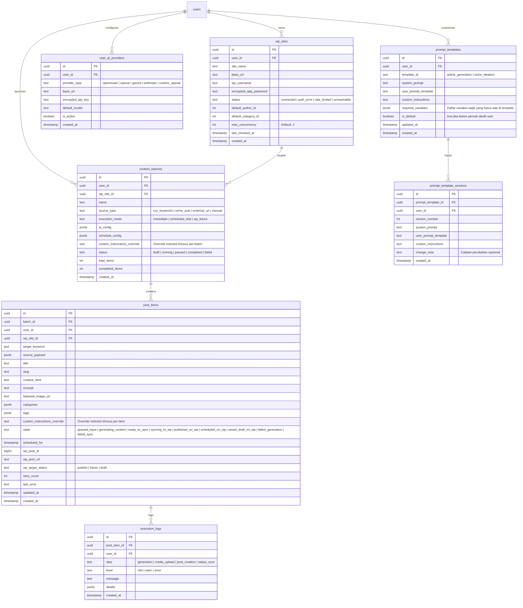
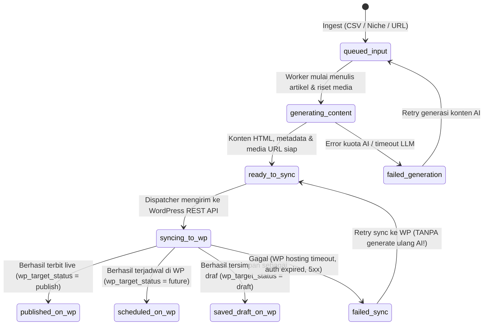
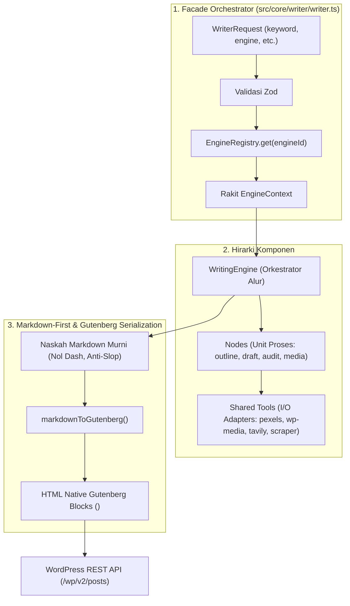

# ARCHITECTURE.md — Arsitektur Sistem & State Machine

Dokumen ini adalah cetak biru teknis (*technical blueprint*) untuk platform **WP Autopost & Multi-Site Content Dashboard**. Dokumen ini mendefinisikan arsitektur modular, skema PostgreSQL Supabase, siklus hidup antrean (*queue state machine*), dan kontrak integrasi dengan WordPress REST API.

---

## 1. Prinsip Desain Arsitektur

1. **Strict Core Separation (`src/core/`)**:
   Seluruh logika bisnis murni (komunikasi WordPress REST API, AI Provider Adapter, Content Ingestion, dan Queue Engine) **wajib terisolasi dari komponen UI React/Next.js**. Komponen UI hanya bertindak sebagai *consumer* atau presenter dari modul inti tersebut.
2. **Interface / Adapter Pattern**:
   Setiap interaksi dengan sistem eksternal (AI provider, WordPress hosting, sumber data konten) harus dibungkus dalam *Interface/Adapter* agar penambahan provider atau metode baru di masa depan tidak merombak kode inti (*Open-Closed Principle*).
3. **Database-First State Machine (Single Source of Truth)**:
   Tidak ada pekerjaan batch atau posting yang berjalan sebagai *ephemeral/fire-and-forget* di memori tanpa status yang tersimpan di Supabase. Setiap tahap siklus hidup artikel dicatat dan dapat dilanjutkan jika terjadi *crash* atau *restart*.
4. **Fault-Tolerant & Hosting-Friendly**:
   Setiap pemanggilan ke website WordPress pengguna dilindungi oleh *per-site concurrency throttling* dan *exponential backoff* agar tidak membebani shared hosting pengguna.

---

## 2. Struktur Direktori Proyek

```text
wp-autopost-dashboard/
├── .agents/                        # Konfigurasi ekosistem Antigravity
│   ├── rules/
│   │   └── security.md             # Guardrails keamanan, RLS Supabase & proteksi kredensial
│   ├── skills/                     # Skills proyek & integrasi eksternal (skills.sh)
│   ├── mcp_config.json             # Konfigurasi MCP Server developer (Supabase, Next-DevTools, Fetch)
│   ├── hooks.json                  # Lifecycle safety hooks
│   └── skills.json                 # Manifest registrasi path skills
├── supabase/                       # Konfigurasi & migrasi database Supabase
│   ├── migrations/                 # File SQL migrasi (Tabel, RLS Policies, Indexes, Triggers)
│   └── seed.sql                    # Data dummy untuk pengujian lokal
├── src/
│   ├── app/                        # Next.js App Router (UI Pages & API Route Handlers)
│   │   ├── (auth)/                 # Autentikasi (login, register, forgot-password)
│   │   ├── (dashboard)/            # Dashboard UI (sites, campaigns, queue, scheduler, settings)
│   │   └── api/                    # Endpoint internal, webhook receivers, cron triggers
│   ├── components/                 # Komponen UI React
│   │   ├── ui/                     # Primitif UI (Shadcn/Radix components)
│   │   ├── layout/                 # Sidebar, Header, Global Site Switcher
│   │   └── features/               # Komponen domain (QueueTable, IngestionWizard, BatchCard)
│   ├── core/                       # Business Logic Murni (Domain Slice Architecture)
│   │   ├── shared/                 # Fondasi Bersama Lintas Domain
│   │   │   ├── tools/              # I/O Adapters (wp-media, wp-posts, pexels, serp, scraper)
│   │   │   ├── formatters/         # Gutenberg Block Serializer & Markdown Cleaner
│   │   │   ├── services/           # LLM Provider Gateway (OpenRouter, OpenAI)
│   │   │   └── DOCUMENTATION_STANDARD.md # Standar baku penyusunan docs.md
│   │   ├── writer/                 # DOMAIN 1: Pembuatan Artikel Baru
│   │   │   ├── writer.ts           # Facade Orchestrator: runWriter()
│   │   │   ├── index.ts            # Barrel export (@/core/writer)
│   │   │   ├── engines/            # Writing Engines (quick, deep-research, visual-story)
│   │   │   ├── nodes/              # Reusable writing nodes (drafter, outline, auditor)
│   │   │   ├── styles/             # Modular Style Rules (listicle.md, essay.md, default.md)
│   │   │   ├── services/           # StyleRuleResolver
│   │   │   └── types/              # contracts.ts, engine.ts
│   │   ├── rewriter/               # DOMAIN 2: Daur Ulang / Penyegaran Konten Lama (Future)
│   │   ├── link-auditor/           # DOMAIN 3: Audit & Injeksi Internal Linking (Future)
│   │   ├── wp-client/              # Client WordPress REST API (Posts, Media, Categories, Tags)
│   │   ├── ingestion/              # Adapter Ingestion (CSVParser, NicheIdeator, UrlExtractor)
│   │   ├── prompt-templates/       # Prompt Template Engine (render, variabel injection)
│   │   └── queue-engine/           # Queue Manager & Dispatcher (Immediate Batch vs Scheduled Cron)
│   ├── lib/                        # Utilitas bersama (Supabase client, Crypto/AES-256, Logger, Sanitizer)
│   └── types/                      # Definisi TypeScript & Supabase generated database types
├── scripts/                        # CLI tools untuk Agentic Ops & maintenance
├── AGENTS.md                       # Sumber kebenaran utama Antigravity AI Agent
├── ARCHITECTURE.md                 # Dokumen ini (Cetak biru arsitektur & state machine)
├── DESIGN.md                       # Design System & UI tokens (Konvensi Google Stitch / ui-ux-pro-max)
├── README.md                       # Dokumentasi gambaran umum repositori
└── .env.example                    # Template environment variables
```

---

## 3. Skema Inti Database (Supabase PostgreSQL)

Setiap tabel di skema `public` terikat dengan `user_id` yang merujuk ke `auth.users(id)` dan **Row Level Security (RLS)** wajib diaktifkan:



### Catatan Skema `prompt_templates`:
- Setiap user mendapat satu baris per `template_id` (di-seed saat registrasi dengan nilai default platform).
- Constraint `UNIQUE(user_id, template_id)` memastikan tidak ada duplikasi.
- `prompt_template_versions` menyimpan riwayat setiap perubahan (auto-insert via trigger `BEFORE UPDATE` pada `prompt_templates`), memungkinkan rollback.
- `content_batches.custom_instructions_override` dan `post_items.custom_instructions_override` menyimpan instruksi per-batch atau per-item yang di-append ke `custom_instructions` global saat prompt di-render.

---

## 4. Database-First State Machine (`post_items.state`)

Siklus hidup setiap artikel dikendalikan oleh mesin status yang ketat:



### Keunggulan Kritis:
- **Cost & Token Saver**: Jika artikel gagal diunggah ke WordPress karena server WordPress pengguna mengalami kendala sementara (*downtime/timeout*), status menjadi `failed_sync`. Saat dilakukan *retry*, sistem langsung mengulang dari `ready_to_sync` ke `syncing_to_wp` **tanpa perlu memanggil LLM ulang**.

---

## 5. Dual-Mode Execution Engine

### A. Mode 1: Immediate Batch ("Proses Sekarang")
- Pengguna memilih batch dan menekan tombol *Run Immediately*.
- Worker mengambil item dengan status `queued_input` secara bertahap.
- Menghormati batas `max_concurrency` per situs (default: 2 request simultan per domain WordPress).
- UI Dashboard menampilkan *real-time progress bar* via Supabase Realtime subscription.

### B. Mode 2: Scheduled / Drip-Feed ("Jadwalkan Bertahap")
1. **Pola Dashboard Scheduler (Hold in Database)**:
   - Artikel tetap berstatus `ready_to_sync` dengan kolom `scheduled_for` terisi waktu masa depan.
   - Cron trigger (`/api/cron/process-queue`) memicu worker setiap X menit untuk mengambil artikel yang jatuh tempo (`scheduled_for <= NOW()`) dan mempublikasikannya langsung (`wp_target_status: 'publish'`).
2. **Pola WordPress Native Future (Delegate to WP)**:
   - Artikel langsung dikirimkan ke WordPress dengan parameter `status: 'future'` dan `date_gmt` sesuai target waktu.
   - Mesin cron internal WordPress (`wp-cron.php`) yang akan mengubah statusnya menjadi `publish` pada waktu yang ditentukan.

---

## 6. Standar Integrasi WordPress REST API (Zero-Plugin)

1. **Autentikasi (Dual-Mode: Redirect Callback + Manual Fallback)**:
   - **Mode Utama — Redirect Authorization Flow** (WordPress ≥ 5.6):
     - Dashboard mengarahkan browser pengguna ke `{wp_url}/wp-admin/authorize-application.php` dengan parameter `app_name`, `app_id` (UUID unik), `success_url`, dan `reject_url`.
     - Jika pengguna belum login ke WordPress, WordPress menampilkan halaman login terlebih dahulu, lalu meneruskan ke halaman otorisasi.
     - Jika pengguna menyetujui (*Approve*), WordPress membuat Application Password baru dan redirect ke `success_url` dengan `user_login` dan `password` sebagai query parameter.
     - Dashboard meng-capture kredensial dari callback, mengenkripsi dengan AES-256-GCM, menyimpan ke Supabase, dan langsung menghapus parameter dari URL browser (`history.replaceState`) untuk mencegah kebocoran via browser history.
     - Semua request API selanjutnya menggunakan HTTP Basic Auth: `Authorization: Basic base64(user_login:app_password)`.
   - **Mode Fallback — Manual Paste**:
     - Untuk WordPress versi < 5.6 atau jika `authorize-application.php` diblokir oleh plugin keamanan, pengguna dapat membuat Application Password secara manual di `wp-admin → Users → Profile → Application Passwords` dan menempelkannya di form dashboard.
     - Tetap menggunakan HTTP Basic Auth standar.
   - **CSRF Protection**: Dashboard menyimpan `state` token (UUID) di Supabase sebelum redirect, dan memverifikasi token ini saat menerima callback.
   - Pengguna tidak diwajibkan menginstal plugin kustom apa pun.
2. **Pre-Flight Healthcheck (`GET /wp-json/wp/v2/users/me?context=edit`)**:
   - Dijalankan saat pendaftaran situs baru (setelah callback berhasil) atau verifikasi koneksi berkala.
   - Memastikan permalink aktif, otentikasi valid, dan akun memiliki hak akses (`publish_posts`, `upload_files`).
3. **Pipeline Upload Media (`POST /wp-json/wp/v2/media`)**:
   - Gambar dari Pexels/AI diunduh ke buffer server dashboard, lalu diunggah via multipart form-data ke REST API WordPress beserta `alt_text` dan `caption`.
   - Mengambil `media_id` yang dikembalikan untuk disematkan sebagai `featured_media` pada artikel.
4. **Manajemen Kategori & Tag (Auto-Create if Not Found)**:
   - **Kategori**:
     - Pencarian: `GET /wp-json/wp/v2/categories?search={name}`.
     - Jika belum ada, otomatis buat baru: `POST /wp-json/wp/v2/categories` dengan payload `{ "name": "..." }`.
     - ID yang dikembalikan digunakan pada field `categories: [id]` saat membuat post.
   - **Tag**:
     - Pencarian: `GET /wp-json/wp/v2/tags?search={name}`.
     - Jika belum ada, otomatis buat baru: `POST /wp-json/wp/v2/tags` dengan payload `{ "name": "..." }`.
     - ID yang dikembalikan digunakan pada field `tags: [id, ...]` saat membuat post.
   - **Caching**: Hasil ID kategori dan tag di-cache lokal per situs (TTL: 1 jam) untuk meminimalkan beban request ke server WordPress. Cache di-invalidate setelah pembuatan kategori/tag baru berhasil.

---

## 7. Internal REST API Routes (Next.js Route Handlers)

Semua endpoint di bawah ini diimplementasikan sebagai **Next.js Route Handlers** di `src/app/api/`. Setiap endpoint membutuhkan autentikasi Supabase (kecuali ditandai Public), dan RLS memastikan isolasi data per-user.

### A. WordPress Sites (`/api/sites`)

| Method | Path | Deskripsi | Auth |
|:-------|:-----|:----------|:-----|
| `GET` | `/api/sites` | Daftar semua situs WP milik user | User |
| `POST` | `/api/sites` | Tambah situs baru (simpan kredensial terenkripsi) | User |
| `GET` | `/api/sites/[id]` | Detail situs + health status | User |
| `PATCH` | `/api/sites/[id]` | Update settings situs (max_concurrency, default category, dll.) | User |
| `DELETE` | `/api/sites/[id]` | Hapus situs (soft delete / cascade post_items?) | User |
| `POST` | `/api/sites/[id]/healthcheck` | Trigger healthcheck manual | User |
| `GET` | `/api/sites/[id]/categories` | Fetch & cache daftar kategori WP | User |
| `GET` | `/api/sites/[id]/tags` | Fetch & cache daftar tag WP | User |

### B. WP Authorization Callback (`/api/sites/callback`)

| Method | Path | Deskripsi | Auth |
|:-------|:-----|:----------|:-----|
| `GET` | `/api/sites/callback` | Menerima redirect callback dari `authorize-application.php` WordPress. Memvalidasi `state` token CSRF, mengenkripsi `user_login` & `password`, menyimpan ke DB, menjalankan healthcheck, lalu redirect ke dashboard. | User (via state token) |

### C. Content Creation & Ingestion (`/api/content`)

| Method | Path | Deskripsi | Auth |
|:-------|:-----|:----------|:-----|
| `POST` | `/api/content/quick-post` | Modul 1: Buat 1 artikel cepat (trigger LLM + sync WP) | User |
| `POST` | `/api/content/bulk-import` | Modul 2: Parse CSV/paste list, simpan ke antrean | User |
| `POST` | `/api/content/niche-ideation` | Modul 3 Tahap 1: Generate daftar subtopik dari niche via LLM | User |
| `POST` | `/api/content/niche-confirm` | Modul 3 Tahap 2: Konfirmasi daftar subtopik, masukkan ke antrean | User |

### D. Batch & Queue Management (`/api/batches`, `/api/queue`)

| Method | Path | Deskripsi | Auth |
|:-------|:-----|:----------|:-----|
| `GET` | `/api/batches` | Daftar batch milik user (filter by status, site) | User |
| `GET` | `/api/batches/[id]` | Detail batch + summary progress | User |
| `POST` | `/api/batches/[id]/run` | Trigger immediate execution pada batch | User |
| `POST` | `/api/batches/[id]/pause` | Pause batch yang sedang running | User |
| `GET` | `/api/queue` | Daftar post_items (filter by state, site, batch) | User |
| `POST` | `/api/queue/[id]/retry` | Retry item yang `failed_sync` atau `failed_generation` | User |
| `DELETE` | `/api/queue/[id]` | Hapus item dari antrean (hanya jika belum dieksekusi) | User |
| `POST` | `/api/queue/bulk-action` | Bulk retry / delete / update items terpilih | User |

### E. Scheduler (`/api/scheduler`)

| Method | Path | Deskripsi | Auth |
|:-------|:-----|:----------|:-----|
| `POST` | `/api/scheduler/generate-schedule` | Generate jadwal drip-feed (jitter + time window) untuk batch | User |
| `GET` | `/api/scheduler/preview` | Preview kalender jadwal sebelum konfirmasi | User |

### F. AI Provider & Prompt Templates (`/api/ai`)

| Method | Path | Deskripsi | Auth |
|:-------|:-----|:----------|:-----|
| `GET` | `/api/ai/providers` | Daftar AI provider user | User |
| `POST` | `/api/ai/providers` | Tambah/update provider (API key terenkripsi) | User |
| `POST` | `/api/ai/providers/test` | Test koneksi & validasi API key | User |
| `GET` | `/api/ai/prompt-templates` | Daftar semua prompt template user (per template_id) | User |
| `GET` | `/api/ai/prompt-templates/[template_id]` | Detail satu prompt template beserta riwayat versi | User |
| `PATCH` | `/api/ai/prompt-templates/[template_id]` | Update system_prompt / user_prompt / custom_instructions | User |
| `POST` | `/api/ai/prompt-templates/[template_id]/preview` | Render prompt lengkap dengan dummy data untuk preview | User |
| `POST` | `/api/ai/prompt-templates/[template_id]/reset` | Reset ke default platform (tanpa hapus custom_instructions) | User |
| `POST` | `/api/ai/prompt-templates/[template_id]/rollback` | Rollback ke versi tertentu (by version_number) | User |

### G. Cron & Webhook Triggers (`/api/cron`, `/api/webhooks`)

| Method | Path | Deskripsi | Auth |
|:-------|:-----|:----------|:-----|
| `POST` | `/api/cron/process-queue` | Cron job: proses item antrean yang jatuh tempo (`scheduled_for <= NOW()`) | Cron Secret |
| `POST` | `/api/cron/healthcheck-all` | Cron job: healthcheck berkala semua situs aktif | Cron Secret |
| `POST` | `/api/webhooks/supabase` | Webhook receiver untuk Supabase Realtime events (opsional) | Webhook Signature |

> **Autentikasi Cron/Webhook**: Semua endpoint cron/webhook memverifikasi `CRON_SECRET` atau `WEBHOOK_SIGNATURE` menggunakan `crypto.timingSafeEqual` sesuai standar di [`security.md`](file:///d:/Antigravity/wp-autopost-dashboard/.agents/rules/security.md).

### H. Prompt Rendering Pipeline (Internal — Non-HTTP)

Alur render prompt saat eksekusi LLM oleh worker:

```
1. Load prompt_templates WHERE user_id = ? AND template_id = ?
2. Load custom_instructions_override dari content_batches (jika ada)
3. Load custom_instructions_override dari post_items (jika ada)
4. Render user_prompt_template:
   - Ganti {{keyword}}, {{language}}, {{category}}, dll. dengan nilai aktual
5. Compose final messages array:
   [
     { role: "system",  content: system_prompt },
     { role: "user",    content: rendered_user_prompt
                                + "\n\n" + global_custom_instructions
                                + "\n\n" + batch_override (jika ada)
                                + "\n\n" + item_override (jika ada) }
   ]
6. Kirim ke AIProviderAdapter.chat(messages, { model, temperature, ... })
```

---

## 8. Arsitektur System Writer (Engine, Node, Tool, & Gutenberg Blocks)

Arsitektur penulisan artikel pada `src/core/writer/` dirancang dengan prinsip **Open-Closed** (bebas menambah engine tanpa merombak orchestrator), alur kerja **Markdown-First**, dan serialisasi **Native WordPress Gutenberg Blocks**:



### A. Tiga Lapisan Arsitektur (Engine ➔ Node ➔ Tool)

1. **Writing Engine (`src/core/writer/engines/`)**:
   - Menentukan orkestrator alur kerja penulisan artikel baru.
   - Wajib mengimplementasikan interface `WritingEngine` dengan deklarasi `EngineCapabilities`.
   - Menggunakan `EngineRegistry` terpusat (`register`, `get`, `list`).
   - Contoh: `QuickEngine` (1-shot), `DeepResearchEngine` (StateGraph riset), `VisualStoryEngine` (penanaman gambar per H2).
2. **Nodes (`src/core/writer/nodes/`)**:
   - Unit fase proses modular yang membaca state, mengeksekusi logika domain/LLM, dan mengembalikan pembaruan naskah.
   - Bersifat *reusable* lintas engine dalam domain writer (misal: `outline-node`, `drafter-node`, `auditor-node`, `media-extractor-node`).
3. **Shared Tools (`src/core/shared/tools/`)**:
   - Adapter I/O teknis stateless yang berinteraksi dengan API pihak ketiga atau WordPress REST API, dan dapat dipakai bersama oleh domain `writer`.
   - Contoh: `tools/media/pexels.ts`, `tools/wp/media-uploader.ts`, `tools/search/tavily.ts`.

### B. Alur Kerja Markdown-First & Native Gutenberg Blocks

1. **Generasi Markdown**: AI LLM diinstruksikan menghasilkan keluaran Markdown murni (bukan tag HTML mentah). Hal ini menghemat konsumsi token ~30%, mencegah risiko tag HTML rusak/unclosed, dan memudahkan proses audit.
2. **Gutenberg Block Serializer (`src/core/shared/formatters/gutenberg.ts`)**: Mengonversi Markdown secara deterministik menjadi markup komentar blok resmi WordPress (`<!-- wp:heading -->`, `<!-- wp:paragraph -->`, `<!-- wp:image {"id":...} -->`, `<!-- wp:list -->`, `<!-- wp:quote -->`, `<!-- wp:code -->`, `<!-- wp:separator -->`).

### C. Standar Dokumentasi Komponen (`docs.md` with YAML Frontmatter)

Setiap Engine, Node, dan Tool **WAJIB** memiliki berkas `docs.md` di samping kodenya dengan metadata YAML frontmatter baku (id, name, type, version, status, capabilities, side_effects, inputs, outputs, dependencies) dan 6 bagian konten wajib (Ikhtisar, Alur Logika, Spesifikasi Parameter, Spesifikasi Output, Penanganan Error, Contoh Pemanggilan) sesuai panduan di [`src/core/shared/DOCUMENTATION_STANDARD.md`](file:///d:/Antigravity/wp-autopost-dashboard/src/core/shared/DOCUMENTATION_STANDARD.md).

