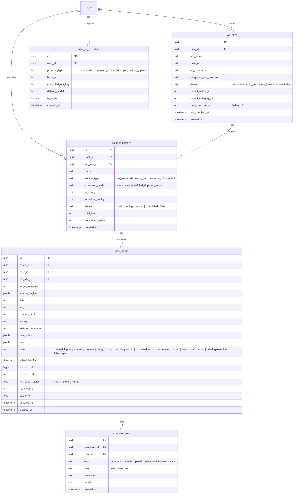
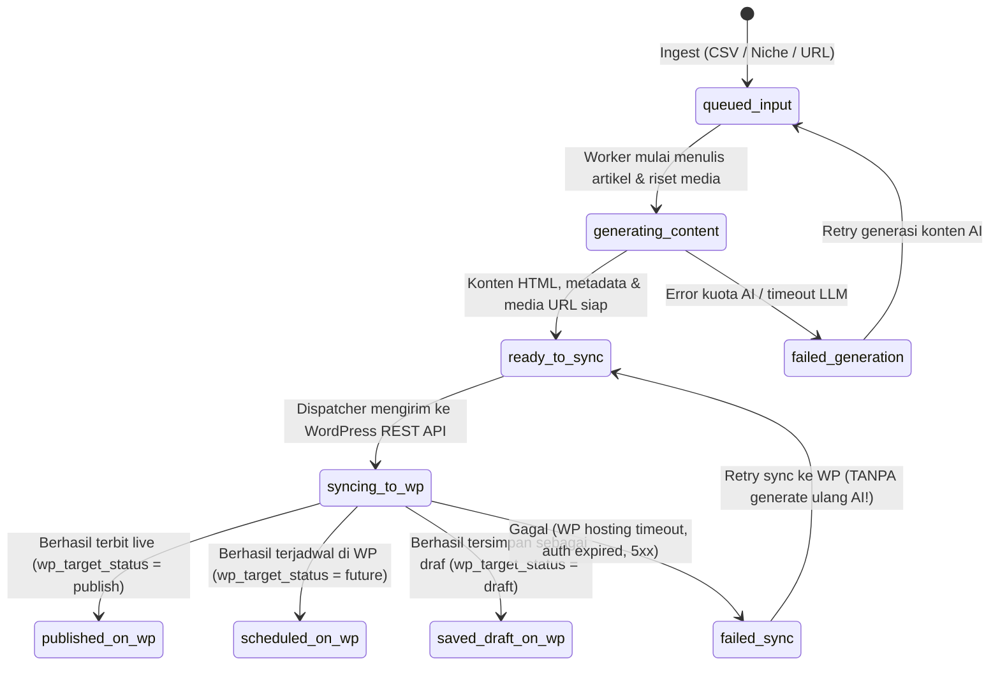

# ARCHITECTURE.md — Arsitektur Sistem & State Machine

Dokumen ini adalah cetak biru teknis (*technical blueprint*) untuk platform **WP Autopost & Multi-Site Content Dashboard**. Dokumen ini mendefinisikan arsitektur modular, skema PostgreSQL Supabase, siklus hidup antrean (*queue state machine*), dan kontrak integrasi dengan WordPress REST API.

---

## 1. Prinsip Desain Arsitektur

1. **Strict Core Separation (`src/core/`)**:
   Seluruh logika bisnis murni (komunikasi WordPress REST API, AI Provider Adapter, Content Ingestion, dan Queue Engine) **wajib terisolasi dari komponen UI React/Next.js**. Komponen UI hanya bertindak sebagai *consumer* atau presenter dari modul inti tersebut.
2. **Interface / Adapter Pattern**:
   Setiap interaksi dengan sistem eksternal (AI provider, WordPress hosting, sumber data konten) harus dibungkus dalam *Interface/Adapter* agar penambahan provider atau metode baru di masa depan tidak merombak kode inti (*Open-Closed Principle*).
3. **Database-First State Machine (Single Source of Truth)**:
   Tidak ada pekerjaan batch atau posting yang berjalan sebagai *ephemeral/fire-and-forget* di memori tanpa status yang tersimpan di Supabase. Setiap tahap siklus hidup artikel dicatat dan dapat dilanjutkan jika terjadi *crash* atau *restart*.
4. **Fault-Tolerant & Hosting-Friendly**:
   Setiap pemanggilan ke website WordPress pengguna dilindungi oleh *per-site concurrency throttling* dan *exponential backoff* agar tidak membebani shared hosting pengguna.

---

## 2. Struktur Direktori Proyek

```text
wp-autopost-dashboard/
├── .agents/                        # Konfigurasi ekosistem Antigravity
│   ├── rules/
│   │   └── security.md             # Guardrails keamanan, RLS Supabase & proteksi kredensial
│   ├── skills/                     # Skills proyek & integrasi eksternal (skills.sh)
│   ├── mcp_config.json             # Konfigurasi MCP Server developer (Supabase, Next-DevTools, Fetch)
│   ├── hooks.json                  # Lifecycle safety hooks
│   └── skills.json                 # Manifest registrasi path skills
├── supabase/                       # Konfigurasi & migrasi database Supabase
│   ├── migrations/                 # File SQL migrasi (Tabel, RLS Policies, Indexes, Triggers)
│   └── seed.sql                    # Data dummy untuk pengujian lokal
├── src/
│   ├── app/                        # Next.js App Router (UI Pages & API Route Handlers)
│   │   ├── (auth)/                 # Autentikasi (login, register, forgot-password)
│   │   ├── (dashboard)/            # Dashboard UI (sites, campaigns, queue, scheduler, settings)
│   │   └── api/                    # Endpoint internal, webhook receivers, cron triggers
│   ├── components/                 # Komponen UI React
│   │   ├── ui/                     # Primitif UI (Shadcn/Radix components)
│   │   ├── layout/                 # Sidebar, Header, Global Site Switcher
│   │   └── features/               # Komponen domain (QueueTable, IngestionWizard, BatchCard)
│   ├── core/                       # Business Logic Murni (Framework Agnostic)
│   │   ├── ai-providers/           # Adapter AI (OpenRouter default, OpenAI, Gemini, Anthropic)
│   │   ├── wp-client/              # Client WordPress REST API (Posts, Media, Categories, Healthcheck)
│   │   ├── ingestion/              # Adapter Ingestion (CSVParser, NicheIdeator, UrlExtractor)
│   │   ├── generator/              # AI Article Composer, Anti-AI Humanizer, Media Matcher
│   │   └── queue-engine/           # Queue Manager & Dispatcher (Immediate Batch vs Scheduled Cron)
│   ├── lib/                        # Utilitas bersama (Supabase client, Crypto/AES-256, Logger, Sanitizer)
│   └── types/                      # Definisi TypeScript & Supabase generated database types
├── scripts/                        # CLI tools untuk Agentic Ops & maintenance
├── AGENTS.md                       # Sumber kebenaran utama Antigravity AI Agent
├── ARCHITECTURE.md                 # Dokumen ini (Cetak biru arsitektur & state machine)
├── DESIGN.md                       # Design System & UI tokens (Konvensi Google Stitch / ui-ux-pro-max)
├── README.md                       # Dokumentasi gambaran umum repositori
└── .env.example                    # Template environment variables
```

---

## 3. Skema Inti Database (Supabase PostgreSQL)

Setiap tabel di skema `public` terikat dengan `user_id` yang merujuk ke `auth.users(id)` dan **Row Level Security (RLS)** wajib diaktifkan:



---

## 4. Database-First State Machine (`post_items.state`)

Siklus hidup setiap artikel dikendalikan oleh mesin status yang ketat:



### Keunggulan Kritis:
- **Cost & Token Saver**: Jika artikel gagal diunggah ke WordPress karena server WordPress pengguna mengalami kendala sementara (*downtime/timeout*), status menjadi `failed_sync`. Saat dilakukan *retry*, sistem langsung mengulang dari `ready_to_sync` ke `syncing_to_wp` **tanpa perlu memanggil LLM ulang**.

---

## 5. Dual-Mode Execution Engine

### A. Mode 1: Immediate Batch ("Proses Sekarang")
- Pengguna memilih batch dan menekan tombol *Run Immediately*.
- Worker mengambil item dengan status `queued_input` secara bertahap.
- Menghormati batas `max_concurrency` per situs (default: 2 request simultan per domain WordPress).
- UI Dashboard menampilkan *real-time progress bar* via Supabase Realtime subscription.

### B. Mode 2: Scheduled / Drip-Feed ("Jadwalkan Bertahap")
1. **Pola Dashboard Scheduler (Hold in Database)**:
   - Artikel tetap berstatus `ready_to_sync` dengan kolom `scheduled_for` terisi waktu masa depan.
   - Cron trigger (`/api/cron/process-queue`) memicu worker setiap X menit untuk mengambil artikel yang jatuh tempo (`scheduled_for <= NOW()`) dan mempublikasikannya langsung (`wp_target_status: 'publish'`).
2. **Pola WordPress Native Future (Delegate to WP)**:
   - Artikel langsung dikirimkan ke WordPress dengan parameter `status: 'future'` dan `date_gmt` sesuai target waktu.
   - Mesin cron internal WordPress (`wp-cron.php`) yang akan mengubah statusnya menjadi `publish` pada waktu yang ditentukan.

---

## 6. Standar Integrasi WordPress REST API (Zero-Plugin)

1. **Autentikasi**:
   - Standar HTTP Basic Auth menggunakan kredensial bawaan **WordPress Application Passwords** (`Authorization: Basic base64(username:app_password)`).
   - Pengguna tidak diwajibkan menginstal plugin kustom apa pun.
2. **Pre-Flight Healthcheck (`GET /wp-json/wp/v2/users/me?context=edit`)**:
   - Dijalankan saat pendaftaran situs baru atau verifikasi koneksi berkala.
   - Memastikan permalink aktif, otentikasi valid, dan akun memiliki hak akses (`publish_posts`, `upload_files`).
3. **Pipeline Upload Media (`POST /wp-json/wp/v2/media`)**:
   - Gambar dari Pexels/AI diunduh ke buffer server dashboard, lalu diunggah via multipart form-data ke REST API WordPress beserta `alt_text` dan `caption`.
   - Mengambil `media_id` yang dikembalikan untuk disematkan sebagai `featured_media` pada artikel.
4. **Manajemen Kategori & Tag**:
   - Pencarian kategori: `GET /wp-json/wp/v2/categories?search={name}`.
   - Jika belum ada, otomatis buat baru: `POST /wp-json/wp/v2/categories`.
   - Hasil ID di-cache lokal untuk meminimalkan beban request ke server WordPress.
