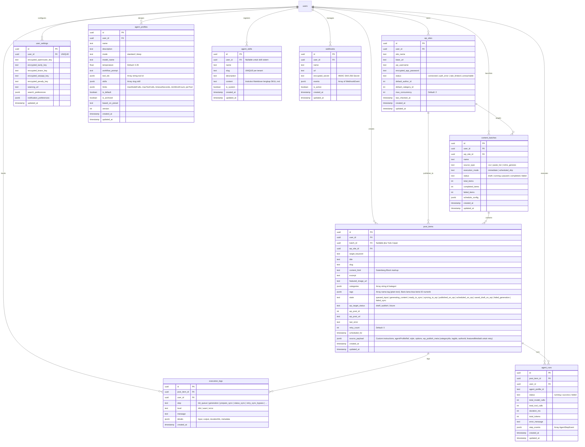
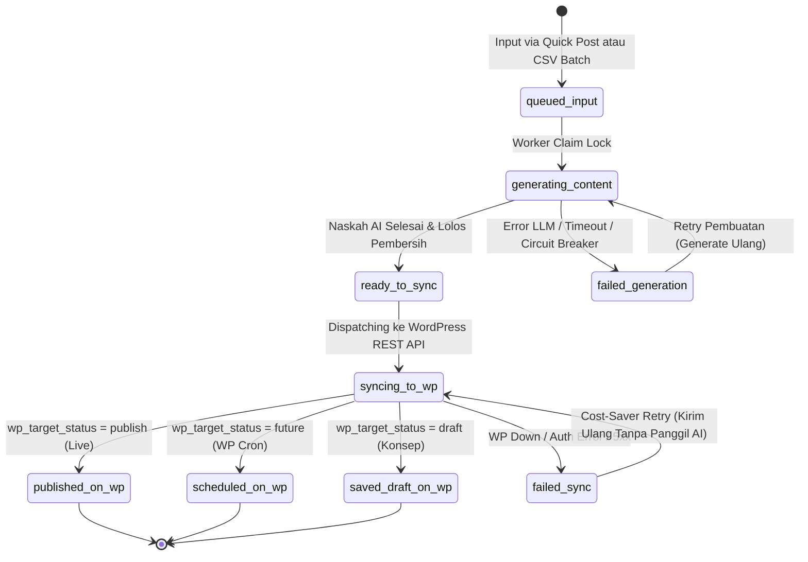
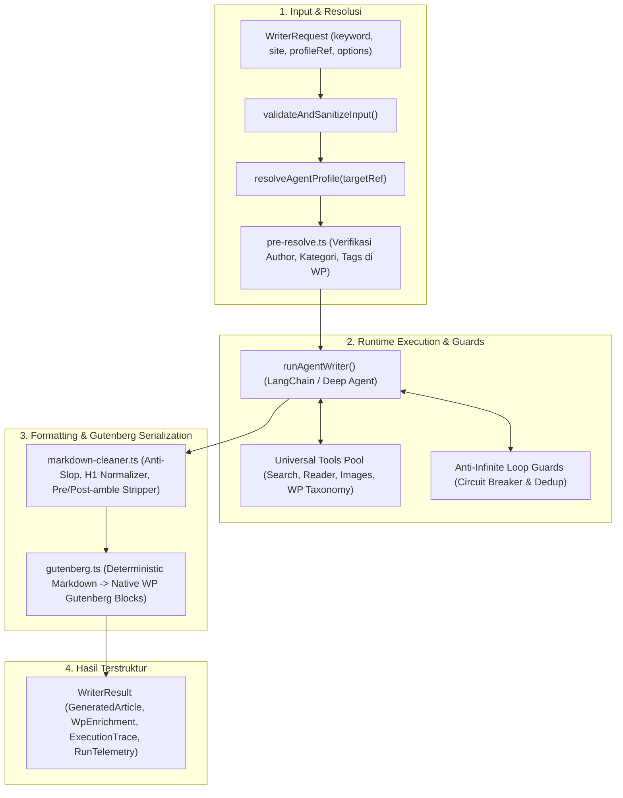
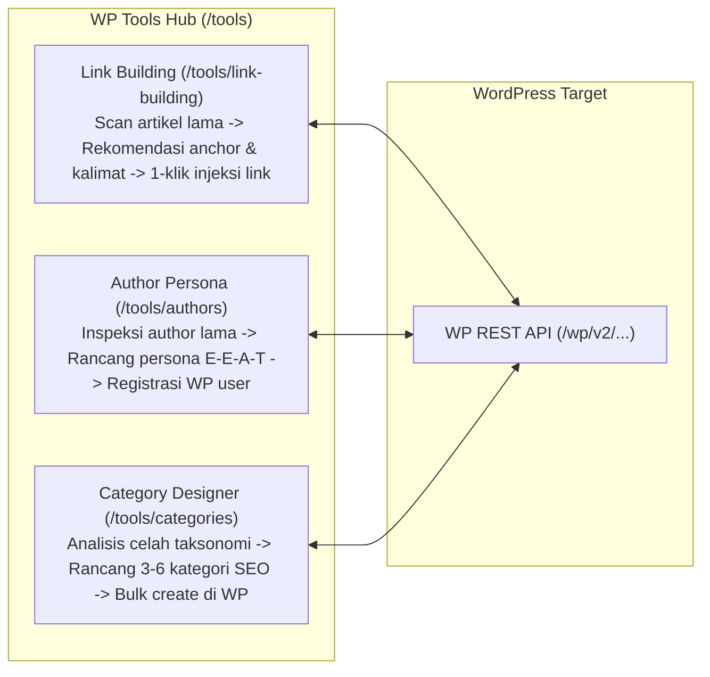

# ARCHITECTURE.md — Arsitektur Sistem & Cetak Biru Teknis Panitera

Dokumen ini adalah cetak biru teknis (*technical blueprint*) resmi untuk platform **Panitera (WP Autopost & Multi-Site AI Agentic Dashboard)**. Dokumen ini mendefinisikan arsitektur sistem, struktur modular Next.js App Router, skema PostgreSQL Supabase, siklus hidup antrean (*queue state machine*), *Agent Profile Runtime*, pipeline media/search, serta integrasi WordPress REST API.

---

## 1. Prinsip Desain Arsitektur

1. **Strict Core Separation (`src/core/`)**:
   Seluruh logika bisnis inti terisolasi penuh dari komponen UI React/Next.js:
   - `src/core/writer/`: Runtime eksekusi agen penulisan artikel (Agent Profile Runtime).
   - `src/core/queue/`: Worker pemrosesan antrean di latar belakang (*atomic claim lock*, fault-tolerant).
   - `src/core/shared/`: Universal tools, serialisasi Gutenberg Blocks, pembersih Markdown anti-slop, dan prompt preset.
2. **Agent Profile Runtime Hierarchy**:
   Menghilangkan ketergantungan pada pipeline/engine kaku. Arsitektur beroperasi atas hirarki modular:
   $$\text{Agent Profile} \longrightarrow \text{Universal Tools} \longrightarrow \text{Runtime Guards}$$
   Pengguna bebas mendefinisikan persona, model AI, alur instruksi (*workflow prompt*), batasan komputasi (*limits*), dan kombinasi alat yang dipilih mandiri.
3. **Database-First State Machine (Single Source of Truth)**:
   Tidak ada pekerjaan pembuatan artikel atau publikasi ke WordPress yang berjalan sebagai *fire-and-forget* di memori tanpa status yang tersimpan di PostgreSQL Supabase. Setiap tahap siklus hidup artikel dicatat, terlacak, dan dapat dilanjutkan secara *idempotent* jika terjadi interupsi.
4. **Zero-Plugin Onboarding & Hosting Guard**:
   Komunikasi dengan website WordPress pengguna berjalan murni di atas **WordPress REST API (`/wp-json/wp/v2/...`)** dan **Application Passwords** bawaan WordPress (tersedia sejak WP 5.6). Tidak memerlukan instalasi plugin custom atau perubahan PHP di sisi pengguna. Setiap koneksi dilindungi *per-site concurrency throttling* (default: maks 2 request paralel per domain).
5. **Markdown-First & Native Gutenberg Block Serializer**:
   AI LLM menulis naskah dalam format Markdown murni (menghemat konsumsi token prompt hingga ~30% dan mencegah risiko HTML rusak), lalu dikonversi secara deterministik ke WordPress Gutenberg Blocks (`<!-- wp:... -->`) sebelum dikirim ke WordPress REST API.
6. **Unified Bring Your Own Key (BYOK) Model**:
   Pengguna mengendalikan sendiri kuota dan biaya API mereka (OpenRouter AI, Web Search Tavily/Brave/SerpAPI, SearXNG lokal/mandiri, dan API Pexafy). Seluruh kredensial dienkripsi dengan **AES-256-GCM** sebelum disimpan ke database.

---

## 2. Struktur Direktori Repositori Aktual

```text
wp-autopost-dashboard/
├── .claude/                               # Harness Claude Code (lihat CLAUDE.md)
│   ├── rules/                             # Aturan operasional & keamanan (dimuat otomatis)
│   │   ├── security.md                    # Standar RLS Supabase, AES-256-GCM & anti-SSRF
│   │   ├── codebase-hygiene.md            # Zero dead code, TS strict, sandbox .workspaces/
│   │   ├── atomic-design-and-styling.md   # Pedoman Atomic Design & larangan arbitrary hex
│   │   ├── page-layout-standard.md        # Standar PageContainer & PageHeader seragam
│   │   ├── prompt-management.md           # 3 pilar prompt & format berkas
│   │   ├── skills-routing-matrix.md       # Matriks pemetaan tugas ke skill
│   │   └── writer-components-standard.md  # Standar Agent Profile Runtime & Gutenberg
│   ├── skills/                            # Skill teknis proyek (Next, Supabase, LangChain, WP)
│   ├── hooks/                             # Hook guard-secrets & session-start
│   └── settings.json                      # Izin & registrasi hooks
├── .workspaces/                           # Sandbox lokal (di-ignore Git): scripts, temp, assets, worklogs
├── CLAUDE.md                              # Konteks utama proyek untuk Claude Code
├── docs/                                  # Dokumentasi sistem & panduan pengguna (/docs)
│   ├── 01-memulai-panitera.md             # Panduan dasar dan konsep platform
│   ├── 02-koneksi-wordpress.md            # Zero-plugin onboarding & Application Passwords
│   ├── 03-manajemen-profil-agen.md        # Konsep Standard vs Deep Agent & Universal Tools
│   ├── 04-penerbitan-dan-penjadwalan.md   # Tulis Cepat, Batch Ingestion & Smart Drip-Feed
│   └── 05-wp-tools-dan-utilitas.md        # Link Building, Author Persona, Category Designer
├── public/                                # Berkas statis web (favicon, ilustrasi)
├── searxng/                               # Konfigurasi mesin metasearch mandiri SearXNG
│   └── settings.yml                       # Konfigurasi engine & format JSON SearXNG
├── src/
│   ├── app/                               # Next.js App Router (Halaman UI & REST API)
│   │   ├── (auth)/
│   │   │   ├── login/page.tsx             # Halaman autentikasi login (Supabase SSR)
│   │   │   └── register/page.tsx          # Halaman pendaftaran pengguna
│   │   ├── agents/                        # Agent Studio (Kelola Agent Profiles)
│   │   │   ├── page.tsx                   # Daftar profil agen & presets
│   │   │   ├── new/page.tsx               # Formulir perancangan agen baru
│   │   │   └── [id]/page.tsx              # Detail & konfigurasi profil agen
│   │   ├── batches/                       # Riwayat & pemantauan Batch Ingestion
│   │   │   └── page.tsx                   # Daftar batch campaign
│   │   ├── docs/                          # In-app Documentation Viewer
│   │   │   └── page.tsx                   # Pembaca berkas Markdown panduan pengguna
│   │   ├── lab/                           # Laboratorium Pengujian Agen
│   │   │   └── page.tsx                   # Sandbox pengujian profil agen terisolasi
│   │   ├── posts/                         # Manajemen Naskah Artikel
│   │   │   ├── page.tsx                   # Daftar seluruh artikel
│   │   │   ├── new/page.tsx               # Tulis Cepat (Quick Writer UI)
│   │   │   └── [id]/page.tsx              # Detail artikel, Gutenberg preview, & audit log
│   │   ├── queue/                         # Pusat Antrean Eksekusi
│   │   │   ├── page.tsx                   # Bulk Artikel (CSV Upload & Column Mapping Wizard)
│   │   │   └── items/page.tsx             # Tabel Antrean (Grouped by Batch, Atomic Actions)
│   │   ├── scheduled/                     # Artikel Terjadwal
│   │   │   └── page.tsx                   # Kalender & timeline artikel mode future
│   │   ├── settings/                      # Pusat Pengaturan Platform
│   │   │   ├── page.tsx                   # Index pengaturan
│   │   │   ├── keys/page.tsx              # Unified BYOK Hub (OpenRouter, Search, Pexafy)
│   │   │   ├── search/page.tsx            # Preferensi & konfigurasi provider pencarian
│   │   │   ├── ai/page.tsx                # Pengaturan global model AI
│   │   │   ├── webhooks/page.tsx          # Konfigurasi outbound webhook & event subscriptions
│   │   │   └── profile/page.tsx           # Profil pengguna & kata sandi
│   │   ├── sites/                         # Multi-Site WordPress Manager
│   │   │   └── page.tsx                   # Hubungkan situs, health check, edit taksonomi
│   │   ├── skills/                        # Skill Registry
│   │   │   ├── page.tsx                   # Daftar modul keahlian (SKILL.md)
│   │   │   └── new/page.tsx               # Buat modul keahlian editorial baru
│   │   ├── tools/                         # AI-Native WordPress Tools Hub
│   │   │   ├── page.tsx                   # Hub navigasi tools
│   │   │   ├── link-building/page.tsx     # Retroactive Internal Link Building
│   │   │   ├── authors/page.tsx           # Pembuat Persona Penulis E-E-A-T
│   │   │   └── categories/page.tsx        # Perancang Taksonomi Kategori
│   │   ├── api/                           # Endpoint Internal REST API
│   │   │   ├── agents/                    # CRUD profil agen, templates, tools
│   │   │   ├── ai/                        # Verifikasi kunci AI & dynamic model fetcher
│   │   │   ├── auth/                      # Session user & signout
│   │   │   ├── batches/                   # Inisialisasi & pembatalan batch
│   │   │   ├── docs/                      # Fetcher berkas Markdown dokumentasi
│   │   │   ├── health/                    # Healthcheck platform
│   │   │   ├── lab/                       # Registry runner untuk pengujian sandbox
│   │   │   ├── posts/                     # CRUD artikel & endpoint /api/posts/quick
│   │   │   ├── queue/                     # Pengambilan item antrean & /api/queue/process
│   │   │   ├── settings/                  # BYOK key updates, preferensi search
│   │   │   ├── sites/                     # CRUD situs, WP callback redirect, test auth
│   │   │   ├── skills/                    # CRUD modul keahlian agen
│   │   │   ├── tools/                     # Endpoint asisten link, author, kategori
│   │   │   └── webhooks/                  # CRUD webhook, pengujian trigger test
│   │   ├── layout.tsx                     # Root App Layout (Inter font, dark/light theme)
│   │   ├── page.tsx                       # Dashboard Overview (KPIs, Active Sites, Quick Links)
│   │   └── globals.css                    # Tailwind CSS v4 styling & semantic design tokens
│   ├── components/                        # Komponen UI Terstruktur (Atomic Design)
│   │   ├── atoms/                         # Badge, Button, Input, Select, Table, Card, Dialog
│   │   ├── molecules/                     # PageHeader, StatusBadge, SiteBadge, SearchInput
│   │   ├── organisms/                     # SidebarNav, TopNavbar, QueueDataTable, BatchListTable
│   │   └── templates/                     # DashboardLayout, PageContainer
│   ├── core/                              # Logika Bisnis Murni (Domain Slice Architecture)
│   │   ├── queue/                         # Background Queue Worker
│   │   │   └── worker.ts                  # Worker pemrosesan status, claim lock, & WP sync
│   │   ├── shared/                        # Utilitas & Tools Bersama
│   │   │   ├── formatters/                # Serializer Gutenberg Blocks & pembersih Markdown
│   │   │   ├── prompts/                   # File Markdown preset prompt bawaan
│   │   │   └── tools/                     # Implementasi Universal Tools (11 tools mandiri)
│   │   └── writer/                        # Agent Profile Runtime Engine
│   │       ├── presets/                   # Registrasi preset bawaan (quick, research, deep)
│   │       ├── runtime/                   # Eksekusi agen, loop-guard, telemetri, validator
│   │       ├── tools/                     # Registry, definisi, & eligibilitas tool
│   │       ├── types/                     # Contracts, schema input/output, profil agen
│   │       ├── writer.ts                  # Pintu masuk utama facade orchestrator: run()
│   │       └── index.ts                   # Public API barrel export (@/core/writer)
│   ├── lib/                               # Utilitas Bersama & Adapter Eksternal
│   │   ├── ai/                            # Klien OpenRouter, model list, verifikasi kunci
│   │   ├── constants/                     # Daftar bahasa, otoritas akses
│   │   ├── scheduler/                     # Kalkulator jadwal (randomized jitter & drip window)
│   │   ├── settings/                      # Dekripsi sentral kunci BYOK (user-keys.ts)
│   │   ├── supabase/                      # Klien Supabase (Browser, Server SSR, Admin Service)
│   │   ├── webhooks/                      # Dispatcher webhook dengan tanda tangan HMAC SHA-256
│   │   ├── wordpress/                     # Klien REST API WordPress & pembuat nama aplikasi
│   │   ├── crypto.ts                      # Enkripsi & dekripsi AES-256-GCM
│   │   └── utils.ts                       # Helper class merger Tailwind (`cn`)
│   └── types/                             # Definisi TypeScript Sistem
│       ├── settings.ts                    # Tipe data kunci BYOK, search, & notifikasi
│       ├── skills.ts                      # Tipe data modul keahlian agen
│       └── webhook.ts                     # Definisi event webhook & payload
├── docker-compose.yml                     # Orkestrasi Docker (Aplikasi Next.js + SearXNG)
├── Dockerfile                             # Konfigurasi build image kontainer produksi
├── package.json                           # Dependensi ekosistem Next.js 16, LangChain, Supabase
└── tsconfig.json                          # Konfigurasi TypeScript (strict: true)
```

---

## 3. Skema Inti Database (Supabase PostgreSQL)

Database menggunakan **PostgreSQL via Supabase**. Seluruh 9 tabel berada di skema `public`, terikat dengan `user_id` yang merujuk ke `auth.users(id)`, dan **Row Level Security (RLS) WAJIB aktif** di seluruh tabel.



---

## 4. Siklus Hidup Antrean (Queue State Machine)

Setiap artikel berpindah status melalui 9 tahapan yang terukur di kolom `post_items.state`:



### Rincian 9 Status Siklus Hidup (`post_items.state`):

| # | Status (`state`) | Keterangan Sistem | Tindakan Saat Retry |
| :- | :--- | :--- | :--- |
| 1 | `queued_input` | Artikel terdaftar di antrean, menunggu giliran alokasi worker. | - |
| 2 | `generating_content` | Profil agen AI sedang melakukan riset dan menyusun artikel. Terkunci secara atomik. | Diulang jika waktu eksekusi telah kedaluwarsa (> 10 menit). |
| 3 | `ready_to_sync` | Naskah Markdown berhasil dikonversi ke Gutenberg Blocks dan tersimpan di database. | Siap dikirim ke WordPress. |
| 4 | `syncing_to_wp` | Sedang melakukan request HTTP POST ke endpoint WordPress target. | - |
| 5 | `published_on_wp` | Sukses terbit live di WordPress (`status: 'publish'`). ID dan URL artikel tersimpan. | Selesai. |
| 6 | `scheduled_on_wp` | Sukses dijadwalkan di WordPress (`status: 'future'`). Tanggal dan jam tayang terkunci di WP. | Selesai. |
| 7 | `saved_draft_on_wp` | Sukses disimpan sebagai konsep di wp-admin WordPress (`status: 'draft'`). | Selesai. |
| 8 | `failed_generation` | Gagal saat pemanggilan AI (kehabisan kuota, batas loop tercapai, timeout). | Memulai ulang siklus dari riset & drafting. |
| 9 | `failed_sync` | Gagal saat mengirim ke WordPress (kredensial salah, koneksi putus, hosting down), atau item macet di `syncing_to_wp` > 10 menit. | **Cost-Saver Retry**: HTML Gutenberg tersimpan dikirim apa adanya bersama `wp_publish_meta` (tanpa AI, tanpa unggah ulang gambar). Item yang sudah punya `wp_post_id` tidak dipublikasi ulang. |

### Prinsip Keandalan Worker:
1. **Atomic Claim Lock**:
   Sebelum memproses naskah, worker mengeksekusi pembaruan status bersyarat:
   ```sql
   UPDATE post_items 
   SET state = 'generating_content', updated_at = NOW() 
   WHERE id = :id AND state IN ('queued_input', 'failed_generation', 'failed_sync')  -- failed_sync hanya jika belum ada naskah tersimpan
     AND user_id = :userId;  -- wajib untuk permintaan sesi; hanya cron yang tanpa filter user
   ```
   Retry sinkronisasi memakai klaim terpisah `state IN ('failed_sync', 'ready_to_sync') → 'syncing_to_wp'` (fungsi `retryPostItemSync`), sehingga klik ganda hanya menghasilkan satu publikasi. Mencegah dua proses worker paralel mengeksekusi item antrean yang sama.
   Auto-healing: `generating_content` macet → `queued_input` dengan `retry_count + 1` (maks 3, lalu `failed_generation`); `syncing_to_wp` macet → `failed_sync` (tidak pernah generasi ulang).
2. **Cost-Saver Retry (Nol Pemborosan Token AI)**:
   Jika item berada di status `failed_sync` dan `post_items.content_html` sudah terisi di database, worker mendeteksi kondisi `isRetrySync`. Sistem langsung melompati tahap AI dan mengirim ulang konten yang ada ke WordPress REST API.
3. **Pengelompokan Antrean Virtual (Quick Writer Batch)**:
   Artikel mandiri hasil dari *Tulis Cepat* (`batch_id: null`) dikelompokkan secara visual di halaman antrean ke dalam batch virtual `"⚡ Tulis Cepat (Quick Writer)"` sehingga seluruh item tetap terpantau rapi.

---

## 5. Arsitektur Agent Profile Runtime (`src/core/writer/`)

Sistem penulisan artikel beroperasi menggunakan arsitektur modular **Agent Profile Runtime**:



### Komponen Inti Runtime:
- **`build-agent.ts`**: Menyusun agen runtime LangChain `createAgent` (Standard Mode) atau Deep Agents (Deep Mode) dengan injeksi instruksi `workflowPrompt` kustom dan alat bantu yang diizinkan.
- **`pre-resolve.ts`**: Memeriksa target website WordPress sebelum proses penulisan. Mengambil persona penulis aktif (nama & biografi) serta taksonomi kategori/tags, lalu menyuntikkannya ke prompt agen sehingga artikel ditulis dari sudut pandang author yang sah tanpa penolakan ID author oleh WP REST API.
- **Universal Tools Pool**:
  - `web_search`: Pencarian web faktual via SearXNG, Tavily, atau Brave.
  - `web_reader`: Ekstraksi konten artikel dari URL rujukan untuk riset mendalam.
  - `image_search`: Pencarian gambar bebas royalti via SearXNG Images atau Pexafy API.
  - `upload_media`: Unggah otomatis berkas gambar eksternal ke pustaka WordPress Media Library.
  - `keyword_suggestions`: Penemuan entitas kata kunci LSI dan pencarian terkait.
  - `set_featured_image`: Mencari dan menetapkan gambar sampul landscape.
  - Taksonomi & author WordPress tidak lagi menjadi tool agen; semuanya dikunci oleh Pre-Flight Resolver (`pre-resolve.ts`).
- **Anti-Infinite Loop Guards (`loop-guard.ts` & `guards.ts`)**:
  - *Consecutive Duplicate Tool Call Guard*: Mendeteksi dan memblokir pemanggilan alat dengan parameter persis sama secara berulang.
  - *Circuit Breaker*: Menghentikan eksekusi jika terjadi 2 kali kegagalan pemanggilan alat berturut-turut.
  - *Hard Ceiling Clamp*: Membatasi maksimal pemanggilan model (35 calls) dan batas waktu eksekusi (480 detik).
  - *Emergency Finalize Call*: Jika batas pemanggilan model mendekati limit, sistem memaksa 1x pemanggilan sintesis akhir untuk merangkum hasil yang sudah dikumpulkan menjadi artikel utuh daripada gagal total.
- **Hidden Formatting & Cleaning Engine (`markdown-cleaner.ts`)**:
  - Menghapus pembuka obrolan AI (*"Tentu, ini artikelnya..."*) dan salam penutup (*"Semoga artikel ini membantu..."*).
  - Menghilangkan duplikasi judul H1 di awal paragraf artikel.
  - Menurunkan seluruh heading `# ` internal menjadi `## ` (H2).
  - Menghapus byline terlarang seperti `"Penulis: ..."` agar persona menyatu secara organik dalam gaya narasi.
- **Deterministic Gutenberg Serializer (`gutenberg.ts`)**:
  - Mengonversi sintaks Markdown murni ke blok WordPress Gutenberg resmi: `<!-- wp:heading -->`, `<!-- wp:paragraph -->`, `<!-- wp:image -->`, `<!-- wp:list -->`, `<!-- wp:quote -->`, `<!-- wp:code -->`, `<!-- wp:separator -->`.

---

## 6. Pipeline Pencarian & Kurasi Gambar (SearXNG + Pexafy)

Platform mengadopsi pipeline pencarian mandiri dan bebas ketergantungan biaya API per-pencarian:

1. **SearXNG Engine (Metasearch Mandiri)**:
   - Dijalankan via `docker-compose.yml` di dalam internal network Docker (`http://searxng-internal:8080`).
   - Tidak mengekspos port ke internet luar demi keamanan maksimal.
   - Melayani pencarian teks web dan pencarian gambar tanpa kuota berbayar.
2. **Pexafy API Integration**:
   - Provider foto bebas royalti resolusi tinggi melalui endpoint `https://api.pexafy.com/api/v1/search/photos`.
   - Menghasilkan foto berdimensi landscape ideal untuk *Featured Image* WordPress.
3. **Penyedia Pencarian Web BYOK Alternatif**:
   - Mendukung Tavily API, Brave Search API, dan SerpAPI yang dapat dikonfigurasi pengguna melalui menu **Pengaturan ➔ Kunci API** (`/settings/keys`).

---

## 7. Utilitas AI WordPress (AI-Native WP Tools)

Menu **WP Tools** (`/tools`) menyediakan 3 utilitas bertenaga AI yang berinteraksi langsung dengan WordPress target:



1. **Internal Link Building Retroaktif (`/tools/link-building`)**:
   - Menganalisis URL artikel baru untuk mengekstrak topik dan entitas kunci.
   - Mencari artikel lama yang relevan di WordPress target via REST API.
   - AI membaca naskah artikel lama dan merancang kalimat penyisipan tautan internal secara alami dengan *anchor text* kontekstual.
   - Pengguna dapat menyalin kalimat rekomendasi atau menerapkan penyisipan otomatis 1-klik ke WordPress via REST API.
2. **Pembuat Persona Penulis E-E-A-T (`/tools/authors`)**:
   - AI menginspeksi profil penulis yang sudah ada di situs WordPress target.
   - Merancang 2–3 profil penulis kredibel dengan biografi persuasif yang relevan dengan niche situs.
   - Menyediakan alur persetujuan, lalu mendaftarkan akun pengguna baru ke WordPress dengan role `author` secara otomatis.
3. **Perancang Taksonomi Kategori (`/tools/categories`)**:
   - AI membaca seluruh kategori aktif di situs target untuk mendeteksi tumpang tindih topik (*cannibalization*).
   - Menghasilkan usulan 3–6 kategori baru yang terstruktur, lengkap dengan slug ramah SEO dan deskripsi kategori.
   - Pengguna dapat memilih dan menerbitkan kategori baru tersebut secara masal ke WordPress.

---

## 8. Outbound Webhooks & Integrasi Eksternal

Platform dilengkapi sistem webhook keluar (*outbound webhooks*) untuk mengirimkan notifikasi event secara real-time ke sistem otomasi eksternal (Make.com, n8n, Zapier, atau backend kustom):

- **Event yang Didukung**:
  - `post.published`: Artikel sukses tayang langsung di WordPress.
  - `post.scheduled`: Artikel sukses dijadwalkan di WordPress untuk tanggal mendatang.
  - `post.draft_saved`: Artikel sukses disimpan sebagai konsep di WordPress.
  - `post.failed`: Pembuatan AI atau sinkronisasi ke WordPress gagal.
  - `batch.completed`: Seluruh item dalam satu batch selesai diproses.
  - `batch.failed`: Seluruh batch mengalami kegagalan fatal.
  - `test.ping`: Event uji coba konektivitas webhook.
- **Keamanan Webhook**:
  - Setiap pengiriman membawa header `X-Panitera-Timestamp` (unix detik) dan `X-Panitera-Signature: sha256=<hex>`, dengan tanda tangan **HMAC SHA-256** atas string `"<timestamp>.<rawBody>"`. Penerima wajib membandingkan secara constant-time dan menolak timestamp yang selisihnya lebih dari 5 menit (anti-replay).
  - Secret webhook dienkripsi menggunakan AES-256-GCM di database; jika secret tidak bisa didekripsi, pengiriman dibatalkan (tidak ada secret cadangan).
  - URL webhook divalidasi Anti-SSRF saat disimpan (`assertSafeUrl`) dan dikirim lewat `safeFetch` tanpa mengikuti redirect.

---

## 9. Katalog Endpoint REST API Internal

Berikut adalah daftar endpoint internal Next.js App Router (`src/app/api/`) yang aktif:

| Rute Endpoint | Metode | Deskripsi & Fungsi |
| :--- | :--- | :--- |
| `/api/agents` | GET, POST | Mengambil daftar profil agen pengguna & membuat profil agen baru |
| `/api/agents/[id]` | GET, PUT, DELETE | Mengambil detail, memperbarui, atau mengarsipkan profil agen |
| `/api/agents/templates` | GET | Mengambil daftar preset profil agen bawaan sistem |
| `/api/agents/tools` | GET | Mengambil daftar tools yang terdaftar dan eligibilitasnya |
| `/api/ai/models` | GET | Mengambil daftar model AI aktif dari OpenRouter |
| `/api/ai/test` | POST | Menguji validitas OpenRouter API Key |
| `/api/batches` | GET, POST, DELETE | Manajemen batch ingestion masal |
| `/api/docs` | GET | Mengambil daftar berkas dokumentasi Markdown |
| `/api/health` | GET | Healthcheck status layanan |
| `/api/lab/registry` | GET | Mengambil data pendukung sandbox (situs, agen, tools) |
| `/api/lab/run` | POST | Menjalankan uji coba eksekusi agen di laboratorium |
| `/api/posts` | GET, DELETE | Mengambil daftar artikel & bulk delete artikel |
| `/api/posts/quick` | POST | Eksekusi pembuatan 1 artikel instan (Tulis Cepat) |
| `/api/posts/[id]` | GET, DELETE, PATCH | Mengambil detail artikel, log audit, atau memicu retry sync |
| `/api/queue` | GET | Mengambil item antrean berdasarkan status dan filter |
| `/api/queue/process` | GET, POST | Memicu eksekusi antrean worker. Cron: `Authorization: Bearer <CRON_SECRET>` (atau `x-cron-secret`), tanpa batasan tenant. Sesi pengguna: hanya POST dan hanya item milik pengguna itu. GET khusus cron. |
| `/api/settings/user` | GET, POST | Mengambil status masking dan menyimpan kunci API BYOK |
| `/api/settings/search/test`| POST | Pengujian koneksi ke mesin pencarian (SearXNG/Tavily/Brave) |
| `/api/sites` | GET, POST | Mengambil daftar situs WordPress & mendaftarkan situs baru |
| `/api/sites/[id]` | GET, PUT, DELETE | Mengambil detail situs, update setelan, atau menghapus situs |
| `/api/sites/[id]/authors` | GET, POST | Membaca daftar author WP atau mendaftarkan author baru |
| `/api/sites/[id]/categories`| GET | Membaca kategori situs WordPress target |
| `/api/sites/connect` | POST | Inisialisasi redirect authorization Application Passwords |
| `/api/sites/callback` | GET | Menerima redirect callback kredensial dari WordPress |
| `/api/sites/test` | POST | Pengujian koneksi manual Application Password ke WordPress |
| `/api/skills` | GET, POST | Mengambil daftar modul keahlian & membuat skill baru |
| `/api/skills/[id]` | GET, PUT, DELETE | Mengambil detail, mengubah, atau menghapus modul keahlian |
| `/api/tools/link-building/analyze` | POST | Menganalisis peluang internal link building pada situs WP |
| `/api/tools/link-building/apply` | POST | Menerapkan injeksi tautan internal ke artikel lama di WP |
| `/api/tools/authors/suggest` | POST | AI perancang rekomendasi profil author E-E-A-T |
| `/api/tools/categories/suggest` | POST | AI perancang rekomendasi taksonomi kategori WordPress |
| `/api/webhooks` | GET, POST | Mengambil daftar webhook & mendaftarkan webhook baru |
| `/api/webhooks/[id]` | PUT, DELETE | Memperbarui atau menghapus konfigurasi webhook |
| `/api/webhooks/[id]/test` | POST | Mengirim event ping pengujian ke webhook eksternal |
