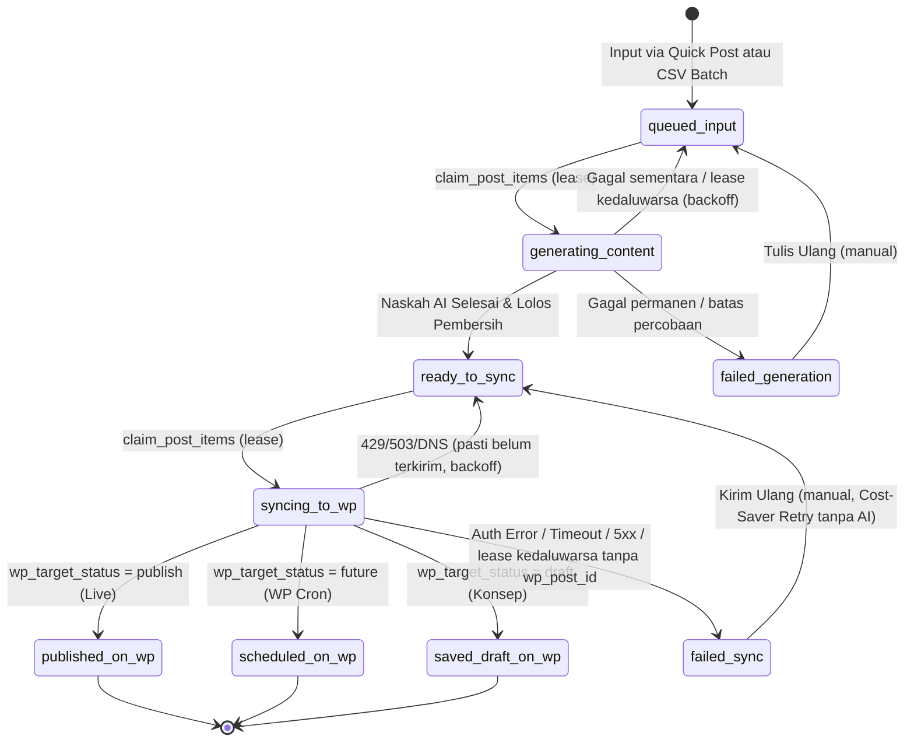
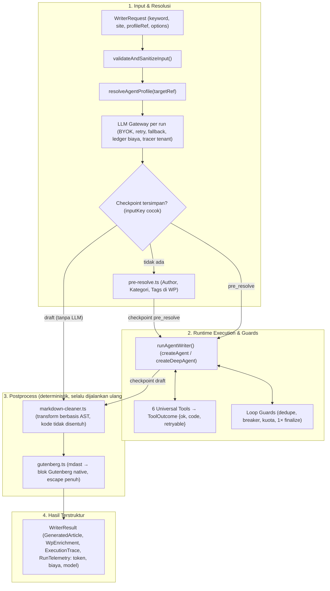
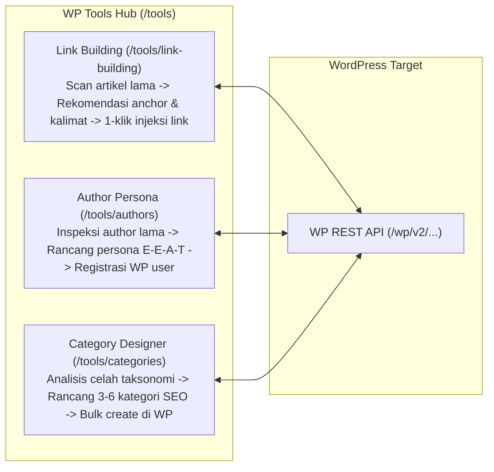

# ARCHITECTURE.md — Arsitektur Sistem & Cetak Biru Teknis Panitera

Dokumen ini adalah cetak biru teknis (*technical blueprint*) resmi untuk platform **Panitera (WP Autopost & Multi-Site AI Agentic Dashboard)**. Dokumen ini mendefinisikan arsitektur sistem, struktur modular Next.js App Router, skema PostgreSQL Supabase, siklus hidup antrean (*queue state machine*), *Agent Profile Runtime*, pipeline media/search, serta integrasi WordPress REST API.

---

## 1. Prinsip Desain Arsitektur

1. **Strict Core Separation (`src/core/`)**:
   Seluruh logika bisnis inti terisolasi penuh dari komponen UI React/Next.js:
   - `src/core/writer/`: Runtime eksekusi agen penulisan artikel (Agent Profile Runtime).
   - `src/core/queue/`: Worker pemrosesan antrean di latar belakang (*atomic claim lock*, fault-tolerant).
   - `src/core/shared/`: Universal tools, serialisasi Gutenberg Blocks, pembersih Markdown anti-slop, dan prompt preset.
2. **Agent Profile Runtime Hierarchy**:
   Menghilangkan ketergantungan pada pipeline/engine kaku. Arsitektur beroperasi atas hirarki modular:
   $$\text{Agent Profile} \longrightarrow \text{Universal Tools} \longrightarrow \text{Runtime Guards}$$
   Pengguna bebas mendefinisikan persona, model AI, alur instruksi (*workflow prompt*), batasan komputasi (*limits*), dan kombinasi alat yang dipilih mandiri.
3. **Database-First State Machine (Single Source of Truth)**:
   Tidak ada pekerjaan pembuatan artikel atau publikasi ke WordPress yang berjalan sebagai *fire-and-forget* di memori tanpa status yang tersimpan di PostgreSQL Supabase. Setiap tahap siklus hidup artikel dicatat, terlacak, dan dapat dilanjutkan secara *idempotent* jika terjadi interupsi.
4. **Zero-Plugin Onboarding & Hosting Guard**:
   Komunikasi dengan website WordPress pengguna berjalan murni di atas **WordPress REST API (`/wp-json/wp/v2/...`)** dan **Application Passwords** bawaan WordPress (tersedia sejak WP 5.6). Tidak memerlukan instalasi plugin custom atau perubahan PHP di sisi pengguna. Setiap koneksi dilindungi *per-site concurrency throttling* (default: maks 2 request paralel per domain).
5. **Markdown-First & Native Gutenberg Block Serializer**:
   AI LLM menulis naskah dalam format Markdown murni (menghemat konsumsi token prompt hingga ~30% dan mencegah risiko HTML rusak), lalu dikonversi secara deterministik ke WordPress Gutenberg Blocks (`<!-- wp:... -->`) sebelum dikirim ke WordPress REST API.
6. **Unified Bring Your Own Key (BYOK) Model**:
   Pengguna mengendalikan sendiri kuota dan biaya API mereka (OpenRouter AI, Web Search Tavily/Brave/SerpAPI, SearXNG lokal/mandiri, dan API Pexafy). Seluruh kredensial dienkripsi dengan **AES-256-GCM** sebelum disimpan ke database.

---

## 2. Struktur Direktori Repositori Aktual

```text
wp-autopost-dashboard/
├── .claude/                               # Harness Claude Code (lihat CLAUDE.md)
│   ├── rules/                             # Aturan operasional & keamanan (dimuat otomatis)
│   │   ├── security.md                    # Standar RLS Supabase, AES-256-GCM & anti-SSRF
│   │   ├── codebase-hygiene.md            # Zero dead code, TS strict, sandbox .workspaces/
│   │   ├── atomic-design-and-styling.md   # Pedoman Atomic Design & larangan arbitrary hex
│   │   ├── page-layout-standard.md        # Standar PageContainer & PageHeader seragam
│   │   ├── prompt-management.md           # 3 pilar prompt & format berkas
│   │   ├── skills-routing-matrix.md       # Matriks pemetaan tugas ke skill
│   │   └── writer-components-standard.md  # Standar Agent Profile Runtime & Gutenberg
│   ├── skills/                            # Skill teknis proyek (Next, Supabase, LangChain, WP)
│   ├── hooks/                             # Hook guard-secrets & session-start
│   └── settings.json                      # Izin & registrasi hooks
├── .workspaces/                           # Sandbox lokal (di-ignore Git): scripts, temp, assets, worklogs
├── CLAUDE.md                              # Konteks utama proyek untuk Claude Code
├── docs/                                  # Dokumen arsitektur internal (tidak disajikan ke pengguna)
│   └── guides/                            # Panduan pengguna untuk reader in-app /docs (satu-satunya yang disajikan)
│       ├── 01-memulai-panitera.md         # Panduan dasar dan konsep platform
│       ├── 02-koneksi-wordpress.md        # Zero-plugin onboarding & Application Passwords
│       ├── 03-manajemen-profil-agen.md    # Konsep Standard vs Deep Agent & Universal Tools
│       ├── 04-penerbitan-dan-penjadwalan.md # Tulis Cepat, Batch Ingestion & Smart Drip-Feed
│       └── 05-wp-tools-dan-utilitas.md    # Link Building, Author Persona, Category Designer
├── public/                                # Berkas statis web (favicon, ilustrasi)
├── searxng/                               # Konfigurasi mesin metasearch mandiri SearXNG
│   └── settings.yml                       # Konfigurasi engine & format JSON SearXNG
├── src/
│   ├── app/                               # Next.js App Router (Halaman UI & REST API)
│   │   ├── (auth)/                        # Route group halaman masuk/daftar (URL tanpa prefix grup)
│   │   │   ├── layout.tsx                 # Pengguna bersesi → redirect ke dasbor
│   │   │   ├── error.tsx                  # Error boundary halaman auth
│   │   │   ├── login/page.tsx             # Masuk & daftar (react-hook-form + zod), menghormati ?next=
│   │   │   └── register/page.tsx          # Alias → /login?tab=register
│   │   ├── (dashboard)/                   # Route group seluruh halaman dasbor (URL tidak berubah)
│   │   │   ├── layout.tsx                 # Server Component: verifikasi sesi (getUser) + shell persisten SEKALI (+ boolean Developer Mode untuk menu Lab)
│   │   │   ├── loading.tsx                # Skeleton halaman (PageSkeleton) saat segmen dimuat
│   │   │   ├── error.tsx                  # Error boundary di dalam shell (RouteErrorState, tanpa stack trace)
│   │   │   ├── not-found.tsx              # notFound() dari page dasbor, dirender di dalam shell
│   │   │   ├── page.tsx                   # Dashboard Overview RSC: KPI (getDashboardStats), situs, pintasan, artikel terbaru (live)
│   │   │   ├── agents/                    # Profil Agen RSC: page.tsx (katalog), new/ (?cloneFrom=), [id]/ (edit; preset → kloning)
│   │   │   ├── batches/page.tsx           # Riwayat & pemantauan Batch Ingestion
│   │   │   ├── docs/page.tsx              # Pembaca panduan RSC (docs/guides via services/docs, ?doc=<slug>)
│   │   │   ├── lab/                       # Laboratorium: layout.tsx (gate server Developer Mode), page.tsx (?tab=tools|agent)
│   │   │   ├── posts/                     # page.tsx (→ redirect), new/ (Tulis Cepat), [id]/ (detail & audit log)
│   │   │   ├── queue/                     # page.tsx (Tulis Massal), items/ (Tabel Antrean)
│   │   │   ├── scheduled/page.tsx         # Artikel Terjadwal (→ redirect)
│   │   │   ├── settings/                  # page.tsx, keys/, ai/, webhooks/, profile/
│   │   │   ├── sites/                     # page.tsx (daftar + sambungkan + banner ?auth_status), [id]/ (pengaturan, kategori, author, hapus)
│   │   │   ├── skills/                    # Skill Registry RSC: page.tsx, new/, [id]/ (edit; skill sistem baca-saja)
│   │   │   ├── tools/                     # WP Tools: page.tsx, link-building/, authors/, categories/ (?site=<uuid> = website awal)
│   │   │   └── write/                     # page.tsx (→ redirect), structured/ (Tulis Terstruktur)
│   │   ├── api/                           # Endpoint Internal REST API (tidak disentuh redirect proxy; JSON 401)
│   │   │   ├── agents/                    # CRUD profil agen & katalog tools (eligibilitas BYOK)
│   │   │   ├── ai/                        # Verifikasi kunci AI & dynamic model fetcher
│   │   │   ├── auth/                      # Session user & signout
│   │   │   ├── batches/                   # Inisialisasi & pembatalan batch
│   │   │   ├── health/                    # Healthcheck platform
│   │   │   ├── lab/                       # Registry (situs, tools, Agent Profile) & run uji (dapat dibatalkan)
│   │   │   ├── posts/                     # CRUD artikel & endpoint /api/posts/quick
│   │   │   ├── queue/                     # Pengambilan item antrean & /api/queue/process
│   │   │   ├── settings/                  # BYOK key updates, preferensi search
│   │   │   ├── sites/                     # CRUD situs, WP callback redirect, test auth
│   │   │   ├── skills/                    # CRUD modul keahlian agen
│   │   │   ├── tools/                     # Endpoint asisten link, author, kategori
│   │   │   └── webhooks/                  # CRUD webhook, pengujian trigger test
│   │   ├── layout.tsx                     # Root layout: font, skrip tema tanpa kedip, AppProviders, title template
│   │   ├── not-found.tsx                  # 404 global untuk URL yang tidak cocok rute mana pun
│   │   └── globals.css                    # Tailwind CSS v4: token semantik + peran status (-foreground/-strong) & text-2xs
│   ├── components/                        # Komponen UI Terstruktur (Atomic Design)
│   │   ├── atoms/                         # Primitive shadcn: Button, Input, Field, Alert, AlertDialog, Sonner, Dialog, …
│   │   ├── molecules/                     # PageHeader, FormField, ControlledField, ConfirmDialog, EmptyState, StatusBadge, …
│   │   ├── organisms/                     # Blok fitur per folder (auth/, sites/…), SidebarNav, TopNavbar, RouteErrorState
│   │   ├── providers/                     # AppProviders (TanStack Query, Tooltip, ConfirmProvider, Toaster)
│   │   └── templates/                     # DashboardShell, PageContainer, PageSkeleton
│   ├── core/                              # Logika Bisnis Murni (Domain Slice Architecture)
│   │   ├── queue/                         # Logika antrean (tanpa loop/proses)
│   │   │   ├── worker.ts                  # Proses satu item: generasi, Cost-Saver Retry, WP sync, fencing lease
│   │   │   ├── leases.ts                  # Klaim RPC claim_post_items & heartbeat lease
│   │   │   ├── retry-policy.ts            # Klasifikasi kegagalan, backoff, dead-letter (murni)
│   │   │   ├── stale-recovery.ts          # Pemulihan item in-flight dengan lease kedaluwarsa
│   │   │   ├── manual-actions.ts          # Kirim ulang / Tulis ulang / Jalankan sekarang (menjadwalkan ulang)
│   │   │   ├── batch-progress.ts          # Rekalkulasi progres batch
│   │   │   └── cron-auth.ts               # Verifikasi header CRON_SECRET
│   │   ├── shared/                        # Utilitas & Tools Bersama
│   │   │   ├── formatters/                # Serializer Gutenberg Blocks & pembersih Markdown
│   │   │   ├── prompts/                   # File Markdown preset prompt bawaan
│   │   │   └── tools/                     # Implementasi Universal Tools (11 tools mandiri)
│   │   └── writer/                        # Agent Profile Runtime Engine
│   │       ├── presets/                   # Registrasi preset bawaan (quick, research, deep)
│   │       ├── runtime/                   # Eksekusi agen, loop-guard, telemetri, validator
│   │       ├── tools/                     # Registry, definisi, & eligibilitas tool
│   │       ├── types/                     # Contracts, schema input/output, profil agen
│   │       ├── writer.ts                  # Pintu masuk utama facade orchestrator: run()
│   │       └── index.ts                   # Public API barrel export (@/core/writer)
│   ├── server/                            # Lapisan server API (tanpa UI)
│   │   ├── http/                          # defineRoute, ApiError & pemetaan error, respons, rate limit
│   │   ├── services/                      # Logika bisnis per domain: (supabase, userId, ...) → data
│   │   ├── validation/                    # Skema zod khusus server (refinement butuh modul server, query/callback route)
│   │   └── queue/                         # Runner antrean tertanam: loop, heartbeat, shutdown, enqueue/nudge
│   ├── instrumentation.ts                 # register(): validasi env & start runner antrean (Node.js)
│   ├── proxy.ts                           # Proxy Next 16: refresh sesi Supabase SSR, redirect /login?next= (bukan /api/**)
│   ├── lib/                               # Utilitas Bersama & Adapter Eksternal
│   │   ├── agents/                        # Mapper murni katalog Agent Profile & skill untuk UI (catalog.ts)
│   │   ├── ai/                            # Pemanggilan OpenRouter, kunci platform (BYOK-only)
│   │   ├── api/                           # Data layer client: apiFetch + ApiClientError, contract envelope, QueryClient, queryKeys
│   │   │   └── queries/                   # queryOptions per domain: agents, ai, batches, lab, posts, queue, settings, sites, skills, webhooks
│   │   ├── auth/                          # routes.ts (klasifikasi rute, sanitasi ?next=), session.ts (getSession/requireSession RSC, server-only)
│   │   ├── constants/                     # Daftar bahasa, otoritas akses
│   │   ├── env/                           # Validasi env server/client (zod), termasuk QUEUE_*
│   │   ├── hooks/                         # Hook client: useZodForm, useTheme, useDeveloperMode, useRealtimeChannel, useQueueLiveUpdates, usePostDetailLive
│   │   ├── net/                           # safeFetch anti-SSRF (DNS pinning, redirect, batas ukuran)
│   │   ├── parser/                        # Parser input massal (CSV/TSV/pipe/baris) & pemetaan kolom dinamis
│   │   ├── queue/                         # Model UI antrean murni: state/kelompok status, baris tabel, aksi ulang, patch Realtime, backoff polling, metrik run
│   │   ├── scheduler/                     # Kalkulator jadwal (randomized jitter & drip window)
│   │   ├── security/                      # redactSecrets / redactSecretsInText untuk log, telemetri & respons Lab
│   │   ├── settings/                      # Dekripsi sentral kunci BYOK (user-keys.ts)
│   │   ├── supabase/                      # Klien Supabase (Browser, Server SSR, Admin Service, penyegar sesi proxy)
│   │   ├── ui/                            # notify (toast Sonner) & useConfirm (dialog konfirmasi)
│   │   ├── validation/                    # Skema zod MURNI bersama form client & route: common, auth, sites, agents, skills, lab, settings, webhooks, tools, posts, batches, queue
│   │   ├── webhooks/                      # Dispatcher webhook dengan tanda tangan HMAC SHA-256
│   │   ├── wordpress/                     # Klien REST API WordPress & pembuat nama aplikasi
│   │   ├── crypto.ts                      # Enkripsi & dekripsi AES-256-GCM
│   │   ├── sanitize-html.ts               # Sanitasi HTML hasil LLM sebelum dirender (allowlist konservatif)
│   │   ├── search-params.ts               # firstParam(): nilai pertama searchParams halaman RSC
│   │   └── utils.ts                       # Helper class merger Tailwind (`cn`)
│   └── types/                             # Definisi TypeScript Sistem (tipe kanonis dari bentuk respons API)
│       ├── agents.ts                      # AgentProfileRecord/Summary/Catalog, AgentToolOption
│       ├── dashboard.ts                   # DashboardStats (KPI dasbor)
│       ├── docs.ts                        # UserGuide (reader /docs)
│       ├── lab.ts                         # LabRegistry & manifest situs/tool/Agent Profile
│       ├── posts.ts                       # PostDetailResponse (detail, log eksekusi, AgentRunInfo/Totals, checkpoint)
│       ├── queue.ts                       # PostItemState, QueueItem, PostListItem, Batch, BatchRef
│       ├── settings.ts                    # Tipe data kunci BYOK, search, & notifikasi
│       ├── site.ts                        # Site, SiteStatus, SiteRef, CreatedSite
│       ├── skills.ts                      # Tipe data modul keahlian agen
│       ├── tools.ts                       # Respons WP Tools (saran kategori/author, rekomendasi & penerapan tautan)
│       └── webhook.ts                     # Definisi event webhook & payload
├── docker-compose.yml                     # Orkestrasi Docker (Aplikasi Next.js + SearXNG)
├── Dockerfile                             # Konfigurasi build image kontainer produksi
├── package.json                           # Dependensi ekosistem Next.js 16, LangChain, Supabase
└── tsconfig.json                          # Konfigurasi TypeScript (strict: true)
```

---

## 3. Skema Inti Database (Supabase PostgreSQL)

Database menggunakan **PostgreSQL via Supabase** (wajib PostgreSQL ≥ 15). Seluruh **11 tabel** berada di skema `public`, setiap baris terikat ke pemilik lewat `user_id` → `auth.users(id)` (`ON DELETE CASCADE`), dan **Row Level Security (RLS) aktif + `FORCE`** di seluruh tabel. Sumber kebenaran skema adalah migrasi Supabase CLI di [`supabase/migrations/`](supabase/migrations/) — baseline `20261015090000_baseline_schema.sql` merekonstruksi skema yang dipakai kode (menggantikan skrip ad-hoc `.workspaces/scripts/migrate-*.js`). Tabel lama `prompt_templates` / `prompt_template_versions` tidak dipakai kode dan tidak termasuk baseline.

```mermaid
erDiagram
    users ||--o{ wp_sites : owns
    users ||--o| user_settings : configures
    users ||--o{ agent_profiles : designs
    users ||--o{ agent_skills : registers
    users ||--o{ content_batches : launches
    users ||--o{ post_items : creates
    users ||--o{ execution_logs : tracks
    users ||--o{ agent_runs : executes
    users ||--o{ webhooks : manages
    post_items ||--o{ generation_checkpoints : resumes
    users ||--o{ uploaded_media : caches

    wp_sites ||--o{ content_batches : targets
    wp_sites ||--o{ post_items : publishes_to
    wp_sites ||--o{ uploaded_media : hosts

    content_batches ||--o{ post_items : contains
    post_items ||--o{ execution_logs : logs
    post_items ||--o{ agent_runs : runs
    post_items ||--o{ uploaded_media : uses

    wp_sites {
        uuid id PK
        uuid user_id FK "UNIQUE (user_id, base_url); UNIQUE (id, user_id)"
        text site_name
        text base_url
        text wp_username
        text encrypted_app_password "AES-256-GCM"
        text status "connected | auth_error | rate_limited | unreachable"
        int default_author_id
        int default_category_id
        int max_concurrency "Default: 2, CHECK 1..10"
        timestamptz last_checked_at
        timestamptz created_at
        timestamptz updated_at
    }

    user_settings {
        uuid id PK
        uuid user_id FK "UNIQUE (target upsert)"
        text encrypted_openrouter_key
        text encrypted_tavily_key
        text encrypted_brave_key
        text encrypted_serpapi_key
        text encrypted_pexafy_key
        text searxng_url
        jsonb search_preferences "default_provider, default_ai_model?, reasoning_effort?"
        jsonb notification_prefs "flag boolean + langsmith_api_key (terenkripsi), langsmith_project"
        timestamptz created_at
        timestamptz updated_at
    }

    agent_profiles {
        uuid id PK
        uuid user_id FK
        text name "2-100 karakter"
        text description
        text mode "standard | deep"
        text model
        numeric temperature "numeric(3,2), Default: 0.35"
        text workflow_prompt "<= 12000 karakter"
        text_array tool_ids
        text_array skills "Slug agent_skills"
        jsonb limits "maxModelCalls, maxToolCalls, timeoutSeconds, minWordCount, perTool, isDefault"
        text based_on_preset
        int version
        boolean is_archived "Soft delete"
        timestamptz created_at
        timestamptz updated_at
    }

    agent_skills {
        uuid id PK
        uuid user_id FK "NULL hanya untuk skill sistem"
        text name "2-120 karakter"
        text slug "^[a-z0-9_-]+$; UNIQUE (user_id, slug); sistem: UNIQUE (slug) WHERE is_system"
        text description
        text content "Markdown SKILL.md"
        boolean is_system "true <=> user_id IS NULL"
        timestamptz created_at
        timestamptz updated_at
    }

    agent_runs {
        uuid id PK
        uuid post_item_id FK "(post_item_id, user_id) -> post_items"
        uuid user_id FK
        text profile_ref
        jsonb profile_snapshot "ref, name, mode, model, temperature, toolIds, skills"
        text status "running | completed | failed"
        text stop_reason "termasuk lease_expired | shutdown | superseded | claim_lost | lease_lost | max_duration"
        int model_calls
        int tool_calls
        int tokens_prompt
        int tokens_completion
        int tokens_total
        int llm_calls "Seluruh panggilan LLM attempt ini (loop, pre-resolve, finalize)"
        numeric cost_usd "usage.cost OpenRouter; NULL bila tidak dilaporkan"
        text model "Model yang benar-benar dipakai (setelah fallback)"
        jsonb model_usage "Rincian per model: calls, tokens, reasoning, cached, cost"
        jsonb prompt_versions "Nama prompt -> versi (hash registry)"
        text_array resumed_steps "Langkah checkpoint yang dipakai ulang: pre_resolve | draft"
        int duration_ms
        int word_count
        text error_message
        timestamptz created_at
        timestamptz finished_at
    }

    generation_checkpoints {
        uuid id PK
        uuid post_item_id FK "(post_item_id, user_id) -> post_items, ON DELETE CASCADE"
        uuid user_id FK
        text step "pre_resolve | draft (UNIQUE per item)"
        int schema_version "Versi format data; versi lain diabaikan"
        jsonb data "Hasil langkah + inputKey (sidik input) + usage langkah; maks 256 KiB"
        jsonb prompt_versions
        timestamptz created_at
        timestamptz updated_at
    }

    content_batches {
        uuid id PK
        uuid user_id FK "UNIQUE (id, user_id)"
        uuid wp_site_id FK "(wp_site_id, user_id) -> wp_sites"
        text name
        text source_type "csv_keywords | niche_auto | external_url | manual"
        text execution_mode "immediate | scheduled_drip | wp_future"
        jsonb ai_config "agentProfileRef, engine, aiModel, language, category_ids, tags, ..."
        jsonb schedule_config "executionMode, mode, random/interval/instantConfig"
        text custom_instructions_override
        text status "draft | running | paused | completed | failed"
        int total_items
        int completed_items "Dihitung ulang dari state post_items"
        timestamptz created_at
        timestamptz updated_at
    }

    post_items {
        uuid id PK
        uuid user_id FK "UNIQUE (id, user_id)"
        uuid batch_id FK "Nullable (Tulis Cepat); (batch_id, user_id) -> content_batches, ON DELETE SET NULL (batch_id)"
        uuid wp_site_id FK "(wp_site_id, user_id) -> wp_sites"
        text target_keyword
        text title
        text slug
        text content_html "Gutenberg Block markup"
        text excerpt
        text featured_image_url
        jsonb categories "Array nama kategori (baris lama: ID numerik)"
        jsonb tags "Array nama tag (baris lama: ID numerik)"
        text custom_instructions_override
        text state "9 state PRD §4 (CHECK)"
        text wp_target_status "publish | future | draft"
        bigint wp_post_id
        text wp_post_url
        int retry_count "CHECK 0..1000"
        text last_error
        timestamptz scheduled_for
        timestamptz locked_until "Lease item in-flight (diperpanjang heartbeat)"
        text locked_by "Token klaim <workerId>:<acak> (unik per klaim); berpasangan dengan locked_until (CHECK)"
        timestamptz next_attempt_at "Backoff retry / Jalankan sekarang / Kirim ulang; menggantikan jatuh tempo jadwal"
        jsonb source_payload "agentProfileRef, engine, aiModel, style, language, category_ids, batch/schedule meta, wp_publish_meta"
        timestamptz created_at
        timestamptz updated_at "Heartbeat klaim worker"
    }

    execution_logs {
        uuid id PK
        uuid post_item_id FK "(post_item_id, user_id) -> post_items"
        uuid user_id FK
        text step "Teks bebas: init_queue | generation | prepare_sync | wordpress_publisher | status_sync | stale_recovery | <node agen> | ..."
        text level "info | warn | error"
        text message
        jsonb details "input, output, durationMs, metadata"
        timestamptz created_at
    }

    webhooks {
        uuid id PK
        uuid user_id FK
        text name
        text url "Divalidasi assertSafeUrl sebelum disimpan"
        text encrypted_secret "Secret HMAC SHA-256 (AES-256-GCM)"
        jsonb events "Array WebhookEvent"
        boolean is_active
        timestamptz created_at
        timestamptz updated_at
    }

    uploaded_media {
        uuid id PK
        uuid user_id FK "NOT NULL"
        uuid site_id FK "(site_id, user_id) -> wp_sites"
        uuid post_id FK "(post_id, user_id) -> post_items, ON DELETE SET NULL (post_id)"
        text source_url "Indeks dedup (site_id, source_url)"
        text site_url
        bigint image_id "ID media WordPress"
        jsonb metadata "alt, caption, title, mime"
        timestamptz created_at
        timestamptz updated_at
    }
```



### 3.1 Model Isolasi Tenant (RLS & Hak Akses)

Semua policy berlaku `TO authenticated` dengan predikat `(select auth.uid()) = user_id` (subselect agar `auth.uid()` dievaluasi sekali per query). Role `anon` tidak memiliki hak apa pun atas 11 tabel. Hak akses (`GRANT`) dinyatakan eksplisit di migrasi — tidak bergantung pada auto-grant Data API.

| Tabel | `authenticated` (client sesi) | Penulis lain |
| :--- | :--- | :--- |
| `wp_sites`, `content_batches`, `agent_profiles`, `user_settings`, `webhooks` | CRUD baris sendiri (UPDATE: `USING` + `WITH CHECK`, `user_id` tidak dapat dipindah) | worker (`service_role`) |
| `agent_skills` | SELECT skill sistem **atau** milik sendiri; INSERT/UPDATE/DELETE hanya skill non-sistem milik sendiri | seed (skill sistem) |
| `post_items` | SELECT, DELETE milik sendiri; INSERT hanya item baru (`state = 'queued_input'`) dan **hanya kolom input antrean** (GRANT per kolom: `user_id, batch_id, wp_site_id, target_keyword, title, state, scheduled_for, wp_target_status, categories, tags, custom_instructions_override, source_payload`; `retry_count`, `last_error`, `created_at/updated_at`, naskah, `wp_post_*`, lease & `next_attempt_at` selalu default); **tanpa UPDATE** | transisi state, naskah, `wp_post_id`, lease: hanya worker (`service_role`); RPC `claim_post_items` & `extend_post_item_lease` hanya `service_role` |
| `execution_logs` | SELECT + INSERT milik sendiri (append-only) | worker; terhapus via cascade item |
| `agent_runs`, `uploaded_media` | SELECT milik sendiri saja | worker (`service_role`) |
| `generation_checkpoints` | SELECT milik sendiri saja | worker lewat RPC `save_generation_checkpoint` (`service_role`, dipagari token lease + state `generating_content`) |

`service_role` (Service Role / secret key) mem-bypass RLS dan hanya dipakai proses latar belakang; kode wajib tetap memfilter `user_id` secara eksplisit (lihat `.claude/rules/security.md`).

### 3.2 FK Komposit Anti Lintas-Tenant

Induk memiliki `UNIQUE (id, user_id)` dan anak merujuk `(fk, user_id)`, sehingga baris anak **tidak mungkin** merujuk induk milik tenant lain — termasuk penulisan via `service_role`:

| FK anak | Induk | ON DELETE |
| :--- | :--- | :--- |
| `content_batches (wp_site_id, user_id)` | `wp_sites (id, user_id)` | CASCADE |
| `post_items (wp_site_id, user_id)` | `wp_sites (id, user_id)` | CASCADE |
| `post_items (batch_id, user_id)` | `content_batches (id, user_id)` | SET NULL (`batch_id`) |
| `execution_logs (post_item_id, user_id)` | `post_items (id, user_id)` | CASCADE |
| `agent_runs (post_item_id, user_id)` | `post_items (id, user_id)` | CASCADE |
| `generation_checkpoints (post_item_id, user_id)` | `post_items (id, user_id)` | CASCADE |
| `uploaded_media (site_id, user_id)` | `wp_sites (id, user_id)` | CASCADE |
| `uploaded_media (post_id, user_id)` | `post_items (id, user_id)` | SET NULL (`post_id`) |

### 3.3 Constraint, Indeks & Trigger

- **CHECK**: 9 state `post_items.state`, `wp_target_status`, `retry_count` 0..1000, `wp_sites.max_concurrency` 1..10 (dapat diubah tenant), pasangan lease `locked_until ⇔ locked_by`, enum status/mode/source (`wp_sites`, `content_batches`, `agent_profiles`, `agent_runs`), `execution_logs.level` (`step` sengaja bebas), format slug & kepemilikan skill sistem, serta bentuk JSON (`jsonb_typeof` object/array) untuk kolom `jsonb`.
- **UNIQUE**: `wp_sites (user_id, base_url)`, `agent_skills (user_id, slug)` + `agent_skills (slug) WHERE is_system`, `user_settings (user_id)`, `generation_checkpoints (post_item_id, step)`.
- **CHECK metrik & checkpoint**: `agent_runs` (metrik non-negatif, `model_usage` array, `prompt_versions` object, `resumed_steps` ⊆ {pre_resolve, draft}); `generation_checkpoints` (`step`, `schema_version` 1..1000, `data` object ≤ 256 KiB, `prompt_versions` ≤ 16 KiB).
- **Indeks antrean**: parsial `post_items_claimable_idx (wp_site_id, created_at)` untuk kandidat klaim (`queued_input`/`ready_to_sync`), parsial `post_items_in_flight_lease_idx` untuk hitung slot per situs & pemulihan lease kedaluwarsa, `(batch_id, state)` untuk progres batch, `(user_id, created_at desc)` untuk daftar antrean. Setiap FK memiliki indeks; dedup media `uploaded_media (site_id, source_url)`.
- **Trigger `set_updated_at`** (BEFORE UPDATE) pada tabel yang memiliki `updated_at`; auto-healing baris in-flight lama tanpa lease memakai kolom ini (heartbeat kini memperpanjang `locked_until`). Fungsi trigger tidak dapat dieksekusi role API.

### 3.4 Workflow Migrasi

```text
supabase/
├── config.toml                      # Konfigurasi Supabase CLI (project_id "panitera")
├── migrations/<timestamp>_<nama>.sql # Satu-satunya jalur perubahan skema (berurutan, idempoten)
├── seed.sql                         # Skill sistem anti-ai-editor (db reset / --include-seed)
└── tests/                           # Test RLS & constraint berbasis PGlite (tanpa Docker)
```

1. Buat berkas: `npx supabase migration new <nama_perubahan>`; tulis SQL idempoten (`if not exists`, `drop ... if exists` lalu `create`), sertakan RLS + policy + `GRANT` untuk tabel baru di migrasi yang sama.
2. Uji lokal tanpa Docker: `npm run db:test` (menerapkan prelude Supabase + seluruh migrasi + seed ke PGlite, termasuk uji idempotensi), lalu `npm test`.
3. Sebelum push ke production: `npx supabase link --project-ref <ref>`, `npx supabase db diff --linked` (butuh Docker) untuk membandingkan skema, `npx supabase db push --linked --dry-run`, lalu `npx supabase db push --linked`.
4. **Dilarang** mengubah skema lewat skrip Management API (`.workspaces/scripts/migrate-*.js`) atau SQL editor dashboard tanpa migrasi.
5. Baseline wajib diverifikasi terhadap production (query pre-flight di header baseline + `db diff`) sebelum push pertama. Panduan lengkap: skill [`.claude/skills/panitera-db-migration/`](.claude/skills/panitera-db-migration/SKILL.md).

---

## 4. Siklus Hidup Antrean (Queue State Machine)

Setiap artikel berpindah status melalui 9 tahapan yang terukur di kolom `post_items.state`:



### Rincian 9 Status Siklus Hidup (`post_items.state`):

| # | Status (`state`) | Keterangan Sistem | Tindakan Saat Retry |
| :- | :--- | :--- | :--- |
| 1 | `queued_input` | Artikel terdaftar di antrean, menunggu giliran alokasi worker. | - |
| 2 | `generating_content` | Profil agen AI sedang melakukan riset dan menyusun artikel. Memegang lease (`locked_until`/`locked_by`) yang diperpanjang heartbeat. | Lease kedaluwarsa → kembali `queued_input` dengan backoff (maks 3 percobaan). |
| 3 | `ready_to_sync` | Naskah Markdown berhasil dikonversi ke Gutenberg Blocks dan tersimpan di database. | Siap dikirim ke WordPress. |
| 4 | `syncing_to_wp` | Sedang melakukan request HTTP POST ke endpoint WordPress target. Memegang lease. | Lease kedaluwarsa → `failed_sync` (tidak dikirim ulang otomatis); bila `wp_post_id` sudah tercatat → dituntaskan ke state akhir sukses. |
| 5 | `published_on_wp` | Sukses terbit live di WordPress (`status: 'publish'`). ID dan URL artikel tersimpan. | Selesai. |
| 6 | `scheduled_on_wp` | Sukses dijadwalkan di WordPress (`status: 'future'`). Tanggal dan jam tayang terkunci di WP. | Selesai. |
| 7 | `saved_draft_on_wp` | Sukses disimpan sebagai konsep di wp-admin WordPress (`status: 'draft'`). | Selesai. |
| 8 | `failed_generation` | Gagal saat pemanggilan AI (kehabisan kuota, batas loop tercapai, timeout). | Memulai ulang siklus dari riset & drafting. |
| 9 | `failed_sync` | Gagal saat mengirim ke WordPress (kredensial salah, timeout/5xx yang mungkin sudah membuat post, hosting down), atau lease `syncing_to_wp` kedaluwarsa. | **Cost-Saver Retry**: HTML Gutenberg tersimpan dikirim apa adanya bersama `wp_publish_meta` (tanpa AI, tanpa unggah ulang gambar). Item yang sudah punya `wp_post_id` tidak dipublikasi ulang. |

### Prinsip Keandalan Worker:
1. **Runner antrean tertanam (durable)**:
   Tidak ada request HTTP yang menjalankan job. Route (`/api/posts/quick`, `/api/batches`, aksi ulang) hanya mencatat item di database lalu membangunkan runner (`nudge`). Runner (`src/server/queue/`) dimulai dari `register()` di `src/instrumentation.ts` (runtime Node.js, satu instance per proses via singleton `globalThis`): polling (`QUEUE_POLL_INTERVAL_MS`, default 5 dtk), klaim hingga `QUEUE_CONCURRENCY` job (default 3), heartbeat lease setiap min(60 dtk, lease/3), dan pemulihan lease kedaluwarsa setiap menit (melewati klaim yang masih dikerjakan proses itu sendiri; baris yang gagal dipulihkan dipaksa terminal atau dilewati agar tidak menahan baris lain). Default `QUEUE_RUNNER`: `embedded` di production, `off` di luar production kecuali disetel eksplisit. Saat SIGTERM, dalam satu tenggat total 30 dtk (di bawah `stop_grace_period` 40 dtk): runner berhenti mengklaim, menunggu job berjalan, mencabut klaim yang belum selesai, lalu melepasnya — klaim yang **belum** memulai request pembuatan post ke WordPress kembali ke state sebelum klaim (`queued_input`/`ready_to_sync`), yang **sudah** memulai menjadi `failed_sync` dengan pesan cek wp-admin (atau sukses bila `wp_post_id` tercatat). Mode `QUEUE_RUNNER=off` (serverless/cron eksternal): `/api/queue/process` dengan header `CRON_SECRET` mengklaim maksimal 1 item per pemicu dan memprosesnya lewat `after()` (`maxDuration` 800 dtk).
2. **Atomic Claim dengan Lease (`claim_post_items`)**:
   RPC `service_role` memindahkan item jatuh tempo `queued_input → generating_content` dan `ready_to_sync → syncing_to_wp` dengan `FOR UPDATE SKIP LOCKED` + advisory lock transaksi, mengisi `locked_until` dan `locked_by` = token klaim `<workerId>:<32 hex acak>` (unik per klaim; ID worker tanpa hostname/pid). Jatuh tempo: `next_attempt_at` bila terisi; selain itu batch `immediate`/tanpa jadwal langsung, mode bertahap `scheduled_for − 10 menit`. Slot per situs = `wp_sites.max_concurrency` − item in-flight dengan lease aktif; urutan adil round-robin antar-tenant lalu jatuh tempo terlama. Setiap penulisan state oleh worker dan heartbeat di-*fence* dengan token klaim + state persis yang diharapkan run, sehingga run usang tidak menimpa klaim baru — termasuk saat item dipulihkan lalu diklaim ulang proses yang sama (ABA).
3. **Retry otomatis & dead-letter (`src/core/queue/retry-policy.ts`)**:
   Kegagalan sementara (LLM/WP 429, 5xx LLM, jaringan) diantrekan ulang dengan backoff `next_attempt_at` 1 mnt → 5 mnt; percobaan ke-3 berhenti di `failed_*` dengan `last_error`. Kegagalan permanen (kredensial/izin WP, kunci BYOK hilang/tidak valid, validasi) langsung `failed_*`. Tahap sinkronisasi hanya mengirim ulang otomatis kegagalan yang **pasti** belum membuat post (429/503/DNS/koneksi ditolak); timeout/5xx/putus koneksi → `failed_sync` dan pengguna diminta memeriksa wp-admin.
4. **Cost-Saver Retry & Idempotensi WordPress**:
   Item yang sudah punya naskah (`content_html`) tidak pernah digenerasi ulang, termasuk saat diklaim untuk generasi. "Kirim ulang" memindahkan `failed_sync`/`ready_to_sync` → `ready_to_sync` (`next_attempt_at = now`, `retry_count` direset) lalu runner mengirim HTML Gutenberg tersimpan bersama `wp_publish_meta` tanpa AI dan tanpa unggah ulang gambar. Item yang sudah memiliki `wp_post_id` tidak dipublikasi ulang: worker, auto-healing, dan pelepasan saat shutdown menuntaskannya ke state akhir sukses (`published_on_wp`/`scheduled_on_wp`/`saved_draft_on_wp` menurut status target & jadwal) sehingga ikut terhitung selesai di progres batch. Aksi manual (`src/core/queue/manual-actions.ts`) memakai admin client dengan filter `user_id` dari sesi.
5. **Checkpoint generasi & resume (`src/core/writer/runtime/checkpoints.ts`, `src/core/queue/checkpoints.ts`)**:
   Dua langkah mahal disimpan per item di `generation_checkpoints`: `pre_resolve` (author, kategori, tag) dan `draft` (naskah mentah, sumber, enrichment termasuk ID media WordPress, `stopReason`, model, usage langkah). Penyimpanan hanya lewat RPC `save_generation_checkpoint` yang dipagari token lease + state `generating_content`; RPC menolak run usang (`false`) dan worker langsung membatalkan run tersebut. Setiap klaim generasi baru (retry otomatis, pemulihan lease, revert saat shutdown, "Jalankan sekarang", "Tulis ulang") memuat checkpoint dan melanjutkan dari langkah terakhir; dari `draft` tidak ada panggilan LLM, tool, maupun kunci BYOK yang dibutuhkan. Checkpoint diabaikan bila `schema_version` berbeda, data tidak valid, atau sidik input (`inputKey`: keyword, bahasa, brief, situs, taksonomi diminta; untuk draft juga judul, gaya, target kata, instruksi, dan Agent Profile termasuk `updatedAt`) berubah — jadi "Tulis ulang" memakai ulang draft valid (cost-saver) dan hanya menulis baru bila input/Agent Profile berubah. Postprocess (Markdown → Gutenberg) deterministik dan selalu dijalankan ulang. Checkpoint dihapus setelah naskah tersimpan. Usage dicatat per attempt di `agent_runs` (langkah yang dipakai ulang di `resumed_steps`, tanpa hitung ganda), termasuk saat writer melempar exception (ledger milik worker). Hasil `pre_resolve` yang terdegradasi (kegagalan LLM atau fetch WordPress → fallback heuristik) tidak disimpan. Data checkpoint divalidasi dengan skema yang sama saat ditulis maupun dibaca, ID dari LLM dipaksa menjadi bilangan bulat positif, dan karakter NUL dibuang. Draft beracun: exception deterministik (bukan gangguan jaringan/DB/5xx) saat memakai atau setelah menghasilkan draft membuang checkpoint `draft` agar percobaan berikutnya menulis ulang.
6. **Pembatalan saat lease hilang**:
   Runner memberi setiap job `AbortSignal`; sinyal dibatalkan dengan kode `lease_lost` (heartbeat mengembalikan `false`), `max_duration`, `shutdown`, atau `claim_lost` (RPC checkpoint menolak). Error jaringan heartbeat hanya dicatat, tidak membatalkan. Run yang dibatalkan berhenti tanpa menulis state, media, maupun WordPress; request publish WordPress yang sudah berjalan tidak pernah diputus. Pipeline media berhenti sebelum unggahan berikutnya hanya pada kehilangan pasti (`lease_lost`, `max_duration`, `claim_lost`); unggahan yang sedang berjalan diselesaikan dan dicatat di cache agar tidak menjadi media yatim. Baris `agent_runs` attempt yang mati ditutup `failed` dengan `stop_reason` (`lease_expired`, `shutdown`, `superseded`, atau kode di atas).
7. **Pengelompokan Antrean Virtual (Quick Writer Batch)**:
   Artikel mandiri hasil dari *Tulis Cepat* (`batch_id: null`) dikelompokkan di halaman antrean (TanStack Table, grouping per batch) ke dalam batch virtual `id: "quick-writer"` ("Tulis Cepat (Quick Writer)") sehingga seluruh item tetap terpantau rapi. `/api/batches` mengirim grup virtual dengan bentuk yang sama seperti batch biasa (`wp_sites` objek = situs item terbaru).
8. **Progres live (Supabase Realtime) + polling cadangan**:
   `post_items` dan `execution_logs` terdaftar di publication `supabase_realtime` (migrasi `20261017090000_realtime_publication.sql`, hanya bila publication ada). Dasbor berlangganan `postgres_changes` INSERT/UPDATE `post_items` dengan filter `user_id=eq.<uid>` dan kolom ringkas (`select`, tanpa naskah) lalu menambal cache TanStack Query (`queue`, `posts`, detail); halaman detail juga berlangganan INSERT `execution_logs` (filter `post_item_id=eq.<id>`) untuk log live. Realtime mengotorisasi setiap event terhadap policy SELECT pemilik (RLS); event DELETE sengaja tidak dipakai (tidak melewati RLS) dan replica identity tetap default. Selama kanal tidak `SUBSCRIBED`, query memakai polling dengan backoff (5 dtk → maks 60 dtk, kembali ke awal saat data berubah, berhenti bila tidak ada item in-flight); saat kanal (kembali) tersambung, daftar disegarkan sekali.

---

## 5. Arsitektur Agent Profile Runtime (`src/core/writer/`)

Sistem penulisan artikel beroperasi menggunakan arsitektur modular **Agent Profile Runtime**:



### Komponen Inti Runtime:
- **LLM Gateway (`src/core/shared/llm/`)**: dibuat sekali per run/request (`createLlmGateway`). Kunci OpenRouter BYOK-only (`resolveOpenRouterKey`; tanpa kunci, `ChatOpenRouter` tidak pernah dibuat), urutan model `request.model → defaultAiModel pengguna → profile.model → OPENROUTER_DEFAULT_MODEL → DEFAULT_AI_MODEL`. Retry bawaan model dengan backoff + jitter yang berhenti saat abort (tanpa retry untuk 400/401/402/403/kuota); middleware fallback model kustom (hanya untuk model tidak tersedia / 429 / 5xx / jaringan setelah retry habis, sticky dalam run) untuk Standard dan Deep mode; `completeJson` untuk panggilan JSON tunggal (pre-resolve, WP Tools) dengan JSON Schema strict lalu `json_object`; `LlmUsageLedger` menghitung token & biaya (`usage.cost` OpenRouter) seluruh panggilan termasuk subagent dan panggilan gagal. Konfigurasi di `settings.json` → `ai` (`fallbackModels`, `maxRetries`, suhu, `maxTokens`, timeout; dijepit `ai.bounds`). Kunci ditolak / kredit habis → `LLM_AUTH_FAILED` / `LLM_QUOTA_EXHAUSTED` tanpa retry antrean (klasifikasi membuka lapisan `MiddlewareError` LangChain dan rantai `cause`). Model `:free` tidak pernah fallback ke model berbayar; batas harian model gratis OpenRouter (429 `free-models-per-day`) diperlakukan sebagai kuota (tanpa retry/fallback). Panggilan WP Tools mengikuti `request.signal`.
- **`build-agent.ts`**: Menyusun `createAgent` (Standard) atau `createDeepAgent` (Deep) dengan `workflowPrompt`, tool yang eligible, guard, dan middleware fallback gateway (paling dalam). Pada Deep mode, subagent `general-purpose` didefinisikan eksplisit (prompt & deskripsi bawaan deepagents) dengan instance guard, telemetri, dan fallback yang SAMA dengan agen utama, sehingga kuota tool, breaker, dedupe, dan anggaran panggilan model berlaku untuk seluruh run.
- **`pre-resolve.ts`**: Memeriksa target WordPress sebelum menulis: persona author (nama & bio), kategori, dan tag dikunci lewat LLM (`system-resolve-taxonomy-author.md`) dengan fallback heuristik, lalu disuntikkan ke prompt agen.
- **Checkpoint & resume (`runtime/checkpoints.ts`)**: langkah `pre_resolve` dan `draft` disimpan bersama `inputKey` (sidik input) dan usage langkah; run berikutnya untuk item yang sama melanjutkan dari langkah terakhir yang valid (detail di §4). Writer menerima `checkpoints: { resume, onCheckpoint }` opsional; Lab dan eval berjalan tanpa persistensi.
- **Universal Tools Pool** (6 tool riset/visual; kontrak `ToolOutcome` di `src/core/shared/tools/contract.ts`):
  - `web_search`: Pencarian web faktual via SearXNG, Tavily, Brave, atau SerpAPI (rantai fallback provider).
  - `web_reader`: Ekstraksi konten artikel dari URL rujukan (`safeFetch`, anti-SSRF).
  - `image_search`: Pencarian gambar bebas royalti via SearXNG Images atau Pexafy API.
  - `upload_media`: Unggah gambar eksternal ke WordPress Media Library (dedup `uploaded_media` per pengguna + situs).
  - `keyword_suggestions`: Penemuan entitas kata kunci LSI dan pencarian terkait.
  - `set_featured_image`: Mencari dan menetapkan gambar sampul landscape.
  - Hasil: `{ ok: true, data }` atau `{ ok: false, code, message, retryable }` (14 kode tertutup, pesan diredaksi tanpa secret/host internal). Definisi memakai `responseFormat: "content_and_artifact"`: LLM menerima teks ringkas, guard membaca artifact. Setiap tool meneruskan `AbortSignal` run ke setiap fetch.
  - Taksonomi & author WordPress tidak menjadi tool agen; semuanya dikunci oleh Pre-Flight Resolver.
- **Anti-Infinite Loop Guards (`loop-guard.ts` & `guards.ts`)**:
  - *Duplicate Tool Call Guard*: memblokir panggilan tool identik berturut-turut (mengembalikan hasil tersimpan).
  - *Circuit Breaker*: tool dinonaktifkan setelah 2 kegagalan berturut-turut (`ok: false` pada artifact), langsung pada `missing_credentials`/`unauthorized`.
  - *Hard Ceiling Clamp*: kuota global & per-tool serta batas waktu eksekusi dari `settings.json` lewat `clampLimits()`; anggaran panggilan model per run (`RunModelCallBudgetMiddleware`, dibagi dengan subagent Deep mode) menggantikan `modelCallLimitMiddleware` LangChain dan mengembalikan pemberitahuan dari `system-model-call-limit.md` saat habis.
  - *Emergency Finalize Call*: tepat 1× panggilan sintesis akhir (`system-finalize.md`) bila naskah belum lengkap saat batas tercapai.
- **Prompt Registry (`src/core/shared/prompts/`)**: `npm run prompts:build` memvalidasi semua `.md` (penamaan 3 pilar, frontmatter, `used_by`, variabel, seksi) dan menghasilkan `registry.generated.ts` yang dibundel saat build (runtime tidak membaca disk; image Docker tidak lagi menyalin `src/core`). Setiap prompt punya versi (hash); `createPromptVersionTracker()` mencatat versi yang dipakai run ke `agent_runs.prompt_versions` dan checkpoint. Golden render prompt dan golden formatter dijalankan di `npm test`; eval live `npm run eval:writer` (BYOK dari shell, tidak di CI).
- **Pembersih Markdown (`markdown-cleaner.ts`)**: transform berbasis AST (remark) yang menerapkan edit ke teks asli dan tidak pernah menyentuh blok/inline kode. Menghapus pembuka/penutup obrolan AI, duplikasi H1, byline `"Penulis: ..."`, sitasi/daftar referensi, membungkus JSON; memulihkan literal `\n`; menormalkan indentasi daftar bersarang 2 spasi di bawah item bernomor.
- **Gutenberg Serializer (`gutenberg.ts` + `markdown-ast.ts`)**: parse CommonMark + GFM (tabel, coret, autolink) dengan remark lalu serialisasi deterministik ke blok native: `heading`, `paragraph`, `list`/`list-item` (bersarang), `quote` (inner block + `cite`), `code`, `table`, `image` (`figcaption` dari title, `{caption=…}`, atau baris miring tepat di bawah gambar), `separator`, plus ekstensi (callout, details/FAQ, embed, tombol CTA). Semua teks & atribut di-escape, URL dibatasi http/https/mailto/tel/sms/relatif/#anchor, HTML mentah selalu di-escape (tidak pernah passthrough), `[` dinetralkan (anti-shortcode). Pre-scan linear melindungi dari input patologis: dokumen besar/rumit diturunkan ke mode `inline-safe` atau `plain` (batas 80 KB, 2.500 baris, 1.000 blok, kedalaman bersarang) sehingga input serangan 200 KB tetap selesai < 50 ms; artikel normal ±50–200 ms.

---

## 6. Pipeline Pencarian & Kurasi Gambar (SearXNG + Pexafy)

Platform mengadopsi pipeline pencarian mandiri dan bebas ketergantungan biaya API per-pencarian:

1. **SearXNG Engine (Metasearch Mandiri)**:
   - Dijalankan via `docker-compose.yml` di dalam internal network Docker (`http://searxng-internal:8080`).
   - Tidak mengekspos port ke internet luar demi keamanan maksimal.
   - Melayani pencarian teks web dan pencarian gambar tanpa kuota berbayar.
2. **Pexafy API Integration**:
   - Provider foto bebas royalti resolusi tinggi melalui endpoint `https://api.pexafy.com/api/v1/search/photos`.
   - Menghasilkan foto berdimensi landscape ideal untuk *Featured Image* WordPress.
3. **Penyedia Pencarian Web BYOK Alternatif**:
   - Mendukung Tavily API, Brave Search API, dan SerpAPI yang dapat dikonfigurasi pengguna melalui menu **Pengaturan ➔ Kunci API** (`/settings/keys`).

---

## 7. Utilitas AI WordPress (AI-Native WP Tools)

Menu **WP Tools** (`/tools`) menyediakan 3 utilitas bertenaga AI yang berinteraksi langsung dengan WordPress target:



1. **Internal Link Building Retroaktif (`/tools/link-building`)**:
   - Menganalisis URL artikel baru untuk mengekstrak topik dan entitas kunci.
   - Mencari artikel lama yang relevan di WordPress target via REST API.
   - AI membaca naskah artikel lama dan merancang kalimat penyisipan tautan internal secara alami dengan *anchor text* kontekstual.
   - Pengguna dapat menyalin kalimat rekomendasi atau menyisipkan tautan per rekomendasi ke WordPress via REST API (dengan konfirmasi).
2. **Pembuat Persona Penulis E-E-A-T (`/tools/authors`)**:
   - AI menginspeksi profil penulis yang sudah ada di situs WordPress target.
   - Merancang 2–3 profil penulis kredibel dengan biografi persuasif yang relevan dengan niche situs.
   - Menyediakan alur persetujuan, lalu mendaftarkan akun pengguna baru ke WordPress dengan role `author` secara otomatis.
3. **Perancang Taksonomi Kategori (`/tools/categories`)**:
   - AI membaca seluruh kategori aktif di situs target untuk mendeteksi tumpang tindih topik (*cannibalization*).
   - Menghasilkan usulan 3–6 kategori baru yang terstruktur, lengkap dengan slug ramah SEO dan deskripsi kategori.
   - Pengguna menyetujui/menolak tiap usulan, atau menyetujui semua sisa sekaligus (dikirim berurutan) ke WordPress.

Ketiga halaman berbagi alur UI di `src/components/organisms/tools/`: selector situs ringkas di `PageHeader.actions`
(`ToolSiteProvider`, data awal dari RSC), run AI sebagai mutation dengan `AbortController` (pindah halaman/ganti situs
membatalkan request; route meneruskan `request.signal` ke LLM & WordPress), jeda 429 dengan hitung mundur, serta daftar
persetujuan bersama (`SuggestionList`) untuk kategori & author. Skema murni ada di `src/lib/validation/tools.ts`.

---

## 8. Outbound Webhooks & Integrasi Eksternal

Platform dilengkapi sistem webhook keluar (*outbound webhooks*) untuk mengirimkan notifikasi event secara real-time ke sistem otomasi eksternal (Make.com, n8n, Zapier, atau backend kustom):

- **Event yang Didukung**:
  - `post.published`: Artikel sukses tayang langsung di WordPress.
  - `post.scheduled`: Artikel sukses dijadwalkan di WordPress untuk tanggal mendatang.
  - `post.draft_saved`: Artikel sukses disimpan sebagai konsep di WordPress.
  - `post.failed`: Pembuatan AI atau sinkronisasi ke WordPress gagal.
  - `batch.completed`: Seluruh item dalam satu batch selesai diproses.
  - `batch.failed`: Seluruh batch mengalami kegagalan fatal.
  - `test.ping`: Event uji coba konektivitas webhook.
- **Keamanan Webhook**:
  - Setiap pengiriman membawa header `X-Panitera-Timestamp` (unix detik) dan `X-Panitera-Signature: sha256=<hex>`, dengan tanda tangan **HMAC SHA-256** atas string `"<timestamp>.<rawBody>"`. Penerima wajib membandingkan secara constant-time dan menolak timestamp yang selisihnya lebih dari 5 menit (anti-replay).
  - Secret webhook dienkripsi menggunakan AES-256-GCM di database; jika secret tidak bisa didekripsi, pengiriman dibatalkan (tidak ada secret cadangan).
  - URL webhook divalidasi Anti-SSRF saat disimpan (`assertSafeUrl`) dan dikirim lewat `safeFetch` tanpa mengikuti redirect.

---

## 9. Katalog Endpoint REST API Internal

Semua route di `src/app/api/` memakai `defineRoute` (`src/server/http/route.ts`, skill `panitera-api-route`):

- **Auth:** `user` (sesi Supabase wajib), `cron` (header `Authorization: Bearer <CRON_SECRET>`), `user-or-cron`, `public` (sesi opsional), `none` (tanpa Supabase).
- **Validasi:** body/query/params lewat skema zod — skema murni yang juga dipakai form client di `src/lib/validation/` (mis. `sites.ts`), refinement/skema khusus server di `src/server/validation/`; input tidak valid → 400 `validation_failed` + `issues`.
- **Proxy:** `src/proxy.ts` tidak berjalan untuk `/api/**` (matcher) dan tidak pernah me-redirect API; route memverifikasi sesinya sendiri dan membalas JSON 401.
- **Client:** UI memanggil API lewat `apiFetch` (`src/lib/api/client.ts`) yang mengurai envelope dan melempar `ApiClientError { status, code, message, issues?, retryAfterSeconds? }` (`Retry-After` dari 429); cache & invalidasi lewat TanStack Query (`queryKeys`, `src/lib/api/queries/<domain>.ts`). Tipe envelope bersama: `src/lib/api/contract.ts`.
- **Respons:** sukses `{ ok: true, ...data }`; error `{ ok: false, error, code, issues? }`. Error Postgres dipetakan tanpa membocorkan detail (23505 → 409, 23503/23514/23502 → 422, 22P02 → 400, 42501 → 403); kegagalan layanan eksternal → 502 `upstream_failed`.
- **Rate limit** (sliding window di memori, per pengguna): `llm` 20/menit, `outboundTest` 15/menit, `enqueue` 30/menit.
- **Logika bisnis** di `src/server/services/<domain>.ts` dengan signature `(supabase, userId, …)`; route tetap tipis. Akses lintas pengguna → 404.

| Rute Endpoint | Metode | Auth & Batasan | Deskripsi & Fungsi |
| :--- | :--- | :--- | :--- |
| `/api/agents` | GET, POST | user | Preset + Agent Profile kustom; POST tervalidasi zod (201) |
| `/api/agents/[id]` | GET, PUT, DELETE | user | `[id]` = UUID atau `preset:*` (GET saja); PUT parsial; DELETE = arsip; preset → 403 |
| `/api/agents/tools` | GET | user | Katalog ToolRegistry + eligibilitas; `?siteId=` opsional (milik pengguna) |
| `/api/ai/models` | GET | user, outboundTest | Katalog model OpenRouter (`?toolsOnly=false`); kunci belum tersimpan via header `x-openrouter-key` |
| `/api/ai/test` | POST | user, llm | Uji kunci OpenRouter (`apiKey` opsional, default kunci BYOK tersimpan); kunci ditolak → 400 |
| `/api/auth/me` | GET | public | Status sesi pengguna saat ini |
| `/api/auth/signout` | POST | public | Mengakhiri sesi (aman dipanggil tanpa sesi) |
| `/api/batches` | GET, POST, DELETE | user, enqueue (POST) | Daftar batch (+ grup virtual Tulis Cepat berbentuk sama, `wp_sites` selalu objek/null), pembuatan batch (hanya mengantrekan item lalu membangunkan runner; body ≤ 10 MB, skema `lib/validation/batches`), pembatalan/hapus batch |
| `/api/health` | GET | none | Healthcheck status layanan |
| `/api/lab/registry` | GET | user + Developer Mode | Data pendukung sandbox: `{ sites, tools, profiles }` (Agent Profile bawaan + kustom) |
| `/api/lab/run` | POST | user + Developer Mode, llm | Uji tool / Agent Profile (`type: "tool" \| "agent"`); kegagalan eksekusi = 200 `ok:false` (+`code`, `retryable`), keluaran diredaksi; putus koneksi → run dibatalkan |
| `/api/posts` | GET, DELETE | user | Daftar artikel (+ `next_attempt_at`) & hapus massal |
| `/api/posts/quick` | POST | user, enqueue | Tulis Cepat: mengantrekan 1 item lalu membangunkan runner (tidak memproses di dalam request) |
| `/api/posts/[id]` | GET, DELETE, POST | user, enqueue (POST) | Detail artikel + log audit + `agentRun` terakhir, `agentRunTotals` (LLM calls, token, biaya USD; `null` = tidak dilaporkan) & ringkasan checkpoint (`services/posts`); POST = Kirim ulang (Cost-Saver Retry) → **202** `{ postId, state: "ready_to_sync" }`; 404/409/422 bila tidak dapat dijadwalkan ulang |
| `/api/queue` | GET | user | Item antrean berdasarkan status dan filter (+ `next_attempt_at`) |
| `/api/queue/process` | GET, POST | user-or-cron, enqueue (POST) | Sesi pengguna: jadwalkan ulang item miliknya (`postId`, `forceNow`) lalu bangunkan runner → `{ mode, postId?, state?, message }`. Cron (`Authorization: Bearer <CRON_SECRET>`): hanya relevan bila `QUEUE_RUNNER=off`; mengklaim maksimal 1 item per pemicu dan memprosesnya di latar (`maxDuration` 800 dtk) |
| `/api/settings/user` | GET, PUT | user | Status kunci BYOK tersamar (`hasKey`) & penyimpanan kunci terenkripsi |
| `/api/settings/search/test` | POST | user, outboundTest | Uji koneksi mesin pencarian (SearXNG/Tavily/Brave/SerpAPI) |
| `/api/sites` | GET, POST | user, outboundTest (POST) | Daftar situs WordPress & pendaftaran situs baru; URL duplikat → 409 |
| `/api/sites/[id]` | PATCH, DELETE | user | Ubah nama tampilan / `max_concurrency` (1–10) situs; hapus situs (kaskade batch, antrean, log, media) |
| `/api/sites/[id]/authors` | GET, POST | user | Daftar author WP (`users`) & pendaftaran author baru |
| `/api/sites/[id]/categories` | GET, POST | user | Kategori situs WordPress target & pembuatan kategori baru |
| `/api/sites/connect` | POST | user, outboundTest | Inisialisasi redirect otorisasi Application Passwords (state HMAC) |
| `/api/sites/callback` | GET | public | Callback kredensial dari WordPress; verifikasi state HMAC + sesi di handler; selalu redirect |
| `/api/sites/test` | POST | user, outboundTest | Uji koneksi manual Application Password ke WordPress |
| `/api/skills` | GET, POST | user | Skill sistem + milik sendiri; slug duplikat → 409 |
| `/api/skills/[id]` | GET, PUT, DELETE | user | Detail/ubah/hapus skill; skill sistem baca-saja (403) |
| `/api/tools/categories/suggest` | POST | user, llm | AI perancang taksonomi kategori WordPress (situs milik pengguna) |
| `/api/tools/authors/suggest` | POST | user, llm | AI perancang profil author E-E-A-T (situs milik pengguna) |
| `/api/tools/link-building/analyze` | POST | user, llm | Analisis peluang internal link pada situs WP |
| `/api/tools/link-building/apply` | POST | user, outboundTest | Menyisipkan tautan internal ke artikel lama di WP |
| `/api/webhooks` | GET, POST | user | Daftar webhook & pendaftaran webhook baru (URL divalidasi anti-SSRF) |
| `/api/webhooks/[id]` | PATCH, DELETE | user | Memperbarui atau menghapus konfigurasi webhook |
| `/api/webhooks/[id]/test` | POST | user, outboundTest | Kirim event ping bertanda tangan; penerima gagal → 502 |
