# Rencana Arsitektur & Peletakan Modul: Writer, Rewriter, Internal Link Auditor

## 1. Latar Belakang & Akar Masalah

Saat kita memindahkan isi `src/core/writer/` langsung menjadi flat di bawah `src/core/` (`src/core/engines/`, `src/core/nodes/`, `src/core/tools/`, `src/core/styles/`, `src/core/writer.ts`), muncul dilema arsitektur yang krusial ketika aplikasi berkembang:

> **Pertanyaan Kritis Pengguna**:
> *"enaknya taruh dimana ya biar gak lepas di core gitu? Soalnya, bisa jadi saya akan menambahkan rewriter, internal_link_auditor, dsb"*

### Mengapa Struktur Flat di `src/core/` Menjadi Bermasalah?
1. **Pencampuran Konteks (Domain Pollution)**:
   Folder `src/core/styles/` (`listicle.md`, `essay.md`) sangat spesifik untuk penulisan artikel baru (*writer*). Jika nanti ada *Internal Link Auditor*, ia tidak membutuhkan berkas `essay.md`.
2. **Kekaburan Kepemilikan Nodes & Engines**:
   Jika `src/core/engines/` dan `src/core/nodes/` ditaruh langsung di root `src/core/`:
   - Apakah `nodes/` berisi campuran drafter (writer), diff-analyzer (rewriter), dan anchor-matcher (link auditor)?
   - Siapa yang memiliki engine mana? Apakah `EngineRegistry` memuat campuran engine pembuatan artikel dengan engine audit link?
3. **`writer.ts` Menjadi Janggal**:
   File `src/core/writer.ts` berdiri sendirian di samping folder-folder generik (`engines/`, `nodes/`, `tools/`), seolah-olah seluruh folder tersebut hanya milik writer, padahal namanya generik.

---

## 2. Perbandingan 3 Model Arsitektur

Berikut adalah 3 opsi arsitektur produksi yang dapat kita terapkan, beserta evaluasi kritisnya:

```mermaid
flowchart TD
    subgraph Model1["Model 1: Domain / Feature Slice (Sangat Direkomendasikan)"]
        direction TB
        C1["src/core/"] --> S1["shared/ (tools, formatters, services)"]
        C1 --> W1["writer/ (writer.ts, engines/, nodes/, styles/)"]
        C1 --> R1["rewriter/ (rewriter.ts, engines/, nodes/)"]
        C1 --> L1["link-auditor/ (link-auditor.ts, engines/, nodes/)"]
    end

    subgraph Model2["Model 2: Category Namespaced Hub"]
        direction TB
        C2["src/core/"] --> E2["engines/ (writer/, rewriter/, auditor/)"]
        C2 --> N2["nodes/ (generation/, analysis/, media/)"]
        C2 --> T2["tools/ (wp/, media/, search/)"]
        C2 --> F2["workflows/ (writer.ts, rewriter.ts, auditor.ts)"]
    end

    subgraph Model3["Model 3: Platform Core + Capabilities Modules"]
        direction TB
        C3["src/core/"] --> PL3["engine-runtime, shared-tools, wp-client"]
        MOD3["src/modules/"] --> MW3["writer/"]
        MOD3 --> MR3["rewriter/"]
        MOD3 --> ML3["link-auditor/"]
    end
```



---

### Evaluasi Mendalam per Model

| Kriteria Evaluasi | Model 1: Domain / Feature Slice (`src/core/<domain>/`) | Model 2: Namespaced Platform (`src/core/engines/<domain>/`) | Model 3: Platform vs Modules (`src/core/` + `src/modules/`) |
| :--- | :--- | :--- | :--- |
| **Kerapian Batas Domain** | ⭐⭐⭐⭐⭐ **Sangat Tinggi**: Masing-masing fitur punya rumah sendiri, tidak saling mencemari. | ⭐⭐⭐ **Sedang**: Nodes terpisah dari engine, mudah membingungkan pengembang baru. | ⭐⭐⭐⭐ **Tinggi**: Pemisahan jelas antara platform vs fitur aplikasi. |
| **Kemudahan Menambah Fitur Baru** | ⭐⭐⭐⭐⭐ **Mudah**: Buat satu folder baru (`src/core/rewriter/`), tidak menyentuh kode writer. | ⭐⭐⭐ **Rumit**: Harus memecah kode ke 3 folder berbeda (`engines/`, `nodes/`, `workflows/`). | ⭐⭐⭐⭐ **Mudah**: Buat folder di `modules/`. |
| **Reusability Tool & Formatter** | ⭐⭐⭐⭐⭐ **Bersih**: Tools I/O (WordPress, Pexels, SERP) ditaruh di `src/core/shared/tools/`. | ⭐⭐⭐⭐ **Tinggi**: Semua tools ada di satu tempat `tools/`. | ⭐⭐⭐⭐ **Tinggi**: Tools di `src/core/tools/`. |
| **Ergonomi Impor TypeScript** | `@/core/writer`<br/>`@/core/rewriter`<br/>`@/core/link-auditor` | `@/core/workflows/writer`<br/>`@/core/workflows/rewriter` | `@/modules/writer`<br/>`@/modules/rewriter` |
| **Kesesuaian dengan Visi PRD & AGENTS** | ⭐⭐⭐⭐⭐ **Paling Alami & Selaras**: Sesuai dengan pembagian fitur di PRD. | ⭐⭐⭐ Terlalu berorientasi framework/abstraksi tinggi. | ⭐⭐⭐⭐ Baik untuk proyek enterprise skala sangat besar. |

---

## 3. Rekomendasi Solusi: Model 1 (Domain / Feature Slice dengan `shared/`)

> [!TIP]
> **Rekomendasi Utama**: Terapkan **Model 1: Domain Slice**.
> Alih-alih meletakkan `engines`, `nodes`, `styles` telanjang langsung di `src/core/`, kita kelompokkan `src/core/` menjadi **domain fungsional** yang independen, dengan sebuah folder **`shared/`** untuk hal-hal yang dipakai bersama.

### Struktur Visual yang Direkomendasikan:

```text
src/core/
│
├── shared/                          # Fondasi & Utilitas yang Dipakai Bersama Lintas Domain
│   ├── tools/                       # I/O Adapters (Eksternal & WordPress)
│   │   ├── wp-media/                # Upload media ke WordPress REST API
│   │   ├── wp-taxonomy/             # Kategori & tag auto-create/search
│   │   ├── wp-posts/                # Ambil daftar post lama (dibutuhkan link-auditor & rewriter)
│   │   ├── media/                   # Pexels, Unsplash
│   │   ├── search/                  # SERP, Tavily, Google
│   │   └── scraper/                 # URL Reader / Cheerio HTML scraper
│   ├── formatters/                  # Gutenberg block serializer & markdown cleaner
│   │   ├── gutenberg.ts
│   │   └── markdown-cleaner.ts
│   ├── services/                    # LLM Provider Gateway & Base Services
│   │   └── llm.ts                   # OpenRouter / OpenAI adapter
│   ├── types/                       # Base contracts & utility types
│   └── DOCUMENTATION_STANDARD.md    # Standar baku penyusunan docs.md
│
├── writer/                          # DOMAIN 1: Pembuatan Artikel Baru
│   ├── writer.ts                    # Facade Orchestrator: runWriter()
│   ├── index.ts                     # Barrel export (@/core/writer)
│   ├── engines/                     # Engine penulisan artikel
│   │   ├── index.ts                 # WriterEngineRegistry
│   │   ├── quick/                   # Engine 1: 1-shot Markdown ke Gutenberg (+ docs.md)
│   │   ├── deep-research/           # Engine 2: StateGraph Riset (+ docs.md)
│   │   └── visual-story/            # Engine 3: Gambar per Subheading (+ docs.md)
│   ├── nodes/                       # Unit langkah penulisan (drafter, outline, auditor)
│   ├── styles/                      # Aturan gaya bahasa (listicle, essay, tutorial, review)
│   └── types/                       # WriterRequest, WriterResult, WriterEngine
│
├── rewriter/                        # DOMAIN 2: Daur Ulang / Penyegaran Konten (Future-Ready)
│   ├── rewriter.ts                  # Facade Orchestrator: runRewriter()
│   ├── index.ts                     # Barrel export (@/core/rewriter)
│   ├── engines/                     # Engine peremajaan artikel
│   │   ├── seo-refresh/             # Update data lama dengan fakta/keyword baru
│   │   └── style-transform/         # Mengubah tone (misal dari berita ke listicle)
│   ├── nodes/                       # Nodes khusus rewriter (diff-analyzer, content-updater)
│   └── types/
│
└── link-auditor/                    # DOMAIN 3: Audit & Injeksi Internal Linking (Future-Ready)
    ├── link-auditor.ts              # Facade Orchestrator: runLinkAuditor()
    ├── index.ts                     # Barrel export (@/core/link-auditor)
    ├── engines/                     # Engine analisis tautan
    │   ├── orphan-linker/           # Mencari artikel sebatang kara dan menyisipkan backlink
    │   └── topical-clusterer/       # Menautkan artikel dalam satu tema yang relevan
    ├── nodes/                       # Nodes linking (crawler, semantic-matcher, link-injector)
    └── types/
```

---

## 4. Mengapa Desain Ini Menyelesaikan Masalah Anda?

1. **`writer.ts` Punya Rumah yang Jelas**:
   `writer.ts` berada di dalam `src/core/writer/writer.ts` (atau di-reexport lewat `src/core/writer/index.ts`). Panggilan impor tetap sangat elegan:
   ```typescript
   import { run as runWriter } from "@/core/writer"
   ```
2. **Saat Menambah `rewriter`, Tidak Ada Kode yang Saling Tabrakan**:
   Anda cukup membuat folder `src/core/rewriter/`. Di dalamnya ada `engines/` khusus rewriter dan `nodes/` khusus rewriter. Mereka sama sekali tidak mencemari `writer`.
3. **Saat Menambah `internal_link_auditor`, Sangat Terisolasi**:
   `src/core/link-auditor/` memiliki logika sendiri untuk merayapi post WordPress lama dan menyisipkan link.
4. **Semua Tool Bersifat Universal di `src/core/shared/tools/`**:
   - `writer` butuh `wp-media` dan `media` (Pexels).
   - `rewriter` butuh `wp-posts` dan `wp-media`.
   - `link-auditor` butuh `wp-posts` dan `wp-taxonomy`.
   Semua domain memanggil tools dari `src/core/shared/tools/` tanpa duplikasi kode!
5. **Gutenberg Serializer Menjadi Aset Bersama**:
   `writer` mengonversi Markdown ke Gutenberg. `rewriter` juga mengonversi hasil revisi ke Gutenberg. Keduanya memakai `src/core/shared/formatters/gutenberg.ts`.

---

## 5. Rencana Transisi & Verifikasi

Jika Anda menyetujui desain **Model 1 (Domain Slice + Shared Core)** di atas, berikut langkah-langkah implementasinya:

### Langkah Transisi (Safe & Zero Breaking Change):
1. Buat folder `src/core/shared/` dan pindahkan modul bersama ke dalamnya:
   - `src/core/tools/` ➔ `src/core/shared/tools/`
   - `src/core/formatters/` ➔ `src/core/shared/formatters/`
   - `src/core/services/` (llm.ts) ➔ `src/core/shared/services/`
   - `src/core/DOCUMENTATION_STANDARD.md` ➔ `src/core/shared/DOCUMENTATION_STANDARD.md`
2. Pindahkan modul spesifik penulisan ke `src/core/writer/`:
   - `src/core/writer.ts` ➔ `src/core/writer/writer.ts`
   - Buat `src/core/writer/index.ts` yang mengekspor `run`, tipe-tipe, dan kompatibilitas
   - `src/core/engines/` ➔ `src/core/writer/engines/`
   - `src/core/nodes/` ➔ `src/core/writer/nodes/`
   - `src/core/styles/` ➔ `src/core/writer/styles/`
   - `src/core/types/` (kontrak spesifik writer) ➔ `src/core/writer/types/`
3. Siapkan kerangka kosong untuk domain masa depan:
   - Buat placeholder folder `src/core/rewriter/` (dengan README panduan arsitektur)
   - Buat placeholder folder `src/core/link-auditor/` (dengan README panduan arsitektur)
4. Perbarui impor di API route dan verifikasi:
   - `npx tsc --noEmit` ➔ 0 error
   - `npm run lint` ➔ 0 warning
   - `npm run build` ➔ 22/22 rute terkompilasi

---

## 6. Keputusan yang Membutuhkan Persetujuan Pengguna

> [!IMPORTANT]
> Apakah Anda menyetujui pendekatan **Model 1: Domain Slice (`src/core/writer/`, `src/core/rewriter/`, `src/core/link-auditor/`) dengan fondasi bersama di `src/core/shared/`**?
> 
> Klik **Proceed** jika Anda setuju dengan rancangan ini, atau beri tahu saya jika Anda memiliki preferensi penamaan folder lain (misal: `src/core/common/` alih-alih `shared/`, atau lainnya).
