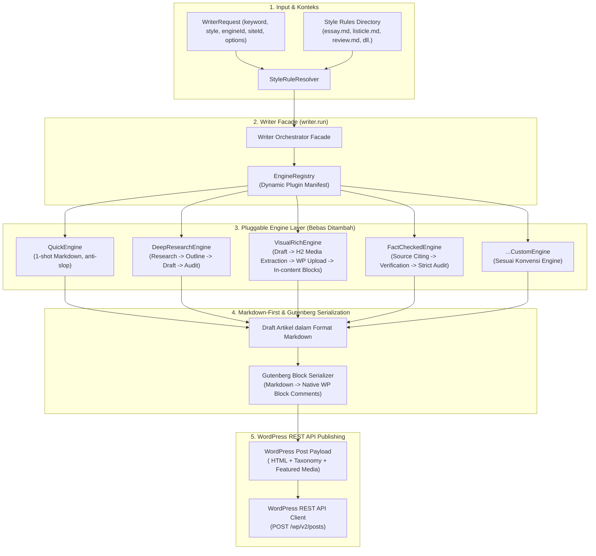
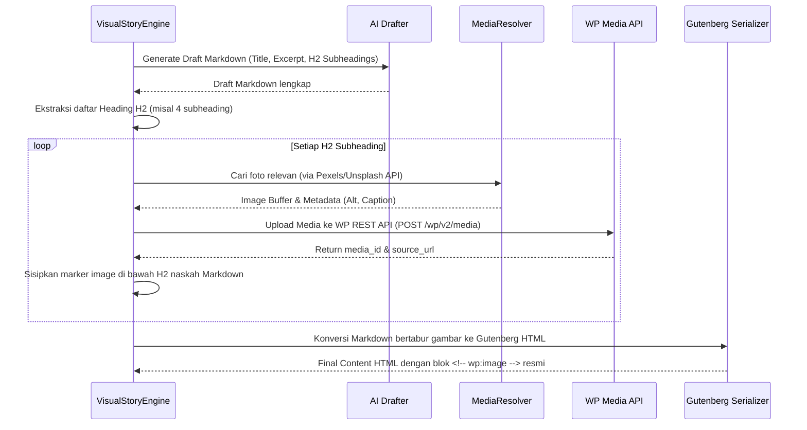

# Cetak Biru Arsitektur System Writer (Extensible Engine Framework, Gutenberg Blocks, Markdown-First, & Style Rules)

> [!NOTE] Catatan Evolusi Arsitektur
> Dokumen ini mencatat fondasi transisi awal System Writer. Sejak implementasi **ADR-047 (Agent Profile Runtime)**, struktur engine/node kaku telah dirombak menjadi arsitektur otonom **Agent Profile Runtime** (`src/core/writer/`) yang mendukung Standard LangChain Agent & Deep Agents dengan Universal Tools. Silakan rujuk [`ARCHITECTURE.md` §5](file:///d:/Antigravity/wp-autopost-dashboard/ARCHITECTURE.md) dan [`docs/03-manajemen-profil-agen.md`](file:///d:/Antigravity/wp-autopost-dashboard/docs/03-manajemen-profil-agen.md) untuk spesifikasi produksi aktif.

Dokumen ini memutakhirkan dan memperluas rencana arsitektur `System Writer` di `wp-autopost-dashboard`. Desain ini mengakomodasi kebutuhan **ekstensibilitas tak terbatas untuk penambahan engine baru**, **dukungan Gutenberg Block asli**, **alur kerja Markdown-First**, **direktori aturan gaya bahasa (*style rules*) modular**, dan **fitur in-content image injection per subheading**.

---

## 1. Visi & Prinsip Inti Arsitektur Baru



### 4 Pilar Desain Utama:

1. **Pluggable & Open-Closed Engine Framework**:
   Engine **tidak dikunci** hanya pada 1 atau 2 jenis. Siapapun (pengembang internal maupun ekstensi fitur di masa depan) dapat membuat engine baru hanya dengan membuat folder baru yang mematuhi **Konvensi Standar Engine** dan mendaftarkannya ke `EngineRegistry`.
2. **Markdown-First Pipeline**:
   Semua engine menghasilkan naskah dalam format **Markdown murni** (bukan tag HTML mentah). Keuntungan:
   - Token hemat hingga ~30% (tidak ada tag penutup `</p>`, `</div>`, `</h2>`).
   - Nol risiko sintaks HTML rusak (tidak ada unclosed tags atau broken nesting).
   - Jauh lebih mudah diaudit oleh regex/AST sebelum dipublikasikan.
3. **Native WordPress Gutenberg Block Serializer**:
   Markdown yang sudah matang dikonversi secara deterministik menjadi markup blok Gutenberg resmi (`<!-- wp:heading -->`, `<!-- wp:paragraph -->`, `<!-- wp:image -->`, `<!-- wp:list -->`, `<!-- wp:quote -->`). Saat artikel dibuka di WordPress Admin, pengguna mendapatkan blok Gutenberg modern yang sepenuhnya dapat diedit.
4. **Style Rules Modular Directory**:
   Aturan format penulisan (esai naratif, listicle viral, tutorial langkah demi langkah, review komparasi, berita piramida terbalik) disimpan sebagai berkas markdown terpisah di direktori `src/core/writer/styles/`. Node pembuatan naskah menginjeksi aturan ini secara dinamis.

---

## 2. Konvensi & Standar Pembuatan Engine Baru (Developer Protocol)

Untuk memastikan penambahan engine baru berlangsung mulus, konsisten, dan mudah diuji, ditetapkan **Standar Konvensi Engine**:

### A. Struktur Folder Standar per Engine

Setiap engine ditempatkan di foldernya sendiri di bawah `src/core/writer/engines/`:

```text
src/core/writer/engines/
├── index.ts                     # Engine Registry & Dynamic Export
├── quick/                       # Engine 1: Cepat & Ringan
│   ├── index.ts                 # Mengimplementasikan WritingEngine
│   └── README.md                # Dokumentasi & contoh penggunaan
├── deep-research/               # Engine 2: Riset Mendalam
│   ├── index.ts
│   ├── state.ts                 # State schema LangGraph
│   ├── nodes/                   # Node-node terisolasi
│   │   ├── research.ts
│   │   ├── outline.ts
│   │   ├── drafter.ts
│   │   └── auditor.ts
│   └── README.md
├── visual-story/                # Engine 3: Gambar per Subheading (In-Content)
│   ├── index.ts
│   ├── nodes/
│   │   ├── drafter.ts
│   │   ├── media-extractor.ts   # Ekstraksi H2 untuk cari gambar
│   │   └── media-uploader.ts    # Upload ke WP & sisipkan blok gambar
│   └── README.md
└── [nama-engine-baru]/          # Engine custom berikutnya
    ├── index.ts                 # Entry point engine
    └── schema.ts                # Validasi opsi kustom (opsional)
```

### B. Kontrak Interface `WritingEngine`

Setiap engine **WAJIB** mengekspor kelas atau objek yang mengimplementasikan interface `WritingEngine`:

```typescript
// src/core/writer/types/engine.ts

import { z } from "zod"
import {
  WriterRequest,
  EngineContext,
  EngineResult,
  EngineCapabilities,
} from "./contracts"

export interface WritingEngine {
  /** Identifier unik engine, e.g. 'quick', 'deep-research', 'visual-story' */
  readonly id: string

  /** Nama tampilan yang ramah pengguna di antarmuka UI */
  readonly name: string

  /** Deskripsi singkat tentang fungsi dan karakteristik engine */
  readonly description: string

  /** Versi engine, misal '1.0.0' */
  readonly version: string

  /** Deklarasi kapabilitas engine untuk membantu UI dan Orchestrator */
  readonly capabilities: EngineCapabilities

  /** Skema Zod untuk opsi tambahan khusus engine ini (opsional) */
  readonly optionsSchema?: z.ZodTypeAny

  /**
   * Titik eksekusi utama engine.
   * Menerima EngineContext dan WAJIB mengembalikan EngineResult
   * dengan draft artikel dalam format Markdown murni.
   */
  execute(context: EngineContext): Promise<EngineResult>
}

export interface EngineCapabilities {
  /** Apakah engine melakukan riset live eksternal */
  supportsResearch: boolean
  /** Apakah engine mencari dan menanamkan gambar di dalam naskah (per H2) */
  supportsInContentImages: boolean
  /** Apakah engine memiliki evaluasi/audit loop sebelum selesai */
  supportsAudit: boolean
  /** Perkiraan waktu eksekusi dalam detik */
  estimatedDurationSeconds: number
  /** Rekomendasi model AI minimal (misal 'openai/gpt-oss-120b' atau 'claude-3.5-sonnet') */
  recommendedModelTier: "fast" | "smart" | "flagship"
}
```

### C. Engine Registry (Manajemen Terpusat & Extensible)

```typescript
// src/core/writer/engines/index.ts

import { WritingEngine } from "../types/engine"
import { QuickEngine } from "./quick"
import { DeepResearchEngine } from "./deep-research"
import { VisualStoryEngine } from "./visual-story"

class EngineRegistryClass {
  private engines: Map<string, WritingEngine> = new Map()

  constructor() {
    // Daftarkan engine bawaan
    this.register(new QuickEngine())
    this.register(new DeepResearchEngine())
    this.register(new VisualStoryEngine())
  }

  /** Mendaftarkan engine baru secara dinamis */
  register(engine: WritingEngine): void {
    if (this.engines.has(engine.id)) {
      console.warn(`[EngineRegistry] Engine "${engine.id}" ditimpa dengan implementasi baru.`)
    }
    this.engines.set(engine.id, engine)
  }

  /** Mengambil engine berdasarkan ID */
  get(id: string): WritingEngine | undefined {
    return this.engines.get(id)
  }

  /** Mengambil daftar seluruh engine terdaftar (untuk dropdown di UI) */
  list(): Array<{
    id: string
    name: string
    description: string
    capabilities: WritingEngine["capabilities"]
  }> {
    return Array.from(this.engines.values()).map(e => ({
      id: e.id,
      name: e.name,
      description: e.description,
      capabilities: e.capabilities,
    }))
  }
}

export const EngineRegistry = new EngineRegistryClass()
```

---

## 3. Markdown-First & Native Gutenberg Block Serializer

Semua engine menghasilkan artikel dalam format **Markdown murni** lengkap dengan frontmatter atau metadata terpisah. Tahap akhir sebelum pengiriman ke WordPress adalah mengonversi Markdown tersebut menjadi HTML resmi berbasis blok Gutenberg.

### A. Contoh Alur Konversi

**Input (Markdown yang dihasilkan AI):**
```markdown
# 5 Tempat Ngopi Santai di Karangploso Malang

Karangploso memiliki udara pegunungan yang sejuk. Kawasan ini menyimpan beragam kedai kopi tersembunyi yang cocok untuk melepas penat.

## 1. Kopi Tani & Kebun
Kedai kopi ini memadukan konsep perkebunan dengan sangrai biji lokal. Pilihan menu manual brew di sini sangat bervariasi.

> "Suasana alam terbuka membuat rasa kopi terasa dua kali lebih nikmat."

- Lokasi: Jl. Raya Karangploso KM 4
- Jam buka: 09.00 - 22.00 WIB
- Rentang harga: Rp15.000 - Rp35.000
```

**Output (HTML dengan WordPress Gutenberg Block Comments):**
```html
<!-- wp:paragraph -->
<p>Karangploso memiliki udara pegunungan yang sejuk. Kawasan ini menyimpan beragam kedai kopi tersembunyi yang cocok untuk melepas penat.</p>
<!-- /wp:paragraph -->

<!-- wp:heading {"level":2} -->
<h2 class="wp-block-heading">1. Kopi Tani & Kebun</h2>
<!-- /wp:heading -->

<!-- wp:paragraph -->
<p>Kedai kopi ini memadukan konsep perkebunan dengan sangrai biji lokal. Pilihan menu manual brew di sini sangat bervariasi.</p>
<!-- /wp:paragraph -->

<!-- wp:quote -->
<blockquote class="wp-block-quote"><p>Suasana alam terbuka membuat rasa kopi terasa dua kali lebih nikmat.</p></blockquote>
<!-- /wp:quote -->

<!-- wp:list -->
<ul class="wp-block-list">
<!-- wp:list-item -->
<li>Lokasi: Jl. Raya Karangploso KM 4</li>
<!-- /wp:list-item -->
<!-- wp:list-item -->
<li>Jam buka: 09.00 - 22.00 WIB</li>
<!-- /wp:list-item -->
<!-- wp:list-item -->
<li>Rentang harga: Rp15.000 - Rp35.000</li>
<!-- /wp:list-item -->
</ul>
<!-- /wp:list -->
```

### B. In-Content Image Block Injection

Pada engine kaya media (`VisualStoryEngine`), gambar per subheading disematkan dalam Markdown menggunakan format anotasi khusus atau diunggah langsung ke WP Media Library:

Format tag gambar dalam Markdown:
`{caption="Pemandangan kebun kopi di pagi hari"}`

Serializer mengubahnya menjadi blok gambar resmi WordPress Gutenberg:
```html
<!-- wp:image {"id":452,"sizeSlug":"large","linkDestination":"none"} -->
<figure class="wp-block-image size-large">
  
  <figcaption class="wp-element-caption">Pemandangan kebun kopi di pagi hari</figcaption>
</figure>
<!-- /wp:image -->
```

---

## 4. Direktori Style Rules (Format & Persona Penulisan Modular)

Untuk memungkinkan penulisan yang kaya rasa (esai mendalam, listicle ringkas, review produk, panduan teknis), dibuat direktori aturan format khusus di `src/core/writer/styles/`.

### A. Struktur Berkas Style Rules

```text
src/core/writer/styles/
├── listicle.md              # Aturan format listicle (penomoran H2, takeaways ringkas)
├── essay.md                 # Aturan esai reflektif (hook naratif, argumen personal, anti-klise)
├── how-to-tutorial.md       # Aturan panduan praktis (prasyarat, tahapan bernomor, catatan tips)
├── in-depth-review.md       # Aturan ulasan produk (spesifikasi, pro-kontra, pengujian, vonis)
├── news-report.md           # Aturan jurnalistik 5W1H piramida terbalik
└── default.md               # Gaya artikel informatif standar
```

### B. Contoh Isi `src/core/writer/styles/listicle.md`

```markdown
# PANDUAN STRUKTUR LISTICLE

1. STRUKTUR ARTIKEL:
- Paragraf Pembuka: Maksimal 2 paragraf singkat. Langsung bahas mengapa daftar ini relevan bagi pembaca.
- Subheading (H2): Setiap item daftar WAJIB diawali angka berurutan, misal: "## 1. Nama Item", "## 2. Nama Item".
- Ulasan Tiap Item: Berisi minimal 2 paragraf penjelas spesifik, daya tarik utama, dan detail praktis (alamat/harga/tips).
- Ringkasan Cepat: Gunakan bullet points di akhir setiap item untuk poin-poin penting.
- Penutup: Berikan satu paragraf rekomendasi penutup tanpa menggunakan kata "Kesimpulannya" atau "Sebagai penutup".

2. NADA BAHASA:
- Santai, informatif, dan praktis.
- Hindari kalimat pembuka klise seperti "Di dunia yang serba modern".
- Nol em-dash (—) dan nol en-dash (–).
```

### C. `StyleRuleResolver` Service

```typescript
// src/core/writer/services/style-resolver.ts

import fs from "fs"
import path from "path"

export class StyleRuleResolver {
  private static STYLES_DIR = path.join(process.cwd(), "src/core/writer/styles")

  /** Mengambil konten instruksi gaya bahasa berdasarkan nama style */
  static getStyleInstruction(styleName: string = "default"): string {
    const cleanName = styleName.toLowerCase().replace(/[^a-z0-9_-]/g, "")
    const filePath = path.join(this.STYLES_DIR, `${cleanName}.md`)

    if (fs.existsSync(filePath)) {
      return fs.readFileSync(filePath, "utf-8")
    }

    const defaultPath = path.join(this.STYLES_DIR, "default.md")
    if (fs.existsSync(defaultPath)) {
      return fs.readFileSync(defaultPath, "utf-8")
    }

    return "Tulis artikel secara informatif, lugas, mengalir wajar, dan tuntas."
  }

  /** Mendapatkan daftar seluruh pilihan style yang tersedia untuk formulir UI */
  static listAvailableStyles(): string[] {
    if (!fs.existsSync(this.STYLES_DIR)) return ["default"]
    return fs
      .readdirSync(this.STYLES_DIR)
      .filter((file) => file.endsWith(".md"))
      .map((file) => file.replace(/\.md$/, ""))
  }
}
```

---

## 5. Visual Story Engine (In-Content Image Insertion per Subheading)

Salah satu engine khusus yang akan hadir adalah **`VisualStoryEngine`**. Engine ini menjawab kebutuhan pengguna agar artikel tidak hanya memiliki featured image, melainkan juga gambar ilustrasi di bawah setiap subheading utama (H2).

### Alur Kerja Engine Visual:



---

## 6. Flow Audit & Quality Gate (Sebelum Kirim ke WordPress)

Sebelum sebuah naskah disetujui untuk diunggah ke WordPress, engine yang mendukung audit (`supportsAudit: true`) menjalankan **Auditor Node**:

1. **Anti-Slop Audit**:
   - Pengecekan sisa karakter dash (`—` atau `–`).
   - Pengecekan kata pembuka/penutup klise terlarang ("Kesimpulannya", "Di era modern").
   - Deteksi frasa penolakan chatbot ("Mohon maaf", "Sebagai AI").
2. **Structure & Length Audit**:
   - Memastikan jumlah kata memenuhi target minimal (misal minimal 600 kata).
   - Memastikan ada minimal 3 subheading H2 yang terstruktur logis.
3. **Loop Revisi Terukur**:
   - Jika skor audit < 7.0 dan percobaan revisi < 2:
     - Naskah dikirim kembali ke node `Refiner/Drafter` bersama catatan perbaikan spesifik (*targeted delta feedback*).
   - Jika sudah mencapai 2 percobaan:
     - Sanitasi otomatis dijalankan untuk perbaikan minor (pembersihan dash langsung), artikel diteruskan dengan status peringatan (*warning flag*), tidak membatalkan proses penerbitan.

---

## 7. Rencana Struktur Berkas Lengkap (`src/core/writer/`)

```text
src/core/
├── writer/
│   ├── index.ts                     # Orchestrator Facade: writer.run(request)
│   │
│   ├── types/
│   │   ├── contracts.ts             # WriterRequest, WriterResult, WpEnrichment
│   │   └── engine.ts                # WritingEngine interface & EngineCapabilities
│   │
│   ├── styles/                      # Direktori Aturan Gaya Tulisan (Modular)
│   │   ├── default.md
│   │   ├── listicle.md
│   │   ├── essay.md
│   │   ├── how-to-tutorial.md
│   │   └── in-depth-review.md
│   │
│   ├── formatters/
│   │   ├── gutenberg.ts             # Markdown -> Native Gutenberg Block Comments
│   │   └── markdown-cleaner.ts      # Sanitasi dash, normalisasi spasi & heading
│   │
│   ├── services/
│   │   ├── llm.ts                   # LLM Provider Adapter (ChatOpenRouter / OpenAI)
│   │   ├── style-resolver.ts        # StyleRuleResolver (membaca berkas di styles/)
│   │   ├── media.ts                 # Pencarian media & upload ke WP Media Library
│   │   ├── taxonomy.ts              # Auto-resolve / create kategori & tag WordPress
│   │   └── wp-publisher.ts          # Sinkronisasi aman & idempoten ke WP REST API
│   │
│   └── engines/
│       ├── index.ts                 # EngineRegistry (Daftar & Registrasi Engine)
│       ├── quick/
│       │   ├── index.ts             # QuickEngine (Plain TS, 1 LLM call, Markdown-first)
│       │   └── README.md
│       ├── deep-research/
│       │   ├── index.ts             # DeepResearchEngine (LangGraph: Research -> Draft -> Audit)
│       │   ├── state.ts             # StateSchema
│       │   └── nodes/               # research.ts, outline.ts, drafter.ts, auditor.ts
│       └── visual-story/
│           ├── index.ts             # VisualStoryEngine (In-content images per H2)
│           └── README.md
│
└── writer.ts                        # Backward Compatibility re-export (agar kode lama tidak rusak)
```

---

## 8. Rencana Eksekusi Bertahap (Implementation Roadmap)

### Tahap 1: Pondasi Inti, Gutenberg Serializer, & Style Rules
- [ ] Buat file kontrak tipe `src/core/writer/types/contracts.ts` dan `engine.ts`.
- [ ] Buat parser `src/core/writer/formatters/gutenberg.ts` (Markdown ke blok komentar WordPress: paragraph, heading, list, quote, image).
- [ ] Buat berkas-berkas style awal di `src/core/writer/styles/` (`default.md`, `listicle.md`, `essay.md`, `how-to-tutorial.md`).
- [ ] Buat service `StyleRuleResolver` di `src/core/writer/services/style-resolver.ts`.

### Tahap 2: Engine Registry & QuickEngine (Markdown-First)
- [ ] Buat `EngineRegistry` di `src/core/writer/engines/index.ts`.
- [ ] Implementasikan `QuickEngine` yang menghasilkan naskah Markdown murni, lalu mengonversinya ke Gutenberg Block via `GutenbergSerializer`.
- [ ] Hubungkan `src/core/writer/index.ts` sebagai facade orchestrator tunggal.
- [ ] Perbarui `src/app/api/posts/quick/route.ts` agar memanfaatkan pipeline baru dengan Gutenberg blocks.

### Tahap 3: Engine Lanjutan (Deep Research & Visual In-Content Media)
- [ ] Implementasikan `DeepResearchEngine` dengan LangGraph StateGraph (Riset -> Outline -> Draft -> Audit loop).
- [ ] Implementasikan `VisualStoryEngine` (Ekstraksi H2 -> Cari gambar bebas royalti -> Upload ke `/wp/v2/media` -> Sematkan blok gambar di tiap H2).

### Tahap 4: Verifikasi & Uji Coba Lapangan
- [ ] Uji typecheck TypeScript (`npx.cmd tsc --noEmit`).
- [ ] Uji konversi Markdown ke Gutenberg blocks dengan berbagai variasi sintaks.
- [ ] Uji pengiriman postingan langsung ke WordPress dan pastikan saat dibuka di WP Admin, artikel tampil sebagai blok Gutenberg asli (bukan Classic block).

---

## 9. Verifikasi Rencana & Persetujuan Pengguna

Rencana di atas menjawab seluruh kebutuhan arsitektur Anda:
1. **Engine terbuka dan bebas ditambah kapan saja** dengan konvensi standar yang jelas.
2. **Format Markdown-First** untuk kualitas drafting AI maksimal dan hemat token.
3. **Konversi deterministik ke Gutenberg Blocks** resmi WordPress.
4. **Direktori `styles/`** terpisah untuk mengontrol gaya format artikel (esai, listicle, dll.).
5. **Dukungan in-content images per subheading** melalui engine khusus yang terintegrasi ke WP Media API.

Silakan tinjau dan klik **Proceed** jika rancangan ini sudah sesuai dengan visi yang ingin Anda bangun, agar kita dapat mulai mengeksekusi Tahap 1.
