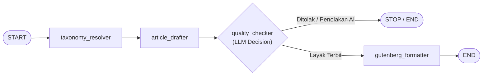

# Tulis Cepat (Quick Engine)

## 1. Ikhtisar & Tujuan

`QuickEngine` adalah mesin generasi artikel instan yang dirancang untuk kecepatan tinggi dan efisiensi biaya. Engine ini mengorkestrasi node-node modular independen menggunakan **LangGraph StateGraph** dengan gerbang keputusan mutu (*quality gatekeeper*) sebelum diunggah ke WordPress.

Engine ini sangat cocok untuk:
- Modul "Tulis Cepat" di mana pengguna menginginkan draf siap tayang dalam waktu kurang dari 20 detik.
- Eksekusi batch masal ratusan artikel yang memprioritaskan konsumsi token rendah dan stabilitas tinggi.

### Node yang Digunakan (Node Composition)

Karena setiap Node di `src/core/writer/nodes/` bersifat modular dan *engine-agnostic* (dapat dipakai ulang lintas engine), `QuickEngine` mengombinasikan node-node berikut:

| Urutan | Node yang Dipakai | Lokasi | Peran dalam QuickEngine |
| :---: | :--- | :--- | :--- |
| **Tahap 1** | `taxonomy-resolver` | `src/core/writer/nodes/taxonomy-resolver` | Mengisi kategori, tag, dan author default jika tidak diisi pengguna. |
| **Tahap 2** | `article-drafter` | `src/core/writer/nodes/article-drafter` | Menulis naskah utuh 1-shot format Markdown murni (Anti-Slop v3.0). |
| **Tahap 3** | `quality-checker` | `src/core/writer/nodes/quality-checker` | **Pengambil Keputusan (LLM Gatekeeper)**: Memeriksa kelayakan naskah; jika penolakan AI, hentikan alur (*stop*). |
| **Tahap 4** | `gutenberg-formatter` | `src/core/writer/nodes/gutenberg-formatter` | Sanitasi dash, ekstraksi metrik, dan serialisasi deterministik ke blok Gutenberg resmi. |

*(Catatan: `input-validator` dijalankan di pintu gerbang Facade Orchestrator `writer.run()` sebelum masuk ke engine).*

## 2. Cara Kerja & Alur Logika (Workflow)



## 3. Spesifikasi Parameter (Inputs & Options)

| Parameter | Tipe | Wajib | Default | Keterangan |
| :--- | :--- | :--- | :--- | :--- |
| `keyword` | `string` | **Ya** | - | Topik atau kata kunci utama artikel. |
| `brief` | `string` | Tidak | `undefined` | Instruksi tambahan dari pengguna. |
| `wordCountTarget` | `number` | Tidak | `800` | Target jumlah kata minimal naskah. |
| `language` | `"id" \| "en"` | Tidak | `"id"` | Bahasa target penulisan. |

## 4. Spesifikasi Keluaran (Outputs)

Engine mengembalikan objek `EngineResult` yang membungkus `GeneratedArticle`:
- `markdownContent`: Digunakan untuk preview editor teks, audit, atau ekspor markdown.
- `contentHtml`: Digunakan saat dikirim ke WordPress REST API (`POST /wp-json/wp/v2/posts`) sehingga otomatis dirender sebagai blok Gutenberg asli di WP Admin.

## 5. Penanganan Error & Kasus Khusus (Edge Cases)

1. **Jebakan Persona Chatbot**:
   Jika model AI mengembalikan frasa penolakan (seperti *"Mohon maaf, saya tidak dapat menemukan informasi..."*), fungsi `isChatbotRefusal()` akan mendeteksinya secara otomatis dan langsung memicu **Recovery Generator** otonom tanpa membatalkan proses.
2. **Pelanggaran Tanda Baca Dash**:
   Karakter em-dash (`—`) atau en-dash (`–`) yang lolos dari filter LLM akan disanitasi secara deterministik menjadi tanda koma atau tanda kurung oleh `sanitizeDashes()`.
3. **Format JSON Rusak**:
   Jika LLM mengembalikan teks mentah alih-alih JSON valid, engine memiliki parser regex fallback untuk mengekstrak naskah Markdown dan judul secara otomatis.

## 6. Contoh Pemanggilan (Code Example)

```typescript
import { run } from "@/core/writer"

const result = await run({
  engine: "quick",
  content: {
    keyword: "Tips merawat aglaonema agar daun mengilap",
    style: "how-to-tutorial",
    language: "id",
    wordCountTarget: 800,
  },
  site: {
    siteId: "site-uuid-001",
    wpSiteId: "site-uuid-001",
  },
  publishing: {
    mode: "draft",
    categoryIds: [12],
    tagNames: ["aglaonema", "tanaman hias"],
  },
})

if (result.success && result.article) {
  console.log("Judul:", result.article.title)
  console.log("Gutenberg HTML:\n", result.article.contentHtml)
}
```
